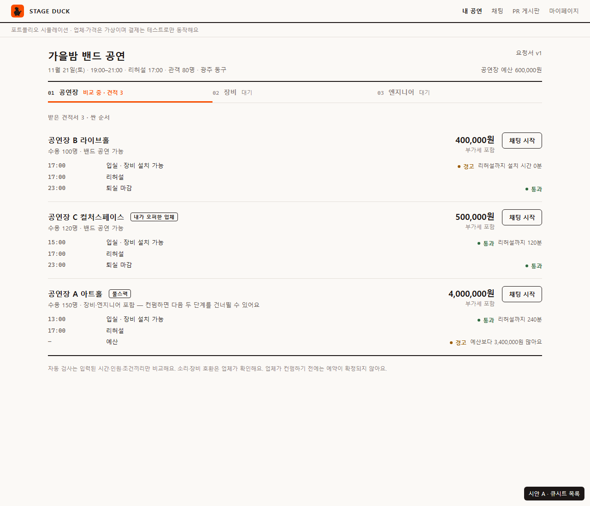
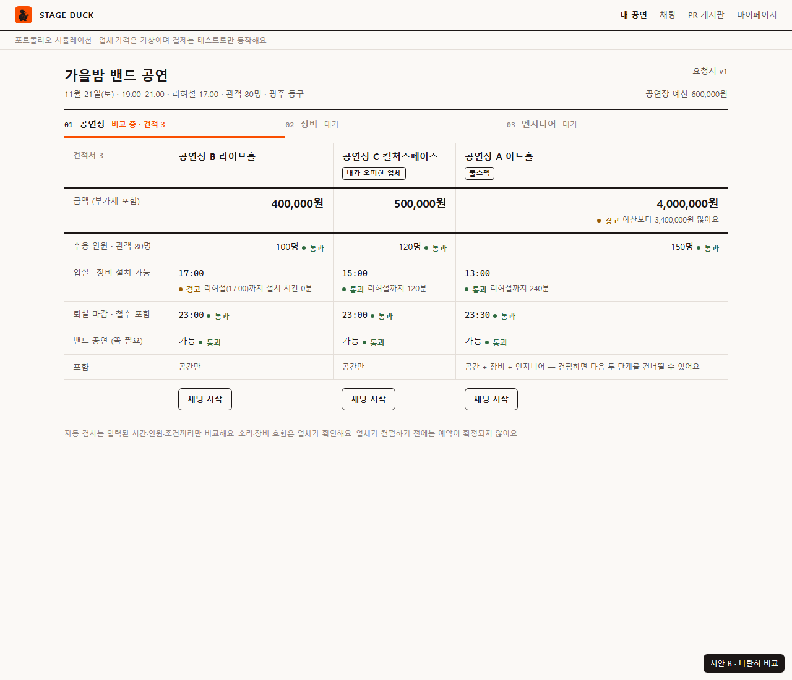
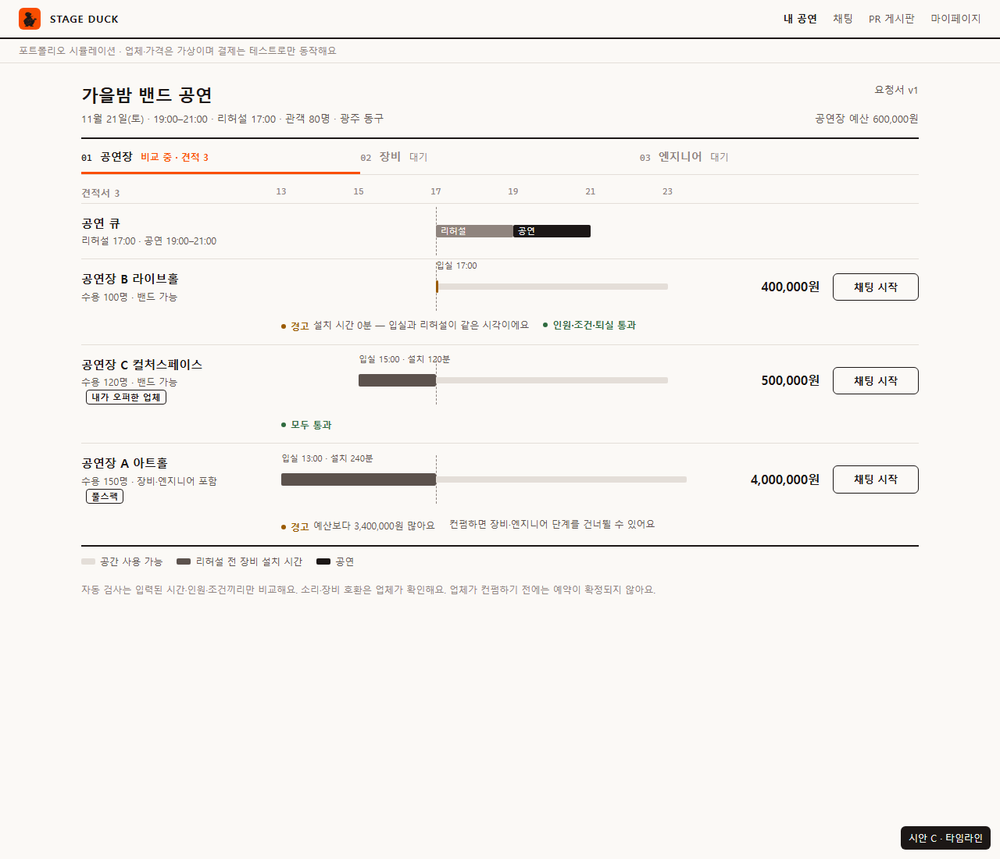

# 대표 화면 시안 3개 — 단계별 견적 비교 (공연장 단계)

[디자인 원칙](../../guides/디자인_원칙.md) 4단계 산출물이다. 세 시안은 **같은 규칙(R1~R8, 금지 목록)과 같은 시연 데이터**로 만들었고 **배치만 다르다.** 하나를 고르면 5단계에서 거기서 디자인 값·공통 부품을 뽑는다.

| 시안 | 화면 | 읽는 방법 | 잘 맞는 것 | 약한 것 |
|---|---|---|---|---|
| **A 큐시트 목록** | [HTML](A_큐시트_목록.html) ·  | 견적서 한 장 = 큐시트 한 구간. 시각 열 + 줄 옆 검사 메모 | 큐시트에 가장 가깝다. 모바일에서도 그대로 한 줄씩 읽힌다. 견적이 많아져도 늘어나기만 한다 | 업체끼리 같은 항목을 가로로 비교하려면 눈이 위아래로 움직인다 |
| **B 나란히 비교** | [HTML](B_나란히_비교.html) ·  | 견적서가 세로 칸으로 나란히. 같은 항목을 가로로 읽는다 | 금액·인원·시간을 한눈에 비교. "왜 이 업체인지" 설명하기 쉽다 | 견적이 4개 이상이거나 모바일이면 칸이 좁아져 가로 스크롤이 필요하다 |
| **C 타임라인** | [HTML](C_타임라인.html) ·  | 공연 큐(리허설·공연)를 기준선으로, 업체마다 시간 막대 | 설치 시간 부족(B)이 **그림으로** 바로 보인다. 가장 STAGE DUCK다운 표현 | 금액·조건 비교는 약하다. 막대를 처음 보는 사용자에게 설명이 필요하다 |

공통: 셋리스트 단계 표시(01 공연장 · 02 장비 · 03 엔지니어), 주황은 지금 단계 하나, 그림자·그라데이션·이모지 없음, 숫자는 고정폭·오른쪽 정렬. **모바일 규칙은 5단계에서 정한다** (지금은 데스크톱 1280px 기준).

## 보는 법
HTML 파일을 브라우저로 열거나 위 PNG를 본다. 오른쪽 아래 검은 라벨은 시안 구분용이고 실제 화면에는 없다.

## 고르는 법
- 하나를 고르거나, **섞을 수 있다** (예: "B를 기본으로, 설치 시간 줄에만 C의 막대"). 섞을 때는 어느 부분을 어디서 가져오는지 적는다.
- 고른 뒤 바꾸고 싶은 점(글자 크기, 간격, 주황 위치 등)을 함께 적는다.
