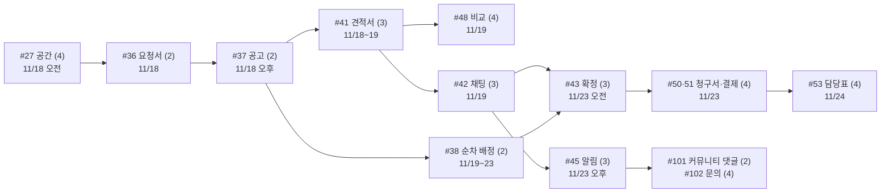

# 남은 일 분업 계획 v2 (11/18 ~ 11/26) — 날짜별 상세

> 작성 2026-11-18 (수, Day 7) · 해원 · **초안 — 팀 회의에서 확정**
> v1(11/17)을 다시 짰어요. 바뀐 점: ① **Claude Opus 5.5로 코드·테스트를 만드는 속도**를 넣어 일을 앞당김, ② 11/20~22 주말에 기대지 않음(여유분으로만), ③ 11/18 새로 생긴 일(비밀번호 찾기, 채팅 목록 찾기, v4 화면 기준, SEO·배포)을 빠짐없이 넣음.
> 진행 기록은 [진행_현황.md](진행_현황.md), 작업 원문은 [specs/tasks.md](../specs/tasks.md), 화면 기준은 [docs/design/mockup-v4/](design/mockup-v4/), 상태는 GitHub 이슈가 기준.

---

## 0. 전제

### 0.1 지금 위치 (11/18 아침)

| 구분 | 끝남 | 남음 |
|---|---|---|
| 준비·공통 | 로컬 환경, 가짜 로그인(#22), 공통 레이아웃(#23), 빈 함수(#35), 시드(#46), 검사 엔진(#47) | v4 화면 기준으로 공통 부품 맞추기 |
| F1 회원·업체 | 이메일 가입·로그인(#24), 업체 입점·심사(#26), 업로드 API(#29) | 네이버(#25), 권한 테스트(#34), **비밀번호 찾기(신규)** |
| F2 자원 | — | 공간(#27·#28), **요청서(#36)·공고(#37)**, 견적서(#41, 합계 검증 브랜치만 있음) |
| F3 배정·채팅 | — | #38, #42, #43, #44, #45, #48, #49, #32 |
| F4 게시판·커뮤니티 | — | #30, #31, #39, #54, #100, #101 |
| F5 결제·운영·콘텐츠 | — | #50~#53, #33, #40, #102, #103 |
| 스펙 | AC **107개** (11/18 FR-AUTH-09·FR-CHAT-07 추가), 결정 D-55까지 | 더 바꾸지 않음 |

남은 개발일은 **11/18·19·23·24 (4일)**. 11/24 18시 기능 동결.

### 0.2 AI(Claude Opus 5.5)로 일하는 방식

사람은 **스펙 확인·리뷰·통합·검증**에 시간을 쓰고, 코드와 테스트 초안은 AI가 만들어요. 그래서 v1보다 한 사람이 하루에 이슈 2~3개를 끝내는 걸로 잡았어요.

| 단계 | 누가 | 하는 일 |
|---|---|---|
| 1. 맥락 주기 | 사람 | 이슈 번호, AC 목록, 관련 스펙 파일, v4 목업 파일을 아래 프롬프트 틀에 넣어 AI에 줘요 |
| 2. 테스트 먼저 | AI | AC마다 pytest·vitest를 먼저 쓰게 해요 (SDD: AC → 테스트 → 코드) |
| 3. 구현 | AI | 모델·마이그레이션·API·화면. 화면은 v4 목업의 HTML·CSS를 React 부품으로 옮겨요 |
| 4. 확인 | 사람 | 테스트를 직접 돌리고, 화면을 목업과 나란히 놓고 봐요. AC 문장과 다르면 고치게 해요 |
| 5. PR | 사람 | PR 본문에 작업 ID·AC·"AI가 만든 부분/사람이 고친 부분" 한 줄. 리뷰는 다른 사람 |
| 6. 기록 | 사람 | 일일 로그에 쓴 프롬프트 요지·고친 것 한 줄 (11/25 SDD·AI 활용 회고서 재료) |

**프롬프트 틀** (복사해서 쓰기):

```text
작업: T2-02 (#36) 공연 요청서 STEP1·STEP2 + 버전
지켜야 할 것: CLAUDE.md, specs/spec.md F2의 AC-F2-04~10, specs/api-contract.md 해당 API,
specs/data-model.md performances·performance_versions·stages, specs/user-flow.md 1번
화면 기준: docs/design/mockup-v4/pages/request-1.html, request-2.html (문구는 docs/design/문구.md)
순서: ① AC마다 실패하는 테스트 ② 마이그레이션(다음 번호) ③ API ④ 화면 ⑤ 테스트 통과
하지 말 것: 스펙에 없는 필드·API 추가, 다른 묶음 파일 수정, 화면 용어 바꾸기(문구.md 7장 기준)
```

**AI 쓸 때 규칙**
- 스펙과 다르게 만들면 AI 탓이 아니라 우리가 놓친 것 — PR 전에 AC 문장과 한 줄씩 대조해요.
- 마이그레이션 번호는 만들기 직전에 develop을 받아 확인 (0003 겹침 사고 다시 안 나게).
- 비밀값(.env, 비밀번호)은 프롬프트에 넣지 않아요.

---

## 1. 일정 한눈에

| 날짜 | Day | 강사님 일정 | 우리 목표 | 끝날 때 develop에 있어야 하는 것 |
|---|---|---|---|---|
| **11/18 (수)** | 7 | F3·F4 구현 | F2 API 전부 + 업체 찾기 + 공간 | #36·#37·#41(API)·#27·#28·#30 API |
| **11/19 (목)** | 8 | **M2 + 1차 통합 시연** | F2 화면 + 시연, 채팅·신고 시작 | 요청서→공고→견적서→비교 화면이 이어짐 |
| 11/20~22 | - | 없음 | **여유분** (밀린 것만, 아무도 이걸 기다리지 않음) | — |
| **11/23 (월)** | 9 | 갭 분석·품질 | F3·F5 핵심 (배정·확정·결제) + 갭 분석 | 대표 시나리오가 결제까지 돈다 |
| **11/24 (화)** | 10 | **M3 수용 테스트·동결** | 나머지 + AC 전수 검증, 18시 동결 | AC 107개 결과표 |
| **11/25 (수)** | 11 | 문서·발표 준비 | 문서 마무리, 시연 서버, 리허설 2회 | 발표 자료·시연 영상(예비) |
| **11/26 (목)** | 12 | **최종 발표 (오전)** | 발표·시연, KPT, v1.0 태그 | — |

---

## 2. 날짜별 상세 배분

`←` 앞 사람 작업이 있어야 함 (없으면 빈 함수·시드로 먼저). `→` 이걸 기다리는 사람. **굵게** = 남이 기다리는 일이라 먼저.
화면 열의 파일은 `docs/design/mockup-v4/pages/` 기준.

### 11/18 (수) Day 7 — F2 뚫기

| 사람 | 오전 (9~13시) | 오후 (14~18시) | 저녁까지 남길 것 |
|---|---|---|---|
| **세환** (1) | **업로드 설계 마이그레이션**: `suppliers.business_reg_file`·`photo_url` → `business_doc_file_id`·`image_file_id` (uploads.md) → 3·4번 사진<br>**#30 업체 찾기 API** (목록·상세·작성, 말머리·필터·부문당 1개) AC-F4-01·02·04·09 | #30 화면: `board.html`·`post.html`·`p-post.html` (화면 이름 "업체 찾기"/"소개 글", 코드는 `pr_posts`)<br>**v4 공통 부품** (#23 후속): 머리 메뉴 통일(손님/사용자/업체, 채팅 메뉴, 계정 메뉴의 견적함·기술 확인), `Select`(펼친 목록 `select.css`), 입력칸 포커스 | PR 2개 (마이그레이션+#30 API / 화면+공통 부품), F1 verify.md 틀 |
| **해원** (2) | **#36 모델·마이그레이션 0005** (`performances`·`performance_versions`·`stages`) — **12시 전 머지** → 3·4번<br>#36 요청서 STEP1·2 + 버전 API AC-F2-04~10 | **#37 공고 게시·내림·노출 조건·버전 갱신 API** AC-F2-11~13 → 3번 견적서<br>이슈 정리 30분: 신규 이슈 3개(아래 5장), #100~#103 본문 v4 파일명, #14·#15·#18~#21 닫기 | PR 2개, 1차 통합 시연 체크리스트, 일일 로그 취합 |
| **채은** (3) | **#41 `quotes`·`quote_versions` + 견적서 작성 API** (여러 개·버전·합계 검증, 기존 `feat/41` 브랜치 이어서). 오전엔 #36 빈 함수로 | **#41 업체 공고 목록·상세 API** (← #37 오후)<br>#41 화면 시작: `p-jobs.html`·`p-job.html`·`p-quote.html` | PR (견적서 API), 화면은 브랜치 |
| **목산** (4) | **#27 서비스·공간 등록 + 공간 스냅샷** AC-F2-01~03 → 2번 요청서 공간 고르기, 3번 견적서 | #28 공간 탐색 목록·상세 AC-F5-01, 화면 `spaces.html`·`space.html`<br>#48 비교 화면 뼈대 (`compare.html`·`performance.html` 비교 부분) — 시드 견적서로 | PR 2개 (#27 / #28) |

### 11/19 (목) Day 8 — M2, 1차 통합 시연

| 사람 | 오전 | 오후 | 저녁까지 남길 것 |
|---|---|---|---|
| **세환** | #33 업체 프로필·개인 프로필·마이페이지 AC-F5-15~17, 화면 `supplier.html`·`mypage.html`·`favorites.html`(틀만) | **신규 T1-14 비밀번호 찾기** AC-F1-21~23 (D-55: `MAIL_BACKEND=console`), 화면 `password.html`<br>**F1 verify.md + Postman(F1)** | PR 2개, verify(F1), `postman/F1` |
| **해원** | 요청서 화면 `request-1.html`·`request-2.html` + 공고 게시 (#36·#37)<br>#38 순차 배정 API 시작 (단계 열기·[다음 단계로]) | **14시 1차 통합 시연 주관**: 요청서 → 공고 → 견적서 → 비교<br>중간 점검 보고서·통합 이슈 목록, F2 verify.md·Postman 취합 | 시연 결과 문서, 이슈 등록 |
| **채은** | #41 화면 마무리 + 시연 견적서 부분<br>견적서 verify + Postman(F2 견적서) | **#42 채팅방·메시지 REST + WebSocket** 시작 (사진은 #29 사용) AC-F3-06~08<br>채팅 위젯 부품 옮기기 (`chat-widget.js`·`css/chat.css` → `shared/chat/ChatWidget.tsx`) | #42 브랜치 (REST 먼저 PR 가능) |
| **목산** | **#48 비교 화면 진짜 데이터** (← #41) + 시연 비교 부분 AC-F3-20 | **#54 신고·블라인드 서비스 + 관리자 뷰(신고·공연 이력)** AC-F5-13 → 1번 #31, 2번 #101<br>#102 1:1 문의 API (쓰기·목록·보기, 사진) | PR 2개, verify(공간) |

### 11/20 ~ 22 — 여유분 (선택)

**아무도 이 날짜의 결과를 기다리지 않게** 짰어요. 밀린 것만 하거나, 아래를 당겨 하면 11/23~24가 편해져요.

| 사람 | 당겨 하면 좋은 것 |
|---|---|
| 세환 | #25 네이버 로그인(테스트 계정)·카카오(비활성)·소셜 추가 정보 AC-F1-04~10 |
| 해원 | #38 마무리, SEO 구현 시작, 시연 서버 EC2 준비 (deploy.md 1~3단계) |
| 채은 | #42 WebSocket·읽음 마무리, FR-CHAT-07 채팅 목록 찾기 |
| 목산 | #50 통합 청구서·이용료 5% (계산 함수는 있음) |

### 11/23 (월) Day 9 — 핵심 흐름 끝까지 + 갭 분석

| 사람 | 오전 | 오후 | 저녁까지 남길 것 |
|---|---|---|---|
| **세환** | #32 직접 오퍼·관심 업체 (← #38) AC-F3-16~19, 화면 `favorites.html`·`post.html` [오퍼 보내기]<br>#31 업체 찾기 블라인드·정지 업체 글 숨김 (← #54) AC-F4-03·10·11 | #25 네이버 로그인 (여유분에 못 했으면)<br>#34 권한 공통 검사 테스트 시작 AC-F1-13~15 | PR 2~3개, verify(F4 업체 찾기) |
| **해원** | **#38 마무리** (건너뛰기·전부 구했어요) AC-F3-01~05 → 3번 확정, 4번 기술 확인<br>#40 내 공연 현황 AC-F5-02, 화면 `my.html`·`performance.html`·`inbox-list.html` | #39 반려 카운트·게시 제한 (← #42) AC-F4-05~07<br>#100 커뮤니티 목록·글 보기·글쓰기·도배 방지 AC-F4-12·13·16, 화면 `community.html`·`community-post.html`·`community-write.html`<br>**17시 갭 분석 보고서** | PR 3개, 갭 분석 |
| **채은** | **#43 최종 견적 카드·내역서·확정(동시성)·다른 견적 자동 마감** AC-F3-09~12·14 → 4번 청구서 | **#45 사이트 안 알림** (종류 28개, notifications.md) → 모든 묶음이 `notify()` 호출, 화면 알림 패널·`notifications.html`<br>#44 자동 마감 알림·연락처 감지 경고·결제 전 비공개 AC-F3-13·15, F5-12 | PR 2~3개, verify(F3 채팅·확정) |
| **목산** | **#50 통합 청구서** AC-F5-03·04 + **#51 모의 결제·장부·멱등** AC-F5-05~07 (← #43, 오전엔 빈 함수), 화면 `invoice.html`·`pay.html` | #49 기술 확인 (← #38) AC-F3-25, 화면 `p-tech.html`<br>#102 1:1 문의 화면 `inquiry-list/write/post.html` + SQLAdmin 답변 AC-F5-18~20 | PR 3개, verify(F5 결제) |

### 11/24 (화) Day 10 — M3, 18시 기능 동결

| 사람 | 오전 | 오후 (동결 전 버그만) | 저녁까지 남길 것 |
|---|---|---|---|
| **세환** | #34 권한 테스트 마감 (2·3·4번 API 다 들어온 뒤)<br>**보안 점검 체크리스트** (인증·권한 우회, 입력값, 업로드) | 수용 테스트: F1 전부 + F4 업체 찾기 + 프로필, 버그 수정 | 보안 체크리스트, AC 결과(F1) |
| **해원** | #101 커뮤니티 댓글·답글·도움 돼요·저장·링크 공유·신고 (← #45, #54) AC-F4-14·15·17<br>**신규 SEO 구현** (서버 head·robots·sitemap, `usePageMeta`, seo.md 9장 테스트) | **수용 기준 전수 검증 주관** (107개), 대표 시나리오 E2E 4개, **18시 동결 선언** | 수용 테스트 결과서, 버그 리포트 |
| **채은** | #103 공지·FAQ·업체 가이드·약관 화면 AC-F5-21 (`notices`·`faq`·`guide`·`terms.html`)<br>FR-CHAT-07 채팅 목록 찾기 AC-F3-26 (여유분에 못 했으면) | 수용 테스트: F3 채팅·확정·알림, 버그 수정<br>verify(F3)·Postman(F3) | AC 결과(F3) |
| **목산** | **#52 취소·위약금·업체 사정 취소 + D-53 결제 기한·독촉·자동 취소** AC-F5-08~10·22, 화면 `cancel.html`<br>**#53 최종 담당표** AC-F5-11, 화면 `sheet.html` | 쿼리 점검(N+1, 인덱스)·데이터 정합성, 수용 테스트 F5, 버그 수정<br>verify(F5)·Postman(F5) | 쿼리 최적화 기록, AC 결과(F5) |

### 11/25 (수) Day 11 — 문서·발표 준비 (코드는 버그 수정만)

| 사람 | 오전 | 오후 |
|---|---|---|
| 세환 | README (설치·실행·시연 계정), API 문서(Swagger) 최종 | 시연 리허설 1차 (회원·업체 부분) |
| 해원 | 스펙 최종본 (11/13 이후 D-41~55를 변경 이력으로), 사용자 매뉴얼 | **발표 자료**, 시연 서버 배포 (deploy.md, 안 되면 로컬 Docker로 결정), 리허설 2회 주관 |
| 채은 | data-model.md 최종 (실제 마이그레이션과 대조), 리팩터링 | 리허설 (채팅·확정 부분) |
| 목산 | 시연 시나리오·화면 캡처 (시연_예시값.md), 시드 데이터 최종·시연 초기화 확인 | 리허설 (결제·담당표 부분), 예비 시연 영상 녹화 |
| 전원 | SDD·AI 활용 회고서 각자 부분 (일일 로그의 AI 기록 모으기) | KPT 초안 |

### 11/26 (목) Day 12 — 최종 발표

| 시간 | 할 일 | 담당 |
|---|---|---|
| 아침 | 시연 초기화, 시연 계정 로그인 확인, 예비 영상 준비 | 목산 |
| 오전 | 발표 (해원 진행, 묶음별 시연 각자) | 전원 |
| 발표 뒤 | KPT 회고, v1.0 태그, 최종 보고서 | 해원 (태그·보고서), 전원 (KPT) |

---

## 3. 사람별 전체 목록 (빠짐 확인용 체크리스트)

### 1번 세환 — 회원·업체·업체 찾기, 공통 부품

- [ ] 업로드 마이그레이션 (`business_doc_file_id`·`image_file_id`) — 11/18
- [ ] #30 업체 찾기 목록·상세·작성 (API + `board`·`post`·`p-post`) AC-F4-01·02·04·09 — 11/18
- [ ] v4 공통 부품: 머리 메뉴 통일, 계정 메뉴, `Select`, 포커스 — 11/18
- [ ] #33 프로필·마이페이지 AC-F5-15~17 — 11/19
- [ ] T1-14 비밀번호 찾기 AC-F1-21~23 — 11/19
- [ ] #32 직접 오퍼·관심 업체 AC-F3-16~19 — 11/23
- [ ] #31 업체 찾기 블라인드·정지 숨김 AC-F4-03·10·11 — 11/23
- [ ] #25 네이버·카카오·소셜 추가 정보 AC-F1-04~10 — 여유분 / 11/23
- [ ] #34 권한 공통 검사 AC-F1-13~15 — 11/23~24
- [ ] verify(F1·F4 업체 찾기), Postman(F1), 보안 체크리스트, README·Swagger

### 2번 해원 — 요청·배정·현황, 커뮤니티, SEO + 팀장

- [ ] #36 요청서 STEP1·2 + 버전 AC-F2-04~10 (모델 11/18 정오) — 11/18~19
- [ ] #37 공고 게시·내림·노출 AC-F2-11~13 — 11/18
- [ ] #38 순차 배정·[다음 단계로]·건너뛰기·전부 구했어요 AC-F3-01~05 — 11/19~23
- [ ] #40 내 공연 현황 AC-F5-02 — 11/23
- [ ] #39 반려 카운트·게시 제한 AC-F4-05~07 — 11/23
- [ ] #100 커뮤니티 목록·글·글쓰기 AC-F4-12·13·16 — 11/23
- [ ] #101 커뮤니티 댓글·답글·도움 돼요·저장·공유·신고 AC-F4-14·15·17 — 11/24
- [ ] SEO 구현 (NFR-UX-07, seo.md) — 11/24
- [ ] #65 리허설 장비 설치·철수 문구 + CHK-03 키 이름 — 11/18 이슈 정리 때
- [ ] 1차 통합 시연·중간 점검 보고서(11/19), 갭 분석(11/23), 수용 테스트 결과서(11/24), 스펙 최종본·사용자 매뉴얼·발표 자료(11/25), 시연 서버(11/25), 최종 보고서·v1.0 태그(11/26), 일일 로그 취합(매일)

### 3번 채은 — 견적서·채팅·확정, 알림, 콘텐츠

- [ ] #41 견적서 작성(여러 개)·버전·합계 검증 + 업체 공고 목록·상세 AC-F2-14~20 — 11/18~19
- [ ] #42 채팅방·메시지·WebSocket·사진·읽음 AC-F3-06~08 + 채팅 위젯 부품 — 11/19 (+여유분)
- [ ] FR-CHAT-07 채팅 목록 찾기 (검색·안 읽음만·정렬) AC-F3-26 — 여유분 / 11/24
- [ ] #43 최종 견적 카드·내역서·확정(동시성)·자동 마감 AC-F3-09~12·14 — 11/23
- [ ] #45 사이트 안 알림 (28종, 패널·목록) — 11/23
- [ ] #44 자동 마감 알림·연락처 경고·비공개 AC-F3-13·15, F5-12 — 11/23
- [ ] #103 공지·FAQ·업체 가이드·약관 AC-F5-21 — 11/24
- [ ] verify(F2 견적서·F3), Postman(F2 견적서·F3), data-model.md 최종

### 4번 목산 — 공간·비교·결제·운영, 문의

- [ ] #27 서비스·공간 등록 + 스냅샷 AC-F2-01~03 — 11/18
- [ ] #28 공간 탐색 AC-F5-01 — 11/18
- [ ] #48 단계별 비교 화면 AC-F3-20 — 11/18~19
- [ ] #54 신고·블라인드 + 관리자 뷰 AC-F5-13 — 11/19
- [ ] #102 1:1 문의 + SQLAdmin 답변 AC-F5-18~20 — 11/19 (API) · 11/23 (화면)
- [ ] #50 통합 청구서·이용료 5% AC-F5-03·04 — 11/23 (여유분에 당기면 좋음)
- [ ] #51 모의 결제·장부·멱등 AC-F5-05~07 — 11/23
- [ ] #49 기술 확인 AC-F3-25 — 11/23
- [ ] #52 취소·위약금 + D-53 결제 기한·독촉·자동 취소 AC-F5-08~10·22 (notifications.md에 독촉·자동 취소 알림 추가) — 11/24
- [ ] #53 최종 담당표 AC-F5-11 — 11/24
- [ ] verify(공간·F5), Postman(F5), 쿼리 최적화 기록, 시연 시나리오·캡처, 시드·시연 초기화 유지

---

## 4. 빠진 것 없는지 — 스펙 ↔ 작업 대조

| 스펙 | 작업 | 담당 |
|---|---|---|
| F1 AC-F1-01~03·11·12·16·17·18·19·20 | 끝남 (#22·#24·#26, PR #9) | — |
| F1 AC-F1-04~10 | #25 | 세환 |
| F1 AC-F1-13~15 | #34 | 세환 |
| **F1 AC-F1-21~23 (FR-AUTH-09, D-55)** | **T1-14 신규** | 세환 |
| F2 AC-F2-01~03 / 04~10 / 11~13 / 14~20 | #27 / #36 / #37 / #41 | 목산 / 해원 / 해원 / 채은 |
| F3 AC-F3-01~05 | #38 | 해원 |
| F3 AC-F3-06~08, **AC-F3-26 (FR-CHAT-07)** | #42 | 채은 |
| F3 AC-F3-09~15 | #43·#44 | 채은 |
| F3 AC-F3-16~19 | #32 | 세환 |
| F3 AC-F3-20~24 / 25 | #47(끝남)·#48 / #49 | 목산 |
| F4 AC-F4-01~04·09~11 | #30·#31 (F4-08은 끝남) | 세환 |
| F4 AC-F4-05~07 | #39 | 해원 |
| F4 AC-F4-12~17 | #100·#101 | 해원 |
| F5 AC-F5-01 / 02 / 03~11 / 12 / 13 / 14 | #28 / #40 / #50~#53 / #44 / #54 / #46(끝남) | 목산 / 해원 / 목산 / 채은 / 목산 / — |
| F5 AC-F5-15~17 / 18~20 / 21 / 22(D-53) | #33 / #102 / #103 / #52 | 세환 / 목산 / 채은 / 목산 |
| NFR-UX-07 SEO (D-50) | **SEO 신규 이슈** | 해원 |
| 업로드 설계 (D-51) 마이그레이션 | #29 후속 | 세환 |
| 알림 28종 (D-52) | #45 (+ 각 묶음이 `notify()` 호출) | 채은 |
| 배포 (D-54) | **배포 신규 이슈** | 해원 |
| v4 화면 기준 (헤더·업체 찾기·Select·채팅 위젯·채팅 카드) | 세환(공통) + 채은(채팅) | |
| 대표 시나리오 E2E 4개 | 11/24 | 해원 |

AC 107개 전부 주인이 있어요.

---

## 5. 오늘(11/18) 아침에 정리할 것

| 할 일 | 담당 |
|---|---|
| 이 계획 회의에서 확정 (특히 11/20~22를 여유분으로 둘지) | 전원 |
| 신규 이슈 3개: **T1-14 비밀번호 찾기**(세환), **T2-11 SEO 구현**(해원), **T2-12 시연 서버 배포**(해원) + tasks.md에 줄 추가 | 해원 |
| #42 이슈 본문에 FR-CHAT-07·AC-F3-26 추가, #52에 AC-F5-22·독촉 알림 | 해원 |
| #100~#103 본문의 화면 파일명 v3 → v4 | 해원 |
| 끝난 이슈 닫기: #14·#15(로컬 환경), #18~#21(와이어프레임 → HTML 목업으로 대신) | 각자 |
| `docs/logs/`·`postman/` 폴더 만들기 (첫 로그는 오늘 저녁) | 해원 |
| 강사님께 확인: Tailwind 대신 CSS Modules(D-40), Figma 대신 HTML 목업 | 해원 |

---

## 6. 과정 산출물

| 산출물 | 마감 | 담당 | 비고 |
|---|---|---|---|
| **일일 개발 로그** | 매일 저녁 | 전원 → 해원 취합 | `docs/logs/YYYY-MM-DD.md`, 한 사람 4줄: 한 일 / 막힌 것 / 내일 / **AI 사용 한 줄** |
| verify.md (F1) · Postman (F1) | 11/19 | 세환 | AC마다 입력값·기대값·결과·테스트 이름 |
| verify.md (F2) · Postman (F2) | 11/19 | 해원 취합 (요청서·공고 해원, 견적서 채은, 공간 목산) | `postman/F2/` |
| 중간 점검 보고서 · 통합 이슈 목록 | 11/19 | 해원 | 1차 통합 시연 결과 |
| verify.md · Postman (F3·F4) | 11/23~24 | 각 API 주인 | |
| 갭 분석 보고서 | 11/23 | 해원 | 미충족 AC 목록 |
| verify.md · Postman (F5) · 쿼리 최적화 기록 | 11/24 | 목산 (결제·공간), 세환 (프로필), 채은 (콘텐츠) | |
| 수용 테스트 결과서 · 버그 리포트 | 11/24 | 해원 주관, 전원 | AC 107개 전수 |
| 보안 점검 체크리스트 | 11/24 | 세환 | |
| 스펙 최종본 (변경 이력) | 11/25 | 해원 | D-41~55 |
| README · API 문서 (Swagger) | 11/25 | 세환 | |
| data-model.md 최종 | 11/25 | 채은 | |
| 사용자 매뉴얼 · 발표 자료 | 11/25 | 해원 | |
| 시연 시나리오 · 화면 캡처 · 예비 시연 영상 | 11/25 | 목산 | 시연_예시값.md 기준 |
| SDD·AI 활용 회고서 · KPT | 11/25~26 | 전원 | 일일 로그의 AI 기록이 재료 |
| 최종 보고서 · v1.0 태그 | 11/26 | 해원 | |

---

## 7. 핵심 흐름 (이 순서가 막히면 다 막힘)



- **11/18 정오**: #36 모델 머지 (3·4번이 붙음). **11/18 저녁**: #36·#37·#41 API·#27 머지.
- 기다리는 쪽은 roles.md 3장의 **빈 함수 + 시드 데이터**로 먼저 만들고, 진짜가 들어오면 바꿔 끼워요.

## 8. 규칙 (남은 기간)

1. **스펙은 더 바꾸지 않아요.** 꼭 바꿔야 하면 회의에서 정하고 변경 이력에 남겨요.
2. **남이 기다리는 일(굵게)을 먼저.** 오전에 빈 함수로 시작, 오후에 진짜로 바꿔요.
3. PR은 작게, 하루 최소 1번 develop 머지. 제목·본문에 작업 ID와 AC, AI가 만든 부분 한 줄.
4. 리뷰는 받은 지 반나절 안에. 승인 1명이면 머지.
5. 매일 저녁 로그 4줄 + 끝난 이슈 닫기 + 진행_현황.md 체크.
6. 막히면 30분 안에 팀 채팅. AI가 같은 실수를 두 번 하면 사람이 직접 고쳐요.

## 9. 밀릴 때 순서

미리 줄이지 않아요. 11/23 갭 분석에서 11/24 안에 못 끝날 게 보이면 아래 순서로 "후속"으로 돌려요.

1. 네이버 로그인 (#25) — 이메일 로그인·시연 계정 전환으로 시연 가능
2. SEO 구현, 시연 서버(EC2) — 로컬 Docker로 시연
3. 비밀번호 찾기 (T1-14), 채팅 목록 찾기 (FR-CHAT-07) — 둘 다 권장
4. 커뮤니티 댓글·도움 돼요 (#101)
5. 1:1 문의 (#102), 공지·FAQ (#103)
6. 직접 오퍼·관심 업체 (#32), 기술 확인 (#49)

**대표 시나리오(요청서 → 견적서 → 채팅 확정 → 결제 → 담당표)는 어떤 경우에도 끝까지 돌게 해요.**
