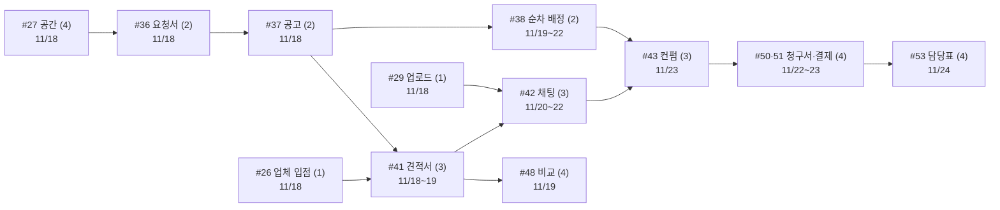

# 남은 일 분업 계획 (11/18 ~ 11/26)

> 작성 2026-11-17 (화, Day 6) · 해원 · **초안 — 내일 아침 회의에서 확정**
> 기준: 강사님 일정표 (Day 7~12), 현재 범위 그대로 (AC 103개 + #106 머지 시 AC-F5-22)
> 진행 기록은 [진행_현황.md](진행_현황.md), 작업 원문은 [specs/tasks.md](../specs/tasks.md), 상태는 GitHub 이슈가 기준.

---

## 0. 지금 위치 한 줄

일정상 오늘(Day 6)까지 F1·F2가 끝나야 하는데 **F1 일부만, F2 API는 0개**예요. 남은 개발일은 **4일 (11/18·19·23·24)**, 11/24에 기능 동결이에요. 범위를 유지하려면 **첫 이틀에 핵심 흐름의 앞부분(요청서 → 공고 → 견적서 → 비교)을 반드시 뚫어야** 해요.

## 1. 남은 일정 (강사님 일정표)

| 날짜 | Day | 일정 목표 | 우리 목표 |
|---|---|---|---|
| 11/18 (수) | 7 | F3·F4 구현 | **F2 모델·API 뚫기** (요청서·공고·공간·견적서) — 하루 늦은 F2를 여기서 따라잡는다 |
| 11/19 (목) | 8 | **M2: F1~F4 완료 + 1차 통합 시연** | 화면 연결 + **1차 통합 시연: 요청서 → 공고 → 견적서 → 비교** |
| 11/20~22 | - | (일정 없음) | 가능한 사람은 밀린 작업 마무리 |
| 11/23 (월) | 9 | 갭 분석·품질 보강 | 순차 배정·채팅·컨펌·결제·게시판 연결, 갭 분석 |
| 11/24 (화) | 10 | **M3: 수용 테스트·기능 동결** | 남은 기능 + **대표 시나리오 끝까지** + 수용 기준 전수 검증 |
| 11/25 (수) | 11 | 스펙-문서 동기화·발표 준비 | 문서 마무리, 발표 자료, 시연 리허설 |
| 11/26 (목) | 12 | **최종 발표 (오전)** | 발표·시연, KPT 회고, v1.0 태그 |

## 2. 분담 조정 (제안)

범위를 그대로 두면 1·2번이 너무 무거워서, 가장 앞서 있는 4번과 3번으로 일부를 옮겨요.

| 작업 | 이슈 | 지금 | 제안 | 이유 |
|---|---|---|---|---|
| 서비스·공간 등록 + 스냅샷 | #27 | 1 세환 | **4 목산** | roles.md "밀리면 넘기기" 1순위. 4번 시드 데이터에 공간 A·B·C가 이미 있고, 비교 화면(#48)이 공간 정보를 쓴다 |
| 공간 탐색 목록·상세 | #28 | 1 세환 | **4 목산** | 위와 같이 |
| 1:1 문의 + 관리자 답변 | #102 | 2 해원 | **4 목산** | SQLAdmin 관리자 뷰를 4번이 이미 다룬다 (신고·이력) |
| 공지·FAQ·업체 가이드·약관 | #103 | 2 해원 | **3 채은** | 화면 코드 위주로 가볍다. 채팅이 막혀 기다릴 때 채우기 좋다 |

조정 뒤 남은 수용 기준(AC)과 작업 수:

| 묶음 | 담당 | 작업 | AC | 그 밖에 |
|---|---|---|---|---|
| 1 | 세환 | 9개 | 26 | 공통 레이아웃 후속, README·Swagger, 보안 점검 |
| 2 | 해원 | 7개 | 25 | SEO 구현, 팀장 일 (통합 시연·검증 주관, 스펙 관리, 발표 자료), 시연 서버 |
| 3 | 채은 | 6개 | 19 | 알림 모듈 (다른 묶음이 `notify()`를 부름) |
| 4 | 목산 | 10개 | 20 (+1) | 시드·시연 초기화 유지, 시연 시나리오 |

## 3. 사람별 할 일 (날짜순)

`→` 뒤는 그 작업이 끝나야 시작할 수 있는 다른 사람 작업. **굵게** = 다른 사람이 기다리는 작업 (먼저).

### 1번 세환 — 회원·업체·게시판

| 날짜 | 할 일 | 이슈 | AC |
|---|---|---|---|
| 11/18 | **업체 가입·입점 3단계·심사 상태** → 공간 등록(4), PR 게시판 | #26 | F1-17, F1-18 |
| 11/18 | **파일 업로드 API** (uploads.md) → 채팅 사진(3), 커뮤니티·문의(2·4), PR 게시판 | #29 | — |
| 11/18 | 업로드 설계 마이그레이션: `suppliers.business_reg_file`·`photo_url` → `business_doc_file_id`·`image_file_id` | (#29에 포함) | — |
| 11/19 | 공통 레이아웃 후속 (커뮤니티 메뉴, 바닥글 링크, 사업자 문구, 1:1 문의 메뉴) → **#23 닫기** | #23 | — |
| 11/19 | PR 게시판 목록·상세·작성 | #30 | F4-01, F4-02, F4-04, F4-09 |
| 11/19 | F1 verify.md + Postman (F1) | - | - |
| 11/20~22 | 네이버 로그인(테스트 계정)·카카오(비활성)·소셜 추가 정보 | #25 | F1-04 ~ F1-10 |
| 11/23 | PR 게시판 블라인드·정지 업체 글 숨김 (← 4번 #54) | #31 | F4-03, F4-10, F4-11 |
| 11/23 | 직접 오퍼·관심 업체 (← 2번 #38) | #32 | F3-16 ~ F3-19 |
| 11/23 | 업체 프로필·개인 프로필·마이페이지 | #33 | F5-15, F5-16, F5-17 |
| 11/24 | 권한 공통 검사 테스트 (← 2·3번 API) | #34 | F1-13, F1-14, F1-15 |
| 11/24 | 보안 점검 체크리스트 (인증·권한 우회, 입력값) | - | - |
| 11/25 | README (설치·실행), API 문서 (Swagger) 최종 | - | - |

### 2번 해원 — 공연 요청·배정, 커뮤니티 (+ 팀장)

| 날짜 | 할 일 | 이슈 | AC |
|---|---|---|---|
| 11/18 | **`performances`·`performance_versions`·`stages` 모델 + 마이그레이션** → 3·4번 전부 | #36 | — |
| 11/18 | **공연 요청서 STEP1·STEP2 + 버전 API** | #36 | F2-04 ~ F2-10 |
| 11/18 | **공고 게시·내림·노출 조건 API** → 견적서(3) | #37 | F2-11, F2-12, F2-13 |
| 11/19 | 요청서 화면 (STEP1·2), 공고 게시 | #36·#37 | |
| 11/19 | 순차 배정·[다음 단계로]·건너뛰기 API 착수 | #38 | F3-01 ~ F3-05 |
| 11/19 | **1차 통합 시연 주관**, 중간 점검 보고서, F2 verify.md 취합 | - | - |
| 11/20~22 | 순차 배정 마무리 → 오퍼(1), 기술 확인·신고(4), 컨펌(3) | #38 | |
| 11/23 | 내 공연 현황 | #40 | F5-02 |
| 11/23 | 반려 카운트·게시 제한 (← 3번 #42) | #39 | F4-05, F4-06, F4-07 |
| 11/23 | 커뮤니티 목록·글 보기·글쓰기 (← 1번 #29) | #100 | F4-12, F4-13, F4-16 |
| 11/23 | **갭 분석 보고서** (미충족 수용 기준 목록) | - | - |
| 11/24 | 커뮤니티 댓글·답글·도움 돼요·저장·공유 (← 3번 #45, 4번 #54) | #101 | F4-14, F4-15, F4-17 |
| 11/24 | SEO: 서버 head·robots·sitemap, `usePageMeta` (seo.md 9장 테스트) | (이슈 만들 것) | NFR-UX-07 |
| 11/24 | **수용 기준 전수 검증 주관**, 수용 테스트 결과서 | - | - |
| 11/25 | 스펙 최종본(변경 이력), 사용자 매뉴얼, **발표 자료** | - | - |
| 11/25 | 시연 서버 (deploy.md) — 또는 로컬 Docker 시연으로 결정 | - | - |
| 11/26 | v1.0 태그, 최종 보고서 | - | - |

### 3번 채은 — 견적·채팅 확정, 알림

| 날짜 | 할 일 | 이슈 | AC |
|---|---|---|---|
| 11/18 | **`quotes`·`quote_versions` 모델 + 견적서 작성 API** (오전엔 2번 빈 함수로, 오후 2번 모델 붙이기) → 비교 화면(4) | #41 | F2-14 ~ F2-20 |
| 11/18 | 업체 공고 목록·상세 API (← 2번 #37) | #41 | |
| 11/19 | 공고 목록·견적서 작성 화면, **1차 통합 시연** 견적서 부분 | #41 | |
| 11/19 | F2 견적서 verify + Postman | - | - |
| 11/20~22 | **채팅방·메시지 + WebSocket** (사진은 ← 1번 #29) → 반려(2), 컨펌 | #42 | F3-06, F3-07, F3-08 |
| 11/23 | **사이트 안 알림** (notifications.md) → 커뮤니티·문의(2·4)가 부름 | #45 | — |
| 11/23 | **견적 내역 확인 카드·컨펌(동시성)·자동 마감** (← 2번 #38, 4번 #47) → 청구서(4) | #43 | F3-09 ~ F3-12, F3-14 |
| 11/24 | 자동 마감 알림·연락처 감지 경고·연락처 비공개 | #44 | F3-13, F3-15, F5-12 |
| 11/24 | 공지·FAQ·업체 가이드·약관 화면 (조정 시) | #103 | F5-21 |
| 11/25 | data-model.md 최종, 리팩터링 | - | - |

### 4번 목산 — 검사·결제·운영, 공간 (조정 시)

| 날짜 | 할 일 | 이슈 | AC |
|---|---|---|---|
| 11/18 | **서비스·공간 등록 + 공간 스냅샷** (조정 시, 시드 공간 사용) → 요청서 공간 고르기(2), 견적서(3) | #27 | F2-01, F2-02, F2-03 |
| 11/18 | 공간 탐색 목록·상세 (조정 시) | #28 | F5-01 |
| 11/19 | **단계별 견적 비교 화면 (대표 화면)** (← 3번 #41), **1차 통합 시연** 비교 부분 | #48 | F3-20 |
| 11/19 | **신고·블라인드 서비스 + 관리자 뷰** → PR 게시판 블라인드(1), 커뮤니티(2) | #54 | F5-13 |
| 11/20~22 | 통합 청구서·플랫폼 이용료 (계산 함수는 끝) | #50 | F5-03, F5-04 |
| 11/23 | 에스크로형 모의 결제·장부·멱등 (← 3번 #43) | #51 | F5-05, F5-06, F5-07 |
| 11/23 | 기술 확인 (← 2번 #38) | #49 | F3-25 |
| 11/23 | 1:1 문의 + 관리자 답변 (조정 시, ← 1번 #29, 3번 #45) | #102 | F5-18, F5-19, F5-20 |
| 11/24 | 취소·위약금·업체 사정 취소 + **D-53 결제 기한·독촉·자동 취소** | #52 | F5-08, F5-09, F5-10, F5-22 |
| 11/24 | 최종 담당표 | #53 | F5-11 |
| 11/24 | 쿼리 점검 (N+1, 인덱스), 데이터 정합성 점검 | - | - |
| 11/25 | **시연 시나리오·화면 캡처**, 시드 데이터 최종 | - | - |

## 4. 핵심 흐름 (이 순서가 막히면 다 막힘)

- **11/18 저녁까지**: #36·#37·#26·#29·#27 API가 develop에 머지돼야 11/19 통합 시연이 된다.
- 기다리는 쪽은 roles.md 3장의 **빈 함수 + 시드 데이터**로 먼저 만들고, 진짜가 머지되면 바꿔 끼운다. 기다리느라 멈추지 않는다.

## 5. 과정 산출물 담당 (강사님 일정표)

| 산출물 | 마감 | 담당 | 비고 |
|---|---|---|---|
| **일일 개발 로그** | 매일 저녁 | 전원 각자 → 해원 취합 | `docs/logs/YYYY-MM-DD.md`, 한 사람 3줄 (한 일 / 막힌 것 / 내일) |
| verify.md (F1) | 11/19 | 세환 | 수용 기준마다 입력값·기대값·결과·테스트 이름 |
| verify.md (F2) | 11/19 | 해원 취합 (요청서 2, 견적서 3, 공간 4) | |
| Postman 컬렉션 (F1·F2) | 11/19 | 각 API 주인, 해원 취합 | `postman/` 폴더, 묶음별 폴더 |
| 중간 점검 보고서 · 통합 이슈 목록 | 11/19 | 해원 | 1차 통합 시연 결과 |
| verify.md (F3·F4) · Postman (F3·F4) | 11/23 | 각 API 주인 | |
| 갭 분석 보고서 | 11/23 | 해원 | 미충족 AC 목록 |
| verify.md (F5) · 쿼리 최적화 기록 | 11/23~24 | 목산 (결제·공간), 세환 (프로필) | |
| 수용 테스트 결과서 · 버그 리포트 | 11/24 | 해원 주관, 전원 | AC 전수 |
| 보안 점검 체크리스트 | 11/24 | 세환 | |
| 스펙 최종본 (변경 이력) | 11/25 | 해원 | 11/13 동결 이후 D-41~54를 변경 이력으로 |
| README · API 문서 (Swagger) | 11/25 | 세환 | |
| data-model.md 최종 | 11/25 | 채은 | |
| 사용자 매뉴얼 · 발표 자료 | 11/25 | 해원 | |
| 시연 시나리오 · 화면 캡처 | 11/25 | 목산 | 시연_예시값.md 기준 |
| SDD·AI 활용 회고서 · KPT | 11/25~26 | 전원 | |
| 최종 보고서 · v1.0 태그 | 11/26 | 해원 | |

## 6. 오늘·내일 아침 정리할 것

| 할 일 | 담당 |
|---|---|
| #106 (D-53 결제 기한) 승인 — 마지막 push가 해원이라 **세환 또는 채은** 승인 | 세환·채은 |
| #107 (진행 현황·이 문서) 승인 | 아무나 |
| #106 후속: AC-F5-22를 tasks.md T4-07(#52)에, notifications.md에 독촉·자동 취소 알림 | 목산 |
| #104 후속: PR 본문, 시연 값, "요청서 쓰기" 문구 | 세환 |
| 끝난 이슈 닫기: #14·#15 (로컬 환경) | 세환·해원 |
| 와이어프레임 이슈 #18~#21: HTML 목업 v3로 대신 → 닫기 | 각자 |
| 분담 조정(2장) 확정되면 이슈 담당 바꾸기: #27·#28·#102 → 목산, #103 → 채은 | 해원 |
| SEO 구현 이슈 만들기 | 해원 |
| #65 리허설 안내 문구 + CHK-03 키 이름 | 해원 |
| 마일스톤에 마감일 넣기: 1주차 = 11/19, 2주차 = 11/24 | 해원 |
| 강사님께 확인: Tailwind 대신 CSS Modules + TypeScript (D-40), Figma 대신 HTML 목업 | 해원 |

## 7. 규칙 (남은 기간)

1. **스펙은 더 바꾸지 않는다.** 꼭 바꿔야 하면 회의에서 정하고 요구사항 명세서 변경 이력에 남긴다.
2. **다른 사람이 기다리는 작업(굵게)을 먼저** 한다. 오전에 빈 함수로 시작하고 오후에 진짜로 바꾼다.
3. PR은 작게 자주. 하루에 최소 1번 develop에 머지. PR 제목·본문에 작업 ID(T2-02 등)와 AC.
4. 리뷰는 받은 지 반나절 안에. 승인 1명이면 머지.
5. 매일 저녁 일일 로그 3줄 + 끝난 이슈 닫기 + 진행_현황.md 체크.
6. 막히면 30분 안에 팀 채팅에 올린다.

## 8. 밀릴 때 순서 (범위는 유지하되, 동결 직전에 못 끝나면 이 순서로 뒤로)

미리 줄이지는 않는다. 11/23 갭 분석에서 11/24 안에 못 끝날 게 보이면 아래 순서로 "후속"으로 돌린다.

1. 네이버 로그인 (#25) — 이메일 로그인·시연 계정 전환으로 시연 가능
2. SEO 구현, 시연 서버(EC2) — 로컬 Docker로 시연
3. 커뮤니티 댓글·도움 돼요 (#101)
4. 1:1 문의 (#102), 공지·FAQ (#103)
5. 직접 오퍼·관심 업체 (#32), 기술 확인 (#49)

**대표 시나리오(요청서 → 견적서 → 채팅 컨펌 → 결제 → 담당표)는 어떤 경우에도 끝까지 돌게 한다.**
