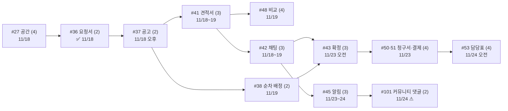

# 남은 일 분업 계획 v2.1 (11/18 ~ 11/26) — 100% 목표

> 작성 2026-11-18 (수, Day 7) · 해원 · **초안 — 팀 회의에서 확정**
> **v2.1 (11/18 오후) 변경**: ① **금·토·일(11/20~22)은 작업하지 않아요** — 금·토 일을 11/19·11/23·11/24 오전으로 옮김. ② **코드 리뷰를 하지 않음** — 9~18시를 모두 개발에 쓰고, PR은 CI `test`가 통과하면 바로 머지. ③ **11/24는 오전까지 개발, 12시 전 기능 머지 → 오후 검증 → 18시 동결.** ④ 해원 일 넘김: **#122 비밀번호 찾기 → 세환, #103 공지·FAQ → 채은.** ⑤ 시간이 모자랄 수 있는 일에 ⚠ (9장 순서로 뒤로). 사람별 상세는 [개인별_할일.md](개인별_할일.md).
> 목표: **AC 107개 전부 + 권장 기능까지 하나도 후속으로 넘기지 않기.**
> (기록) v2 아침판에서 v1(11/17)과 달라진 점 — 아래 ②·③은 v2.1에서 다시 바뀜: ① Claude Opus 5.5로 코드·테스트 초안을 만드는 속도를 넣어 일을 앞당김, ② **11/20(금)·11/21(토)을 작업일로 씀** (11/22 일요일은 여유분), ③ **모든 기능을 11/23 18시까지 머지**하고 11/24는 검증·버그 수정만, ④ 어려운 작업(채팅·확정·결제)을 앞으로, ⑤ **해원이 더 가져감**: 비밀번호 찾기(세환→), 기술 확인 #49(목산→), 공지·FAQ #103(채은→), SEO·#39는 해원 그대로. 대신 채은은 채팅·확정·알림에만, 세환·목산은 검증·보안·결제에 여유를 둠.
> 진행 기록은 [진행_현황.md](진행_현황.md), 작업 원문은 [specs/tasks.md](../specs/tasks.md), 화면 기준은 [docs/design/mockup-v4/](design/mockup-v4/), 상태는 GitHub 이슈가 기준.

---

## 0. 전제

### 0.1 지금 위치 (11/18 아침)

| 구분 | 끝남 | 남음 |
|---|---|---|
| 준비·공통 | 로컬 환경, 가짜 로그인(#22), 공통 레이아웃(#23), 빈 함수(#35), 시드(#46), 검사 엔진(#47) | v4 화면 기준으로 공통 부품 맞추기 |
| F1 회원·업체 | 이메일 가입·로그인(#24), 업체 입점·심사(#26), 업로드 API·업체 사진·서류 칸(#29·#113), 커뮤니티 메뉴·바닥글(#110) | 네이버(#25), 권한 테스트(#34), 비밀번호 찾기(신규) |
| F2 자원 | — | 공간(#27·#28), 요청서(#36)·공고(#37), 견적서(#41, 합계 검증 브랜치만 있음) |
| F3 배정·채팅 | — | #38, #42, #43, #44, #45, #48, #49, #32 |
| F4 게시판·커뮤니티 | — | #30, #31, #39, #54, #100, #101 |
| F5 결제·운영·콘텐츠 | — | #50~#53, #33, #40, #102, #103 |
| 스펙 | AC **107개** (끝남 17 · 남음 90), 결정 D-55까지 | 더 바꾸지 않음 |

남은 작업은 이슈 29개 + 신규 3개 = **32개**. 개발할 수 있는 시간은 **11/18 오후 · 11/19 · 11/23 · 11/24 오전 = 한 사람당 약 24시간** (9~18시, 점심 1시간).

### 0.2 100%가 되는 조건

| 조건 | 왜 |
|---|---|
| **금·토·일(11/20~22)은 쉼** | 대신 평일 9~18시를 모두 개발에 써요 |
| ~~#36 모델 11/18 정오 머지~~ | **끝남** (#125, 11/18 10시 30분). API(#127)도 머지 |
| **코드 리뷰 없음** | PR 올리고 CI `test` 통과하면 바로 머지. 품질은 AC 테스트·CI·매일 18시 대표 시나리오·11/24 수용 테스트로 확인. **develop 룰셋의 필요한 승인 1명 → 0으로 바꿔야 함 (해원)** |
| **매일 18시 대표 시나리오 한 번 끝까지** | 끊기는 곳을 그날 찾기 |
| **권장 기능도 날짜를 박아 둠** | "남으면 하자"는 안 남아요. 대신 시간이 모자랄 수 있는 일은 ⚠로 표시 |
| **체크포인트 3번** | 11/19 18시 F2 완료 · **11/23 18시 확정·결제 완료** · **11/24 12시 전 기능 머지** |

### 0.3 AI(Claude Opus 5.5)로 일하는 방식

사람은 **스펙 확인·통합·검증**에 시간을 쓰고, 코드와 테스트 초안은 AI가 만들어요. 한 사람이 하루에 이슈 2~3개를 끝내는 속도로 잡았어요.

| 단계 | 누가 | 하는 일 |
|---|---|---|
| 1. 맥락 주기 | 사람 | 이슈 번호, AC 목록, 관련 스펙 파일, v4 목업 파일을 아래 프롬프트 틀에 넣어 AI에 줘요 |
| 2. 테스트 먼저 | AI | AC마다 pytest·vitest를 먼저 쓰게 해요 (SDD: AC → 테스트 → 코드) |
| 3. 구현 | AI | 모델·마이그레이션·API·화면. 화면은 v4 목업의 HTML·CSS를 React 부품으로 옮겨요 |
| 4. 확인 | 사람 | 테스트를 직접 돌리고, 화면을 목업과 나란히 놓고 봐요. AC 문장과 다르면 고치게 해요 |
| 5. PR | 사람 | PR 본문에 작업 ID·AC·"AI가 만든 부분/사람이 고친 부분" 한 줄. CI 통과하면 본인이 머지 (리뷰 없음) |
| 6. 기록 | 사람 | 일일 로그에 쓴 프롬프트 요지·고친 것 한 줄 (11/25 SDD·AI 활용 회고서 재료) |

**프롬프트 틀** (복사해서 쓰기):

```text
작업: T2-02 (#36) 공연 요청서 STEP1·STEP2 + 버전
지켜야 할 것: CLAUDE.md, specs/spec.md F2의 AC-F2-04~10, specs/api-contract.md 해당 API,
specs/data-model.md performances·performance_versions·stages, specs/user-flow.md 1번
화면 기준: docs/design/mockup-v4/pages/request-1.html, request-2.html (문구는 docs/design/문구.md)
순서: ① AC마다 실패하는 테스트 ② 마이그레이션(다음 번호) ③ API ④ 화면 ⑤ 테스트 통과
하지 말 것: 스펙에 없는 필드·API 추가, 다른 묶음 파일 수정, 화면 용어 바꾸기(문구.md 7장 기준)
```

**AI 쓸 때 규칙**
- 스펙과 다르게 만들면 우리가 놓친 것 — PR 전에 AC 문장과 한 줄씩 대조해요.
- 마이그레이션 번호는 만들기 직전에 develop을 받아 확인 (0003 겹침 사고 다시 안 나게).
- 비밀값(.env, 비밀번호)은 프롬프트에 넣지 않아요.
- 보고서·verify.md·Postman 설명은 AI 초안 → 사람이 확인. 팀장 문서도 같아요.

---

## 1. 일정 한눈에

| 날짜 | Day | 강사님 일정 | 우리 목표 | 18시 체크 |
|---|---|---|---|---|
| **11/18 (수)** | 7 | F3·F4 구현 | F2 API 전부 + 업체 찾기 + 공간 + 채팅 시작 | #36·#37·#41 API·#27·#28·#30 API 머지 |
| **11/19 (목)** | 8 | **M2 + 1차 통합 시연** | F2 화면 + 시연, **순차 배정 전부**, 채팅 실시간, 신고 | **체크포인트 ①** 요청서→공고→견적서→비교 화면 |
| 11/20 (금) ~ 11/22 (일) | - | 없음 | **쉼** | — |
| **11/23 (월)** | 9 | 갭 분석·품질 | **확정·청구서·결제** + 내 공연·반려 제한·기술 확인·커뮤니티·오퍼 | **체크포인트 ②** 대표 시나리오가 결제까지 |
| **11/24 (화)** | 10 | **M3 수용 테스트·동결** | **오전: 마지막 기능 (12시 머지 마감)** · 오후: AC 107개 전수 검증·버그 수정 | **12시 체크포인트 ③ 전 기능 머지**, 18시 동결 |
| **11/25 (수)** | 11 | 문서·발표 준비 | 문서, 시연 서버, 리허설 2회 | 발표 자료·예비 영상 |
| **11/26 (목)** | 12 | **최종 발표 (오전)** | 발표·시연, KPT, v1.0 태그 | — |

---

## 2. 날짜별 상세 배분

`←` 앞 사람 작업이 있어야 함 (없으면 빈 함수·시드로 먼저). `→` 이걸 기다리는 사람. **굵게** = 남이 기다리는 일이라 먼저.
화면 파일은 `docs/design/mockup-v4/pages/` 기준.

### 11/18 (수) Day 7 — F2 뚫기 + 채팅 시작

| 사람 | 오전 (9~13시) | 오후 (14~18시) | 18시까지 머지 |
|---|---|---|---|
| **세환** (1) | **#30 업체 찾기 API** (목록·상세·작성, 말머리·필터·부문당 1개) AC-F4-01·02·04·09 | #30 화면 `board`·`post`·`p-post` (화면 이름 "업체 찾기"/"소개 글", 코드는 `pr_posts`)<br>**v4 공통 부품** (#23 후속): 머리 메뉴 통일·채팅 메뉴·계정 메뉴(견적함·기술 확인), `Select`(`select.css`), 입력칸 포커스 | #30 API, 화면 + 공통 부품 |
| **해원** (2) | ~~#36 모델·마이그레이션 0005~~ ✅ #125<br>~~#36 요청서 API AC-F2-04~10~~ ✅ #127 · ~~화면~~ ✅ #129 | **#37 공고 게시·내림·노출 조건·버전 갱신 API** AC-F2-11~13 → 3번 | #37 API |
| **채은** (3) | **#41 `quotes`·`quote_versions` + 견적서 작성 API** (여러 개·버전·합계 검증, `feat/41` 이어서) | **#41 업체 공고 목록·상세 API** (← #37)<br>**#42 채팅 모델·REST 시작** (방 만들기·메시지 목록·보내기) | #41 API |
| **목산** (4) | **#27 서비스·공간 등록 + 공간 스냅샷** AC-F2-01~03 → 2·3번 | #28 공간 탐색 AC-F5-01, 화면 `spaces`·`space`<br>#48 비교 화면 뼈대 (`compare`·`performance` 비교 부분) — 시드 견적서로 | #27, #28 |

### 11/19 (목) Day 8 — M2, 1차 통합 시연 · 체크포인트 ①

| 사람 | 오전 | 오후 (14시 시연 1시간 포함) | 18시까지 머지 |
|---|---|---|---|
| **세환** | #33 업체 프로필·개인 프로필·마이페이지 AC-F5-15~17, 화면 `supplier`·`mypage` | #25 네이버 로그인(테스트 계정)·카카오(비활성)·소셜 추가 정보 AC-F1-04~10 (`signup` 소셜 모드) | #33, #25 |
| **해원** | **#38 순차 배정 앞부분**: 약속 함수 `get_open_stage`·`stage_confirmed` 본문, [다음 단계로] AC-F3-01·02 → 1·3·4번 (#36이 일찍 끝나서 당김) | **14시 1차 통합 시연 주관** (요청서 → 공고 → 견적서 → 비교), 중간 점검 보고서 (AI 초안)<br>**#38 마무리**: 건너뛰기·전부 구했어요 AC-F3-03~05, **`confirmed_lines`** → 4번 | #38 |
| **채은** | #41 화면 `p-jobs`·`p-job`·`p-quote` + 시연 견적서 부분 | **#42 WebSocket 실시간·사진·파일·읽음** AC-F3-06~08<br>채팅 위젯 옮기기 (`chat-widget.js`·`chat.css` → `shared/chat/ChatWidget.tsx`) | #41 화면, #42 |
| **목산** | **#48 비교 화면 진짜 데이터** (← #41) + 시연 비교 부분 AC-F3-20 | **#54 신고·블라인드 서비스 + 관리자 뷰(신고·공연 이력)** AC-F5-13 → 1번 #31, 2번 #101<br>#102 1:1 문의 API | #48, #54, #102 API |

### 11/20 (금) ~ 11/22 (일) — 쉼

작업하지 않아요.

### 11/23 (월) Day 9 — 확정·결제 + 나머지 기능 · 체크포인트 ②

| 사람 | 오전 | 오후 | 18시까지 머지 |
|---|---|---|---|
| **세환** | #32 직접 오퍼·관심 업체 (← #38) AC-F3-16~19, 화면 `favorites`, `post`의 [오퍼 보내기] | #31 업체 찾기 블라인드·정지 업체 글 숨김 (← #54) AC-F4-03·10·11 | #32, #31 |
| **해원** | #40 내 공연 현황 AC-F5-02, 화면 `my`·`performance`·`inbox-list`<br>#39 반려 카운트·게시 제한 (← #42) AC-F4-05~07 | #49 기술 확인 AC-F3-25, 화면 `p-tech`<br>#100 커뮤니티 목록·글 보기·글쓰기·도배 방지 AC-F4-12·13·16<br>**18시 대표 시나리오: 결제까지** | #40, #39, #49, #100 |
| **채은** | **#43 최종 견적 카드·내역서·확정(동시성)·다른 견적 자동 마감** AC-F3-09~12·14 → 4번 청구서 | **`notify()` 본문 먼저** → 전원<br>#44 자동 마감 알림·연락처 감지 경고·결제 전 비공개 AC-F3-13·15, F5-12 | #43, #44 |
| **목산** | **#50 통합 청구서·이용료 5%** AC-F5-03·04 (← #43, `confirmed_lines`) | **#51 에스크로형 모의 결제·장부·멱등** AC-F5-05~07, 화면 `invoice`·`pay` | #50, #51 |

### 11/24 (화) Day 10 — M3: 오전 마지막 기능 (12시 머지) · 오후 검증 · 18시 동결

| 사람 | 오전 (12시 머지 마감) | 오후 (새 기능 없음) |
|---|---|---|
| **세환** | #34 권한 공통 검사 테스트 AC-F1-13~15<br>⚠ **#122 비밀번호 찾기** (해원 → 세환) AC-F1-21~23, 화면 `password` | 보안 점검 체크리스트, AC 검증 F1·F4 업체 찾기·프로필·오퍼, 버그 수정 |
| **해원** | ⚠ #101 커뮤니티 댓글·답글·도움 돼요·저장·공유·신고 AC-F4-14·15·17<br>#65 리허설 안내 문구 + CHK-03 키 이름 · ⚠ SEO (#123) | **갭 분석**, **AC 107개 전수 검증 주관**, 수용 테스트 결과서·버그 리포트, **18시 동결 선언** |
| **채은** | #45 사이트 안 알림 마무리 (패널·`notifications`)<br>⚠ FR-CHAT-07 채팅 목록 찾기 AC-F3-26 · ⚠ **#103 공지·FAQ·가이드·약관** (해원 → 채은) AC-F5-21 | AC 검증 F2 견적서 + F3 채팅·확정·알림, 버그 수정 |
| **목산** | **#53 최종 담당표** AC-F5-11 (대표 시나리오 끝이라 먼저)<br>#52 취소·위약금·업체 사정 취소 AC-F5-08~10 · ⚠ D-53 독촉·자동 취소 AC-F5-22 · ⚠ #102 화면 | AC 검증 공간·비교·F5, 쿼리 점검(N+1, 인덱스)·장부 정합성 |

### 11/25 (수) Day 11 — 문서·발표 준비 (코드는 버그 수정만)

| 사람 | 오전 | 오후 |
|---|---|---|
| 세환 | verify(F1·F4)·Postman(F1) 마감, README (설치·실행·시연 계정), API 문서(Swagger) 최종 | 시연 리허설 (회원·업체 부분) |
| 해원 | 스펙 최종본 (D-41~55 변경 이력), 사용자 매뉴얼, data-model.md 최종본 커밋 | **발표 자료**, ⚠ 시연 서버 배포 (#124, 안 되면 로컬 Docker), 리허설 2회 주관 |
| 채은 | verify(F2 견적서·F3)·Postman(F3) 마감, data-model.md 최종 초안 (실제 마이그레이션과 대조) | 리허설 (채팅·확정 부분) |
| 목산 | verify(F5)·Postman(F5) 마감, 시연 시나리오·화면 캡처 (시연_예시값.md), 시드 최종·시연 초기화 확인 | 리허설 (결제·담당표 부분), 예비 시연 영상 녹화 |
| 전원 | SDD·AI 활용 회고서 각자 부분 (일일 로그의 AI 기록 모으기) | KPT 초안 |

### 11/26 (목) Day 12 — 최종 발표

| 시간 | 할 일 | 담당 |
|---|---|---|
| 아침 | 시연 초기화, 시연 계정 로그인 확인, 예비 영상 준비 | 목산 |
| 오전 | 발표 (해원 진행, 묶음별 시연 각자) | 전원 |
| 발표 뒤 | KPT 회고, v1.0 태그, 최종 보고서 | 해원 (태그·보고서), 전원 (KPT) |

---

## 3. 사람별 전체 목록 (빠짐 확인용 체크리스트)

| 사람 | 개발 작업 | 문서·검증 |
|---|---|---|
| 세환 (8개) | #30(18) · v4 공통 부품(18) · #33(19) · #25(19) · #32(23) · #31(23) · #34(24) · **#122**(24 ⚠) | verify(F1·F4)·Postman(F1)(25), 보안 체크리스트(24), README·Swagger(25) |
| **해원 (10개 + 팀장)** | ~~#36~~(18 ✅) · #37(18) · #38(19) · #40(23) · #39(23) · #49(23) · #100(23) · #101(24 ⚠) · #65(24) · SEO(24 ⚠) · 배포(25 ⚠) | 시연 주관·중간 점검(19), 대표 시나리오(매일 18시), 갭 분석·수용 테스트(24), 스펙 최종본·매뉴얼·발표 자료(25), 최종 보고서·태그(26), 일일 로그 취합 |
| 채은 (7개) | #41(18~19) · #42(18~19) · #43(23) · #44(23) · #45(23~24) · FR-CHAT-07(24 ⚠) · **#103**(24 ⚠) | verify(F2 견적서·F3)·Postman(25), data-model.md 최종 초안(25) |
| 목산 (9개) | #27(18) · #28(18) · #48(18~19) · #54(19) · #102(19 API · 24 화면 ⚠) · #50(23) · #51(23) · #53(24) · #52(24, D-53 부분 ⚠) | verify(공간·F5)·Postman(F5)(25), 쿼리 점검(24), 시연 시나리오·캡처·예비 영상, 시드·시연 초기화 |

> 금·토가 빠져서 해원 일 중 **#122 → 세환(인증 담당), #103 → 채은(화면 위주)**으로 넘겼어요. 11/23이 모두에게 가장 빡빡해요 (해원 4개, 채은 확정 + 알림).

---

## 4. 빠진 것 없는지 — 스펙 ↔ 작업 대조

| 스펙 | 작업 | 담당 | 날짜 |
|---|---|---|---|
| F1 AC-F1-01~03·11·12·16~20 | 끝남 (#22·#24·#26, PR #9) | — | — |
| F1 AC-F1-04~10 | #25 | 세환 | 11/19 |
| F1 AC-F1-13~15 | #34 | 세환 | 11/24 |
| F1 AC-F1-21~23 (FR-AUTH-09, D-55) | #122 | **세환** | 11/24 ⚠ |
| F2 AC-F2-01~03 | #27 | 목산 | 11/18 |
| F2 AC-F2-04~10 · 11~13 | #36 끝남 (#125·#127, 화면 #129) · #37 | 해원 | 11/18 |
| F2 AC-F2-14~20 | #41 | 채은 | 11/18~19 |
| F3 AC-F3-01~05 | #38 | 해원 | 11/19 |
| F3 AC-F3-06~08 | #42 | 채은 | 11/18~19 |
| F3 AC-F3-09~12·14 · 13·15 | #43 · #44 | 채은 | 11/23 |
| F3 AC-F3-16~19 | #32 | 세환 | 11/23 |
| F3 AC-F3-20~24 · 20(화면) | #47 끝남 · #48 | 목산 | 11/19 |
| F3 AC-F3-25 | #49 | 해원 | 11/23 |
| F3 AC-F3-26 (FR-CHAT-07) | #42 후속 | 채은 | 11/24 ⚠ |
| F4 AC-F4-01·02·04·09 · 03·10·11 | #30 · #31 (F4-08 끝남) | 세환 | 11/18 · 11/23 |
| F4 AC-F4-05~07 | #39 | 해원 | 11/23 |
| F4 AC-F4-12·13·16 · 14·15·17 | #100 · #101 | 해원 | 11/23 · 11/24 ⚠ |
| F5 AC-F5-01 · 02 | #28 · #40 | 목산 · 해원 | 11/18 · 11/23 |
| F5 AC-F5-03·04 · 05~07 | #50 · #51 | 목산 | 11/23 |
| F5 AC-F5-08~10 · 22 (D-53) · 11 | #52 · #53 | 목산 | 11/24 · 11/24 ⚠ · 11/24 |
| F5 AC-F5-12 · 13 · 14 | #44 · #54 · #46 끝남 | 채은 · 목산 | 11/23 · 11/19 |
| F5 AC-F5-15~17 · 18~20 · 21 | #33 · #102 · #103 | 세환 · 목산 · **채은** | 11/19 · 11/19(API)·11/24(화면 ⚠) · 11/24 ⚠ |
| NFR-UX-07 SEO (D-50) | #123 | 해원 | 11/24 ⚠ |
| 업로드 설계 (D-51) | 끝남 (#113, 업체 사진·서류 칸 포함) | — | — |
| 알림 28종 (D-52) | #45 (+ 각 묶음 `notify()`) | 채은 | 11/23~24 |
| 배포 (D-54) | #124 | 해원 | 11/25 ⚠ |
| v4 화면 기준 (헤더·업체 찾기·Select·채팅 위젯·카드) | 공통 부품 · #42 | 세환 · 채은 | 11/18 · 11/19 |
| 대표 시나리오 | — | 해원 | 매일 18시, 11/24 수용 테스트 |

**AC 107개 전부 주인과 날짜가 있어요.** ⚠는 11/24 12시까지 못 끝나면 9장 순서로 뒤로 돌려요.

---

## 5. 오늘(11/18) 정리할 것

| 할 일 | 담당 |
|---|---|
| 이 계획 확정 — **금·토·일 쉼, 코드 리뷰 없음(CI 통과하면 머지)**, #122 → 세환·#103 → 채은 | 전원 |
| ~~이슈 담당 바꾸기: #122 해원 → 세환, #103 해원 → 채은~~ (완료) | 해원 |
| **develop 룰셋 `필요한 승인` 1 → 0** (코드 리뷰 없음 반영. AI는 룰셋을 바꾸지 않음), CONTRIBUTING.md 5·7장 맞추기 | 해원 |
| ~~신규 이슈 3개: T1-14 #122, T2-11 #123, T2-12 #124 + tasks.md~~ (완료) | 해원 |
| ~~#42 본문에 FR-CHAT-07·AC-F3-26 추가, #52에 AC-F5-22·독촉 알림~~ (완료) | 해원 |
| ~~#100~#103 본문의 화면 파일명 v3 → v4~~ (완료) | 해원 |
| 끝난 이슈 닫기: #14·#15(로컬 환경), #18~#21(와이어프레임 → HTML 목업으로 대신) | 각자 |
| `docs/logs/`·`postman/` 폴더 만들기 (첫 로그는 오늘 저녁) | 해원 |
| 강사님께 확인: Tailwind 대신 CSS Modules(D-40), Figma 대신 HTML 목업 | 해원 |

---

## 6. 과정 산출물

| 산출물 | 마감 | 담당 | 비고 |
|---|---|---|---|
| **일일 개발 로그** | 매일 저녁 | 전원 → 해원 취합 | `docs/logs/YYYY-MM-DD.md`, 한 사람 4줄: 한 일 / 막힌 것 / 내일 / **AI 사용 한 줄** |
| verify.md · Postman (F2) | 11/19 | 해원 취합 (요청서·공고 해원, 견적서 채은, 공간 목산) | `postman/F2/` |
| 중간 점검 보고서 · 통합 이슈 목록 | 11/19 | 해원 | 1차 통합 시연 결과 |
| 갭 분석 보고서 | 11/24 오후 | 해원 | ⚠ 남은 것 확정 |
| 수용 테스트 결과서 · 버그 리포트 | 11/24 | 해원 주관, 전원 | AC 107개 전수 |
| 보안 점검 체크리스트 | 11/24 | 세환 | |
| 쿼리 최적화 기록 | 11/24 | 목산 | |
| verify.md · Postman (F1·F3·F4·F5) | 11/25 오전 | 각 API 주인 (F1·F4 세환, F3 채은, F5 목산, 커뮤니티·콘텐츠 해원·채은) | 개발일을 아끼려고 11/25로 |
| 스펙 최종본 (변경 이력) | 11/25 | 해원 | D-41~55 |
| README · API 문서 (Swagger) | 11/25 | 세환 | |
| data-model.md 최종 | 11/25 | 채은 초안 → 해원 커밋 | `specs/`는 해원만 고침 |
| 사용자 매뉴얼 · 발표 자료 | 11/25 | 해원 | |
| 시연 시나리오 · 화면 캡처 · 예비 시연 영상 | 11/25 | 목산 | 시연_예시값.md 기준 |
| SDD·AI 활용 회고서 · KPT | 11/25~26 | 전원 | 일일 로그의 AI 기록이 재료 |
| 최종 보고서 · v1.0 태그 | 11/26 | 해원 | |

---

## 7. 핵심 흐름 (이 순서가 막히면 다 막힘)



- **11/19 18시** 체크포인트 ①. **11/23 18시** 체크포인트 ② (결제까지). **11/24 12시** 체크포인트 ③ (전 기능 머지).
- 기다리는 쪽은 roles.md 3장의 **빈 함수 + 시드 데이터**로 먼저 만들고, 진짜가 들어오면 바꿔 끼워요.

## 8. 규칙 (남은 기간)

1. **스펙은 더 바꾸지 않아요.** 꼭 바꿔야 하면 회의에서 정하고 변경 이력에 남겨요.
2. **남이 기다리는 일(굵게)을 먼저.** 오전에 빈 함수로 시작, 오후에 진짜로 바꿔요.
3. PR은 작게, 하루 최소 2번 develop 머지. 제목·본문에 작업 ID와 AC, AI가 만든 부분 한 줄.
4. **코드 리뷰 없이, CI `test`가 통과하면 본인이 바로 머지.** 남의 묶음·공통 파일을 고쳤으면 팀 채팅에 PR 링크로 알려요. 대신 테스트(AC ID)·CI·18시 대표 시나리오는 빼먹지 않아요.
5. 매일 저녁 로그 4줄 + 끝난 이슈 닫기 + 진행_현황.md 체크.
6. 막히면 30분 안에 팀 채팅. AI가 같은 실수를 두 번 하면 사람이 직접 고쳐요.
7. 하루 계획이 끝나면 다음 작업일 것을 당겨 해요. 끝난 사람은 체크포인트가 늦은 사람을 도와요.
8. **금·토·일은 작업하지 않아요.** 그래서 11/23 18시·11/24 12시 체크포인트를 놓치면 메울 날이 없어요 → 9장 순서대로 바로 뒤로 돌려요.

## 9. 그래도 밀리면

목표는 **후속 0개**예요. 하지만 금·토가 빠져서 ⚠ 붙은 일은 시간이 모자랄 수 있어요. **11/24 12시**에 안 끝났으면 아래 순서로만 뒤로 돌려요 ([개인별_할일.md](개인별_할일.md) 6장과 같은 순서).

1. SEO 구현 (#123) — 발표에서 "설계 완료, 구현 후속"
2. 시연 서버 EC2 (#124) — 로컬 Docker로 시연
3. 비밀번호 찾기 (#122), 채팅 목록 찾기 (FR-CHAT-07)
4. 커뮤니티 댓글·도움 돼요 (#101)
5. 1:1 문의 화면 (#102), 공지·FAQ (#103) — API·SQLAdmin만
6. 결제 기한 독촉·자동 취소 (#52의 AC-F5-22) — 수동 취소·위약금만
7. (그래도 모자라면) 직접 오퍼·관심 업체 (#32), 기술 확인 (#49), 네이버 로그인 (#25)

**대표 시나리오(요청서 → 견적서 → 채팅 확정 → 결제 → 담당표)는 어떤 경우에도 끝까지 돌게 해요.**
