# STAGE DUCK 사용자 매뉴얼

> 초안 (2026-11-19, 해원). 화면은 develop `#188` 기준 시연 서버에서 찍었어요. 값은 모두 가상 데이터예요.
> STAGE DUCK은 포트폴리오 시연 서비스예요. **결제는 테스트 결제라 실제로 청구되지 않아요.**

공연을 준비하는 사람(사용자)이 요청서를 한 번 쓰면, **공연장 → 장비 → 엔지니어** 순서로 업체 견적서를 받아 비교하고 확정한 뒤, 통합 청구서 한 장으로 결제하는 서비스예요.

## 목차
1. [시작하기 — 시연 계정](#1-시작하기--시연-계정)
2. [둘러보기 (로그인 없이)](#2-둘러보기-로그인-없이)
3. [공연 준비하기 (사용자)](#3-공연-준비하기-사용자)
4. [견적서 보내기 (업체)](#4-견적서-보내기-업체)
5. [운영하기 (관리자)](#5-운영하기-관리자)
6. [휴대폰에서](#6-휴대폰에서)
7. [아직 준비 중인 기능](#7-아직-준비-중인-기능)
8. [자주 헷갈리는 규칙](#8-자주-헷갈리는-규칙)

---

## 1. 시작하기 — 시연 계정

| 계정 | 역할 | 처음 들어가면 |
|---|---|---|
| `host@stageduck.test` | 사용자 (광주밴드) | 내 공연 |
| `supplier-a~c@stageduck.test` | 공연장 업체 A·B·C | 공고 목록 |
| `supplier-d~g@stageduck.test` | 장비·엔지니어 업체 (D는 장비+설치+엔지니어, E 장비, F·G 엔지니어) | 공고 목록 |
| `admin@stageduck.test` | 관리자 | `/admin` (관리자 화면) |

- 시연 서버의 비밀번호는 시연 당일에 따로 알려 드려요.
- 비밀번호를 잊으면 로그인 화면의 [비밀번호 찾기]에서 링크를 받아요. 시연 서버는 메일 대신 화면에 링크를 보여 줘요.

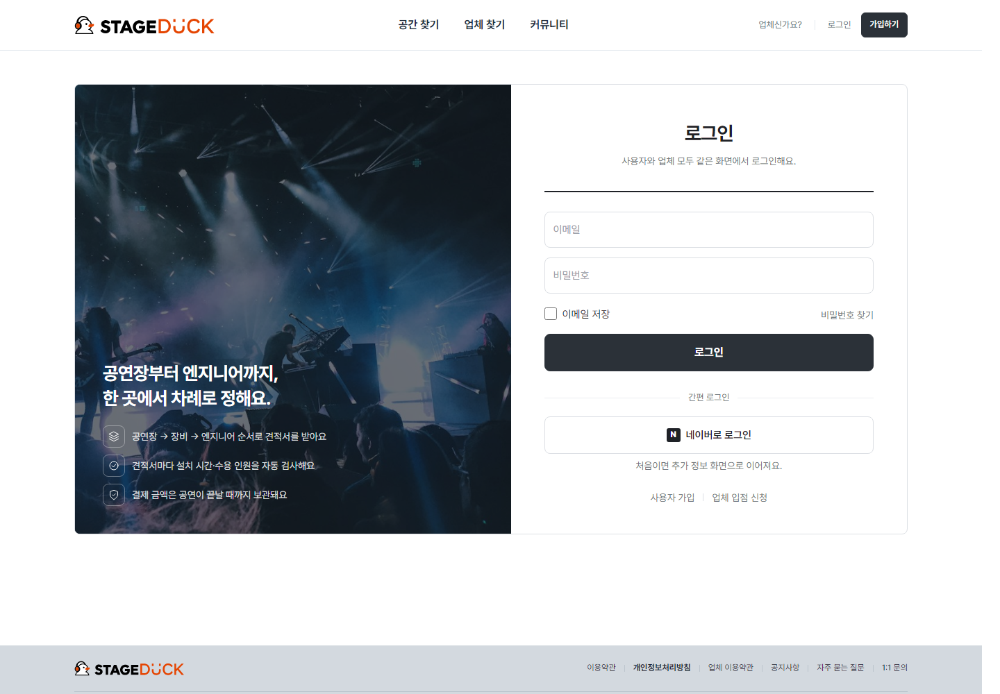

---

## 2. 둘러보기 (로그인 없이)

### 메인 · 업체 메인
메인에서 서비스 흐름과 예시 공간을 보고 [요청서 쓰기]로 시작해요. 업체는 위쪽 [업체신가요?]로 업체 메인에 가요.

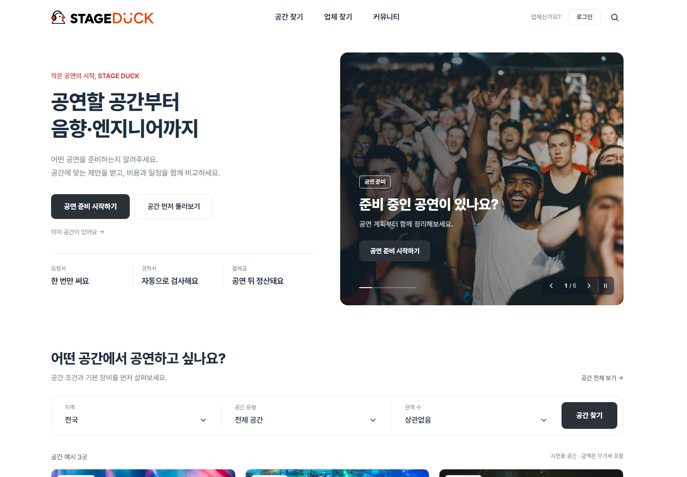

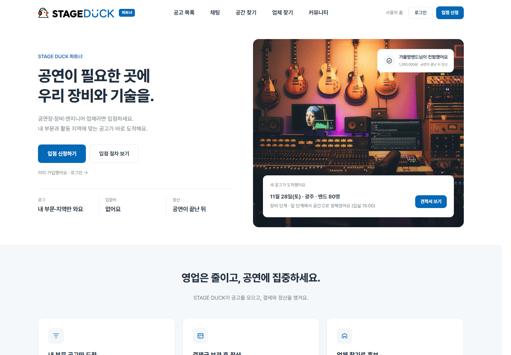

### 공간 찾기
지역·공간 유형·관객 수·공간 조건(밴드 공연 가능, 외부 장비 반입 등)으로 걸러 보고, [공간 찾기]를 눌러야 조건이 적용돼요. 결과가 없으면 [조건 초기화]로 돌아가요.

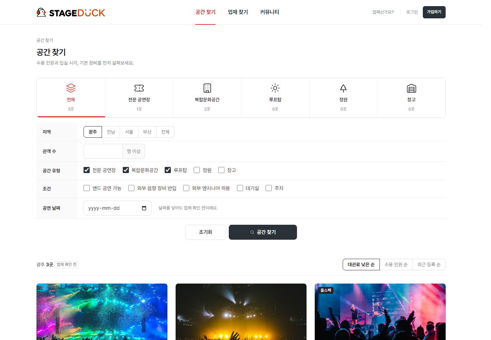

공간을 누르면 사진·수용 인원·입실 시각·대관료·공간 조건이 보여요.

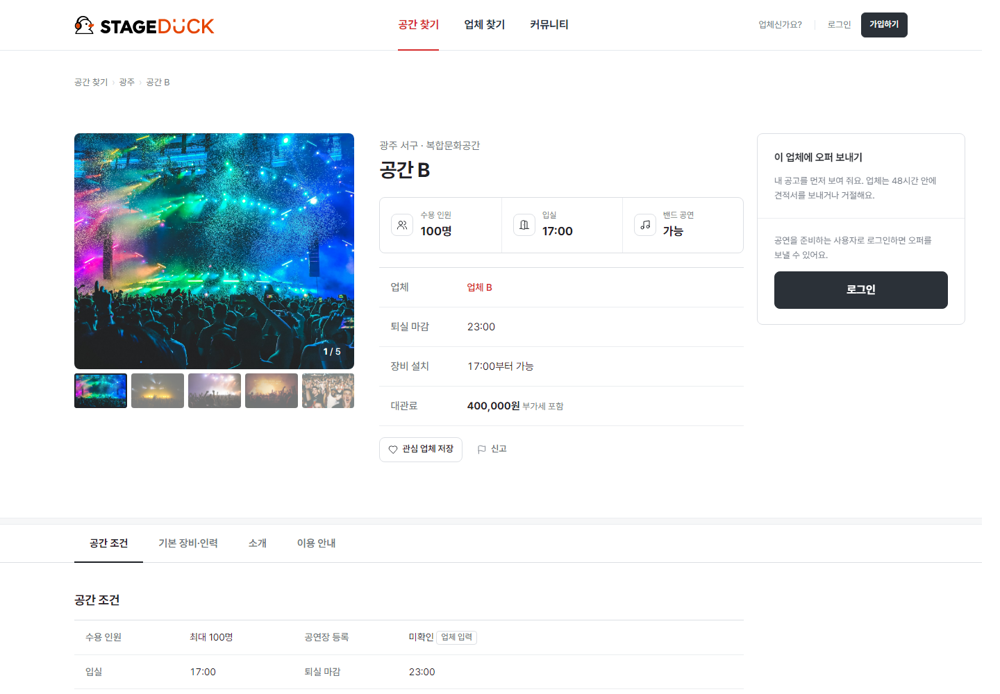

### 업체 찾기 · 커뮤니티
- **업체 찾기**: 업체가 직접 올린 소개 글이에요. 부문(공연장·장비·엔지니어)과 지역으로 걸러 봐요.
- **커뮤니티**: 공연 준비하며 궁금한 것, 알게 된 것을 나누는 게시판이에요. 글쓰기·댓글·도움 돼요·저장·신고는 로그인하면 할 수 있어요.

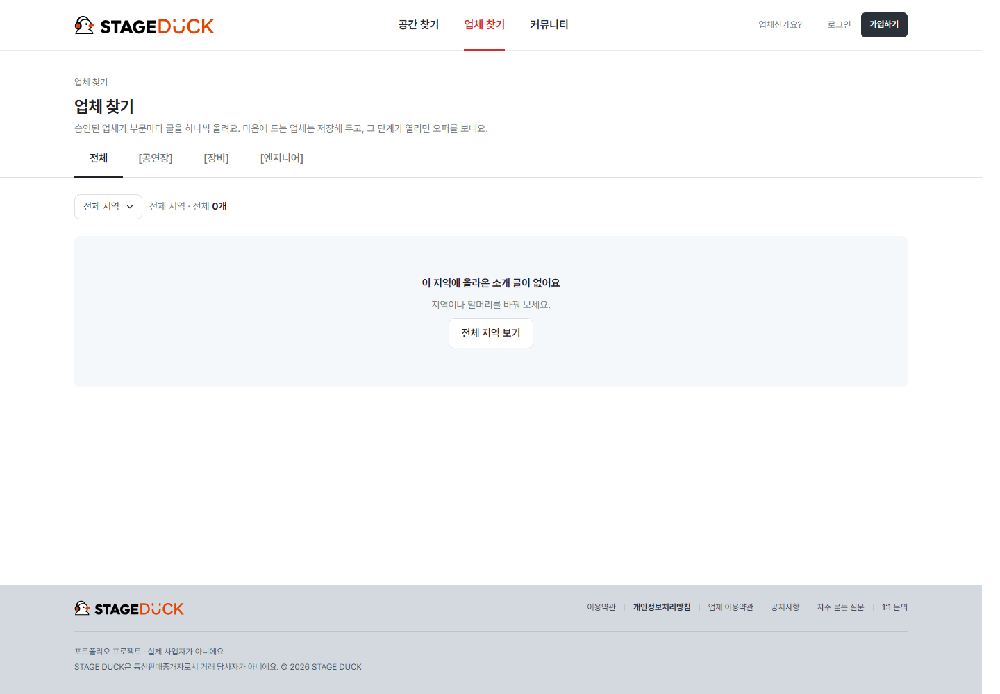

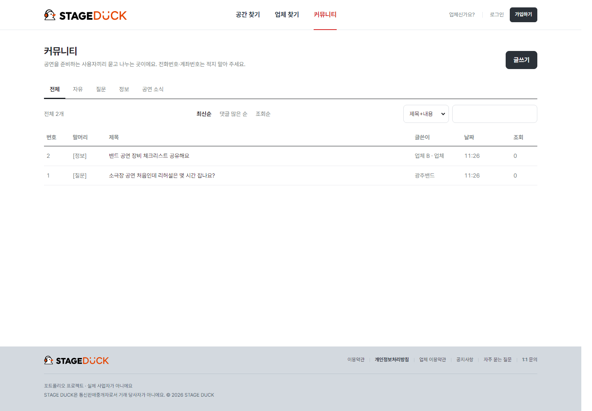

### 고객지원 — 공지사항 · 자주 묻는 질문 · 약관
화면 아래 바닥글에서 들어가요. 고정 공지가 맨 위에 보여요. 자주 묻는 질문은 [사용자]·[업체] 탭과 검색이 있어요.

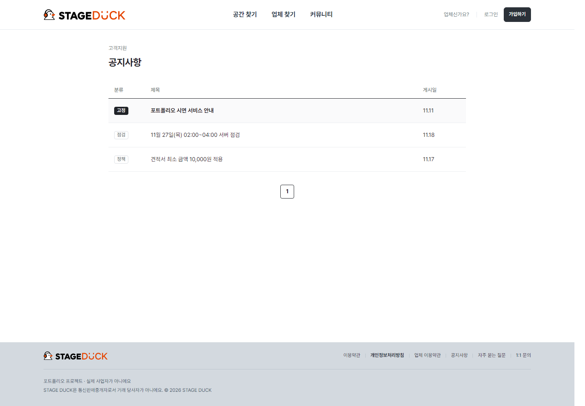

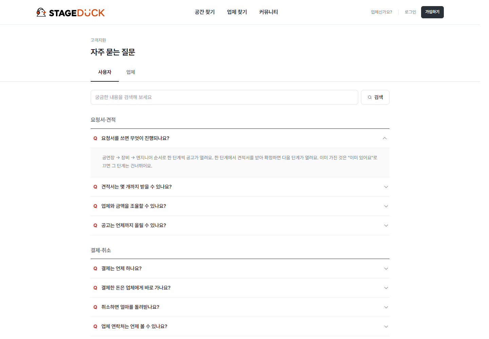

### 가입하기
[가입하기]에서 "공연을 준비해요"(사용자) 또는 "업체로 입점할래요"(업체)를 골라요. 만 14세 이상만 가입할 수 있고, 필수 약관에 동의해야 해요.

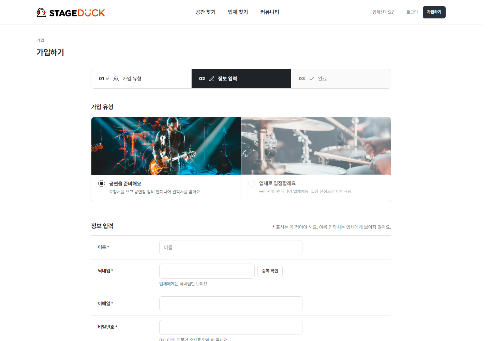

---

## 3. 공연 준비하기 (사용자)

전체 흐름: **요청서 쓰기 → 공고 게시 → (공연장) 견적서 받기 → 비교 → 채팅·확정 → [다음 단계로] → (장비 → 엔지니어 반복) → 통합 청구서 → 테스트 결제**

### 3-1. 요청서 쓰기
위 메뉴 [내 공연] → [+ 새 요청서 쓰기].

**STEP 1 공연 기본 정보**: 공연명, 공연 형태, 편성, 날짜·시간(리허설·공연), 예상 관객, 지역, 대표 전화번호(선택).
- 공연 날짜는 **오늘부터 14일 뒤**부터 고를 수 있어요.
- 리허설은 공연 시작보다 먼저여야 해요. 리허설 시작 전에 장비 설치가 끝나야 해요.
- 전화번호는 결제 전에는 업체에게 보이지 않아요.

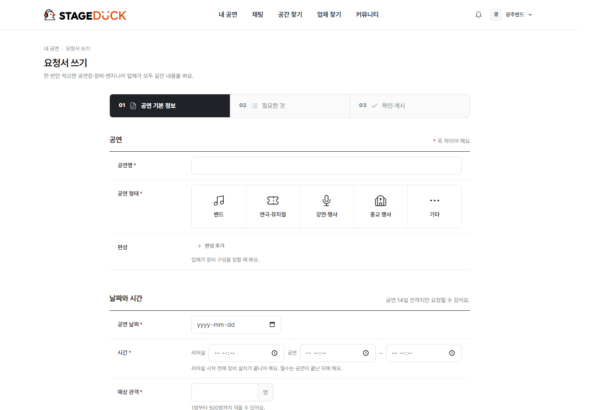

**STEP 2 필요한 것**: 공연장·장비·엔지니어마다 [필요해요]/[이미 있어요]를 골라요.
- [이미 있어요]로 바꾸면 그 단계는 모집하지 않아요.
- 장비를 잘 모르면 "업체 제안 받기"를 켜 두세요.
- 엔지니어가 필요하면 작업을 하나 이상 골라야 해요.

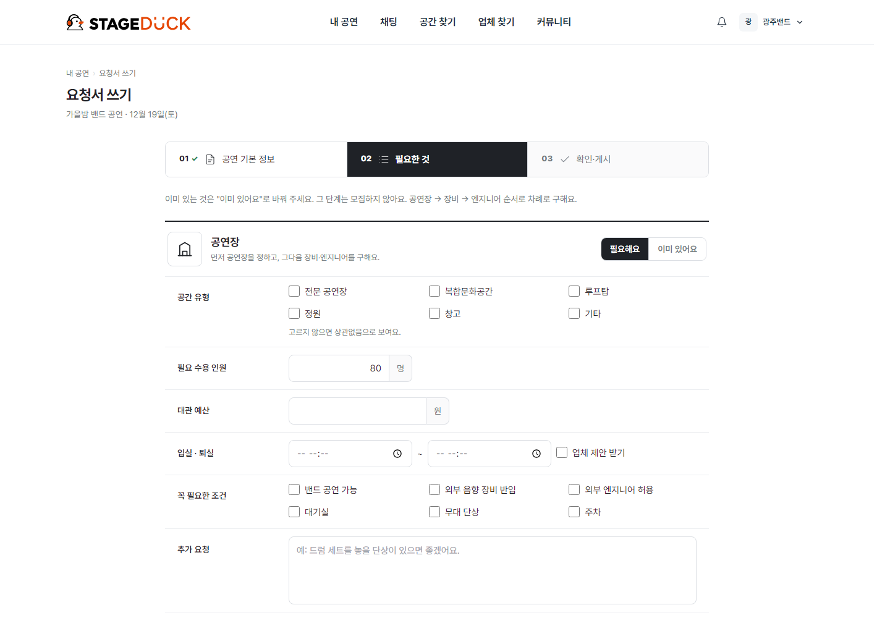

[확인하고 게시하기] → 확인 창에서 [게시하기]. 게시하면 **첫 단계(보통 공연장) 업체에게만** 공고가 보여요.

### 3-2. 내 공연
공연마다 섭외가 어디까지 왔는지(확정 · 조율 중 · 대기)와 지금 할 일이 한 줄로 보여요. 할 일 옆 버튼(단계별 비교 · 다음 단계로 · 청구서 보기)을 누르면 바로 그 화면으로 가요.

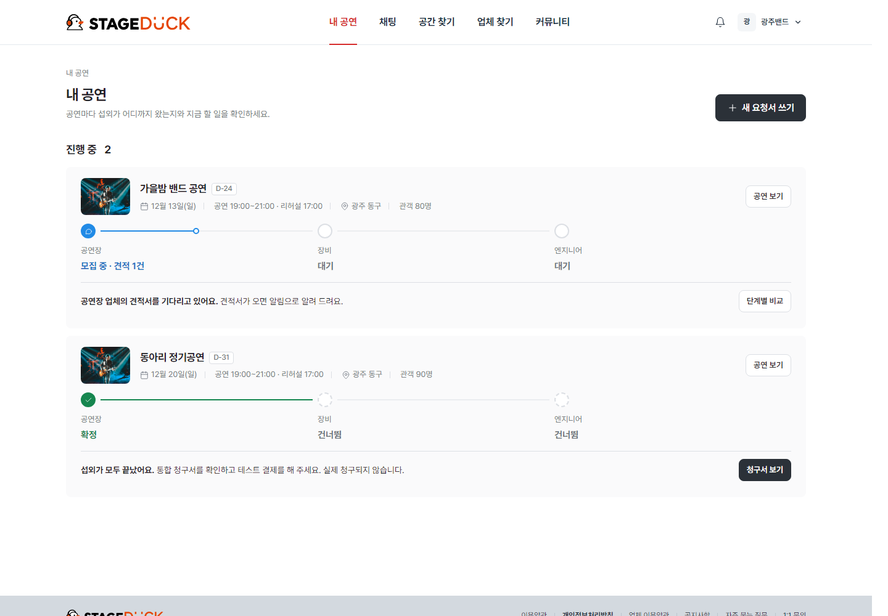

### 3-3. 공연 상세
- **섭외 진행**: 단계별 상태와 받은 견적서 수.
- **STEP 01~03**: 머리줄을 누르면 펼치고 접어요. 확정한 단계는 확정한 견적서(공간·금액)를 보여 줘요.
- 위쪽 [요청서 수정]으로 고치면 새 버전이 생기고, 견적서를 보낸 업체에게 바뀐 항목이 보여요. [공고 내리기]로 공고를 내릴 수 있어요 (채팅 중이었다면 반려로 셀 수 있어요).

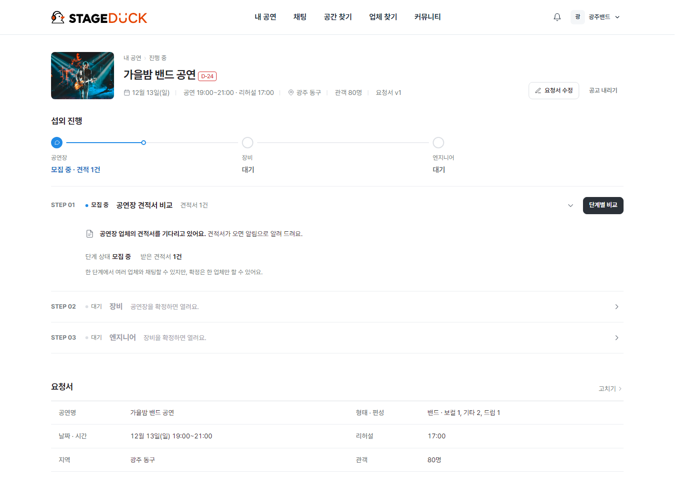

### 3-4. 단계별 견적 비교
받은 견적서를 나란히 비교해요. 금액, 포함 항목(장비·설치·운반·엔지니어), **자동 검사 결과**(수용 인원, 입실·설치 시간 충돌 등)가 함께 보여요.

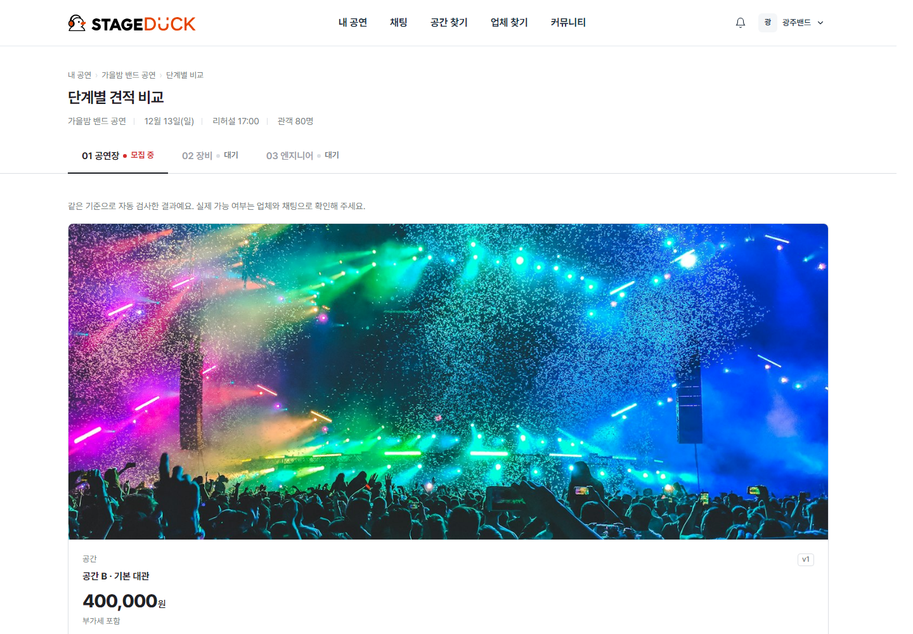

### 3-5. 다음 단계로 · 건너뛰기 · 전부 구했어요
한 단계를 확정하면 공연 상세에 [다음 단계로] 안내가 떠요.
- **[○○ 업체 모집 시작]**: 다음 단계 공고를 열어요.
- **[건너뛰기]**: 그 단계는 직접 준비해요. 책임 고지에 동의해야 해요.
- **[전부 구했어요]**: 남은 단계를 모두 건너뛰고 바로 결제로 가요.

### 3-6. 통합 청구서 · 테스트 결제
필요한 단계가 모두 확정·건너뜀이면 [청구서 보기]가 생겨요.
- 청구서 = 확정한 업체 금액 합계 + **플랫폼 이용료 5%**. 건너뛴 단계는 "건너뜀"으로 보여요.
- 안내 두 개에 동의하면 [결제하기] → 결제 수단(테스트 카드·계좌) → [○○원 결제].
- 결제금은 공연이 끝날 때까지 STAGE DUCK이 보관하고(보관 중), 공연이 끝나면 업체별로 정산 예정이 돼요.

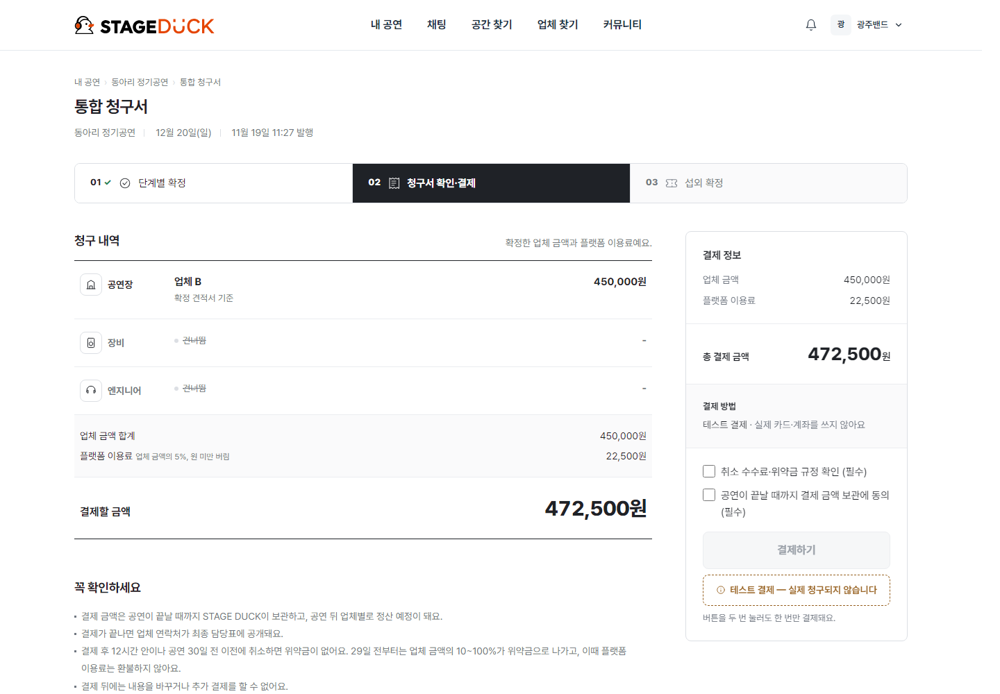

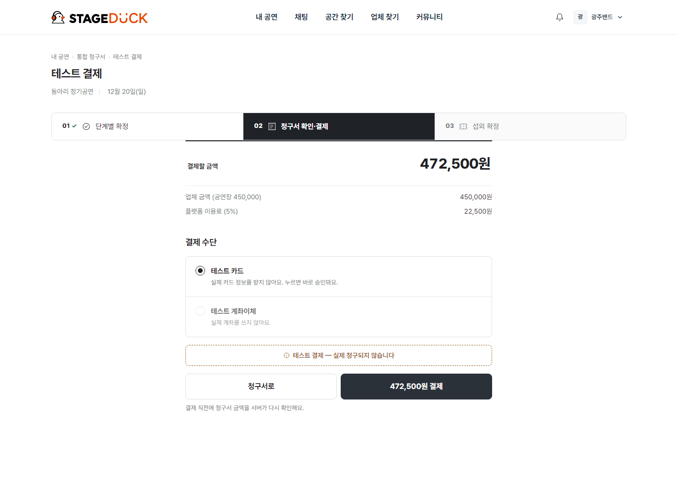

### 3-7. 1:1 문의
바닥글 [1:1 문의]. 유형(결제·환불, 견적·확정, 업체 이용, 계정, 기타)을 고르고, 관련 공연과 사진(3장까지)을 붙일 수 있어요.
- 내 문의만 보여요. 답변이 오기 전에는 고치거나 지울 수 있어요.
- 본문에 전화번호·계좌번호는 적을 수 없어요.

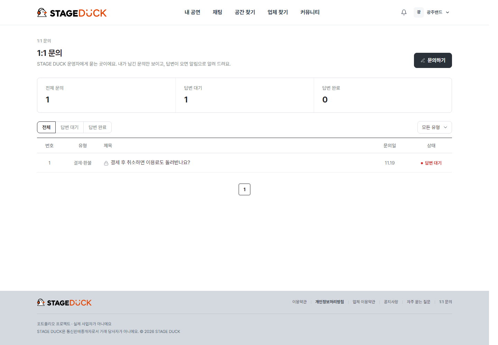

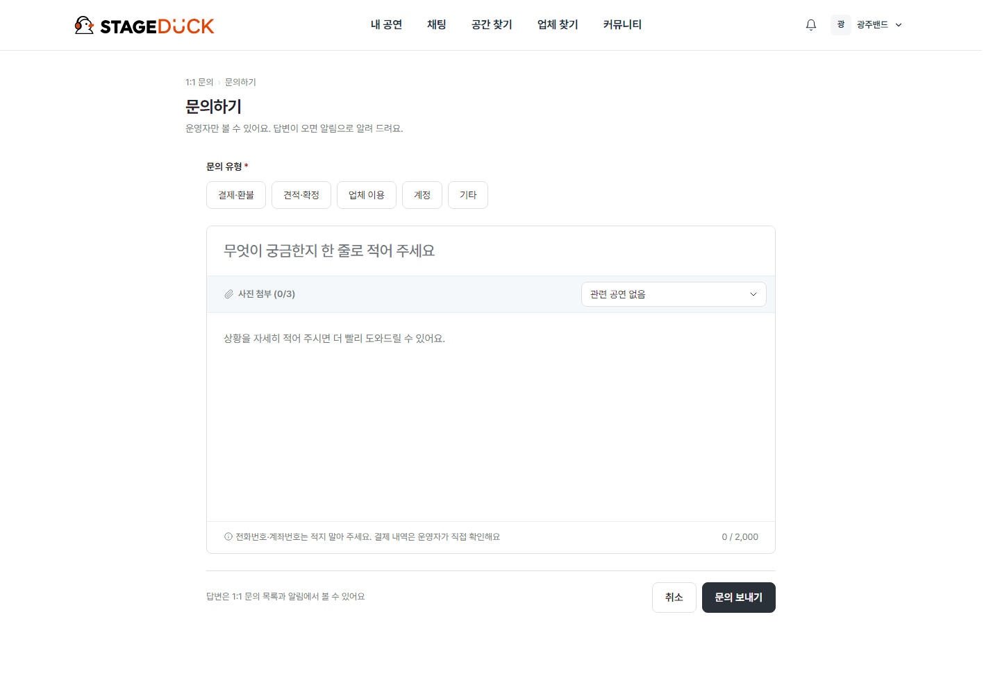

---

## 4. 견적서 보내기 (업체)

전체 흐름: **업체 가입 → 입점 신청(사업자 정보) → 관리자 승인 → 공고 보기 → 견적서 보내기 → 채팅·확정 → 기술 확인 → 공연 → 정산**

### 4-1. 가입 · 입점 신청
[가입하기] → "업체로 입점할래요" → 계정을 만든 뒤 **입점 신청**에서 사업자 정보·서류·부문(공연장·장비·엔지니어)·활동 지역을 내요. 관리자가 승인하기 전까지는 입점·심사 화면만 보여요. 반려되면 사유를 보고 고쳐서 다시 낼 수 있어요.

### 4-2. 공고 목록 · 공고 상세
승인받은 부문과 지역에 맞는 공고만 보여요. 공고 상세에서 공연 정보·요청 내용·사용자 정보(닉네임·이용 횟수·반려 횟수)를 봐요. **사용자의 연락처는 결제 전에는 보이지 않아요.**

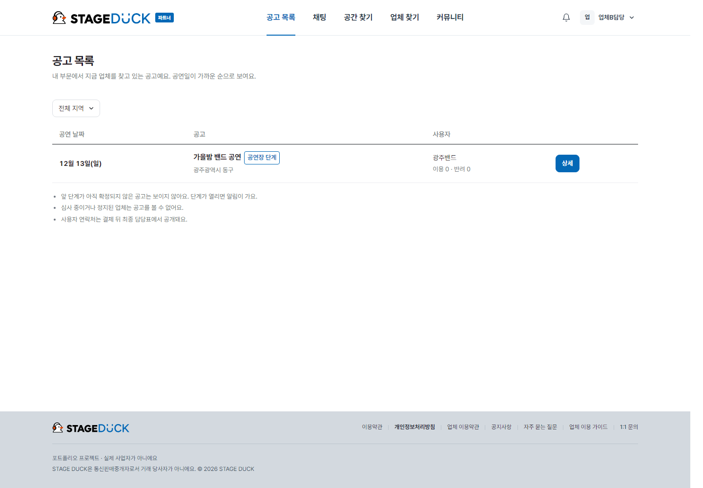

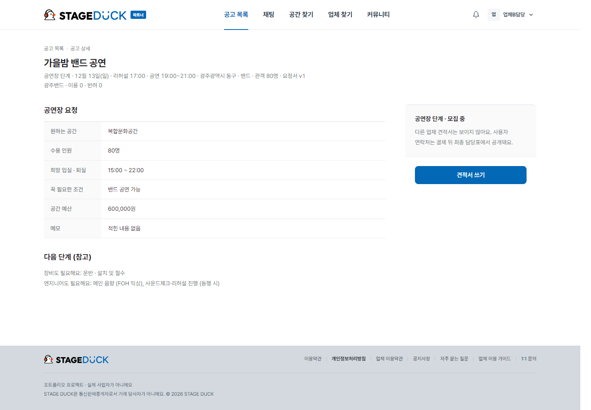

### 4-3. 견적서 쓰기
[견적서 쓰기]에서 견적서 이름(한 공고에 여러 개 가능), 포함 항목, 공간·입실·설치 시각(공연장), 품목·인력·일정·금액을 적어요.
- 금액은 부가세 포함 원 단위, **최종 합계 10,000원 이상**.
- 깎아 주는 금액은 "업체할인" 칸에 적어요.
- 보내면 서버가 자동 검사를 하고 사용자 견적함에 도착해요. 채팅방도 함께 열려요.

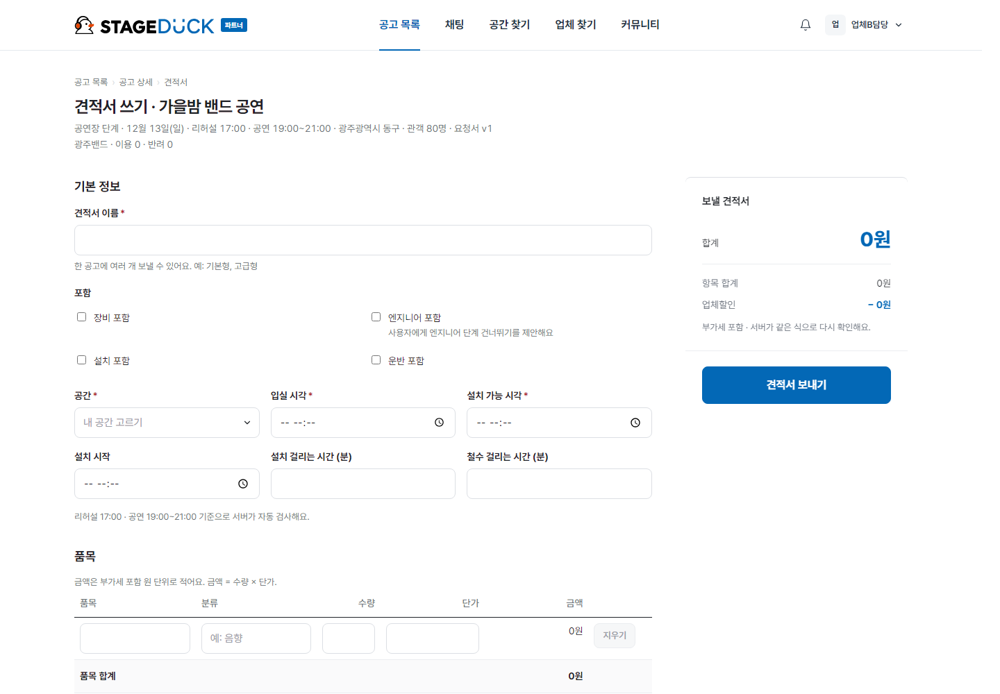

### 4-4. 기술 확인
확정된 공연에서 업체끼리 확인할 항목(전원 위치, 무대 크기 등)에 답해요. **자기 항목에만** 답할 수 있어요.

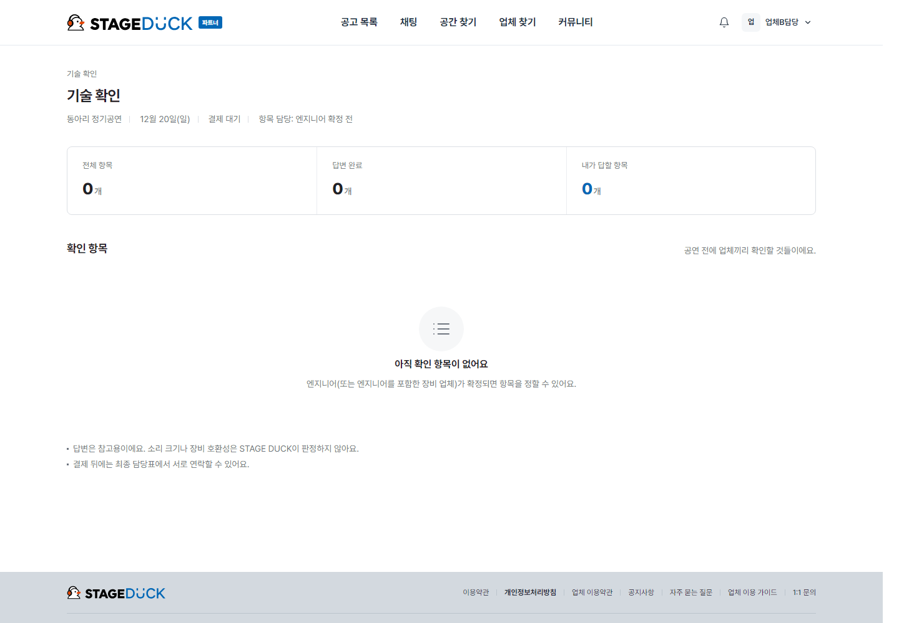

### 4-5. 내 소개 글
업체 찾기에 올릴 소개 글을 부문마다 1개 써요. 규칙을 어긴 글은 관리자가 가리고 경고가 기록돼요.

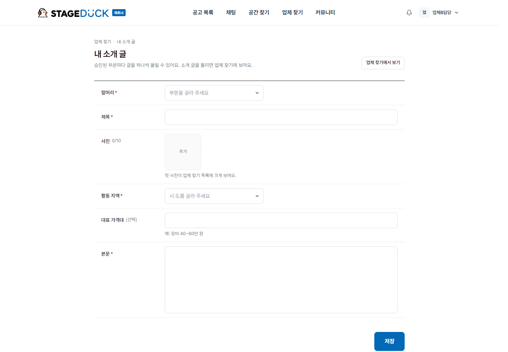

---

## 5. 운영하기 (관리자)

`/admin` 에서 관리자 계정으로 로그인해요. 화면 왼쪽 메뉴에서 고르고, 목록의 행마다 있는 처리 버튼(승인·반려·경고·블라인드·답변 등)을 눌러요. 사유가 필요한 일은 사유 입력 화면이 따로 열리고, 모든 처리는 상태 변경 이력에 남아요.

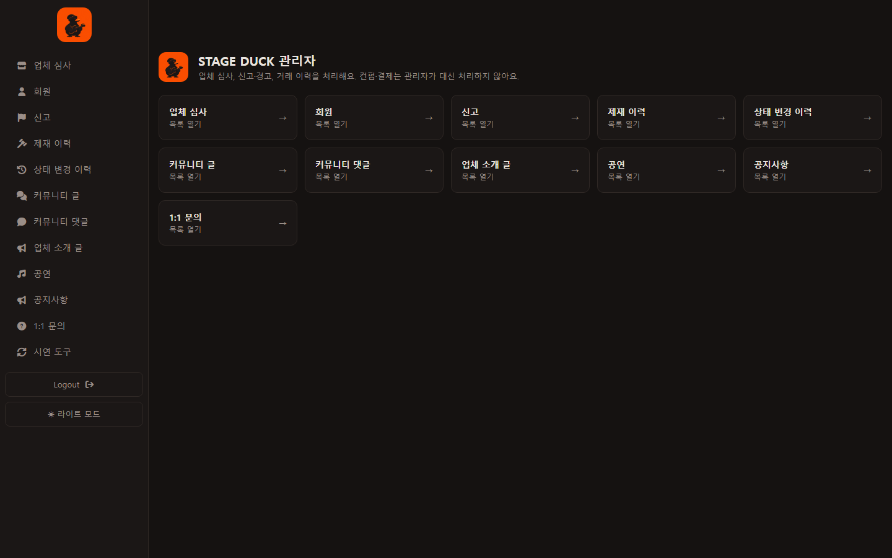

| 메뉴 | 할 일 |
|---|---|
| 업체 심사 | 입점 신청 승인 · 반려(사유) · 정지 · 정지 풀기 |
| 회원 · 신고 · 제재 이력 | 신고 확인 → 경고(3회면 정지) 또는 기각 |
| 커뮤니티 글·댓글 · 업체 소개 글 | 규칙을 어긴 글 블라인드(작성자 경고 1회) · 해제 |
| 공연 | 공연별 상태 변경 이력 보기 |
| 공지사항 | 공지 쓰기 · 고치기 · 지우기 · 상단 고정 |
| 1:1 문의 | 답변 대기부터 보고 [답변] → 문의 내용·첨부 사진 확인 후 답변 보내기 |
| 시연 도구 | 시연 데이터 초기화 (테스트 환경에서만) |

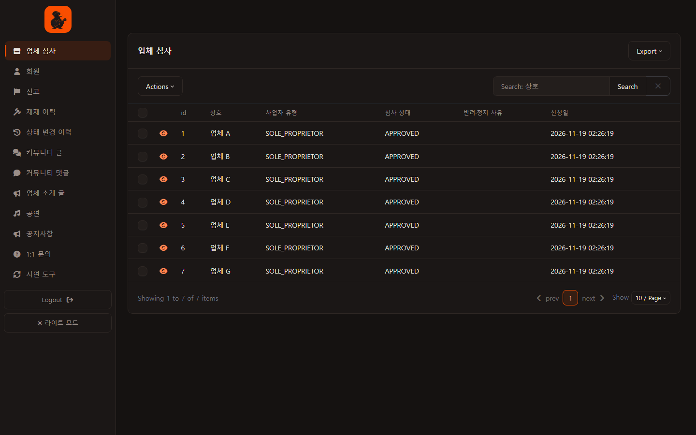

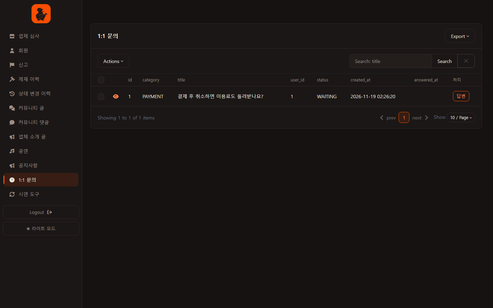

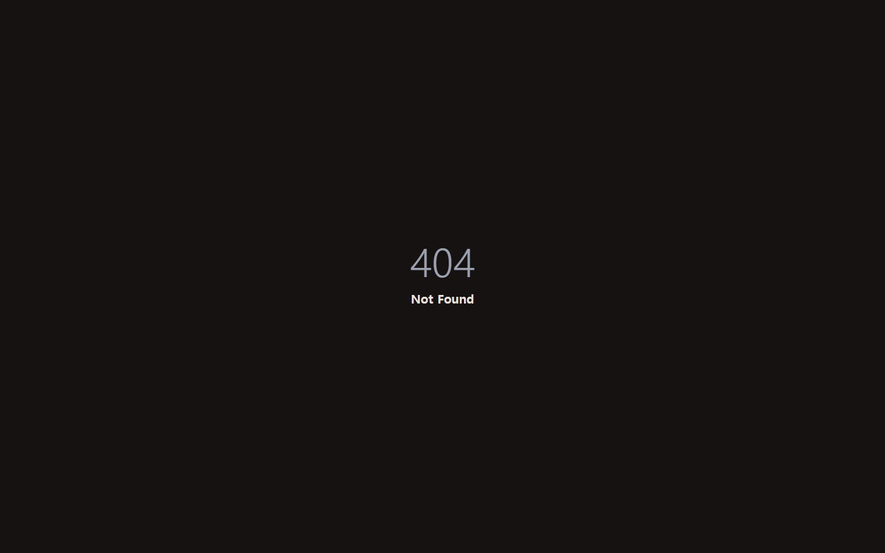

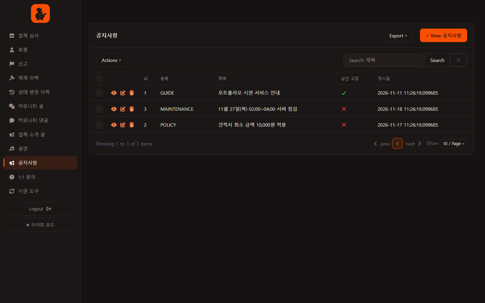

---

## 6. 휴대폰에서
모든 화면이 휴대폰 폭(375px)에 맞춰져요. 위쪽 메뉴는 [☰] 버튼으로 열어요.

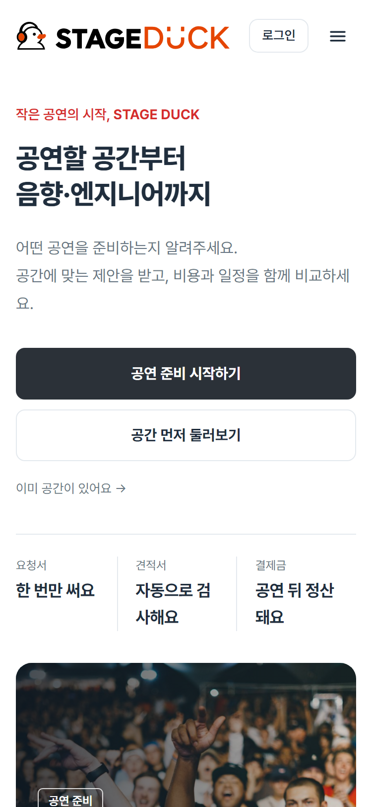
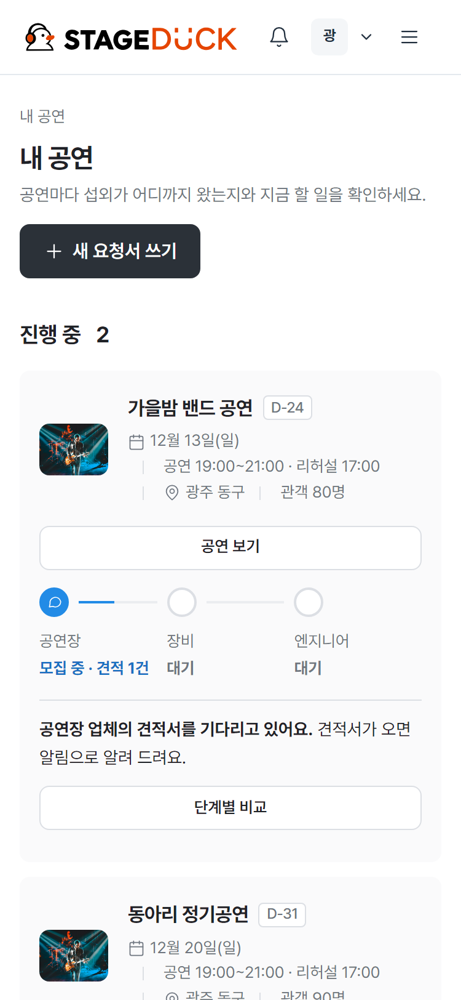

---

## 7. 아직 준비 중인 기능

11/19 기준이에요. 들어오면 이 문서에 화면을 더해요.

| 기능 | 담당 | 지금 |
|---|---|---|
| 채팅 화면(실시간)·견적 내역 확인 카드·**확정** | 채은 (#42·#43) | 채팅 저장·조회 API는 있음, 화면과 확정은 준비 중 |
| 사이트 안 알림 | 채은 (#45) | 준비 중 |
| 연락처 감지 경고·자동 마감 알림 | 채은 (#44) | 일부 |
| 결제 뒤 공연 상태 "결제 완료" 반영 | 목산 | 약속 함수는 준비됨, 결제 쪽 연결 한 줄 남음 |
| 취소·위약금·업체 사정 취소 | 목산 (#52) | 계산 함수는 있음, 화면·API 준비 중 |
| 최종 담당표 (결제 후 연락처 공개) | 목산 (#53) | 준비 중 |
| 직접 오퍼·관심 업체 | 세환 (#32) | 준비 중 |
| 프로필·마이페이지 | 세환 (#33) | 준비 중 |
| 네이버 로그인 | 세환 (#25) | 준비 중 |
| 로그인 화면 "시연 계정으로 들어가기" | 세환 | 시드 계정 목록 API 필요 |

---

## 8. 자주 헷갈리는 규칙

| 규칙 | 내용 |
|---|---|
| 요청 기한 | 공연 날짜 14일 전까지 공고를 올릴 수 있어요 |
| 섭외 순서 | 공연장 → 장비 → 엔지니어. 한 단계를 확정하고 [다음 단계로]를 눌러야 다음 업체에게 공고가 열려요 |
| 견적서 최소 금액 | 최종 합계 10,000원 이상 (부가세 포함) |
| 플랫폼 이용료 | 사용자가 업체 금액 합계의 5%를 내요. 업체는 입점비·수수료가 없어요 |
| 연락처 | 결제 전에는 사용자·업체의 전화번호·이메일이 서로 보이지 않아요. 채팅으로만 연락해요 |
| 반려·게시 제한 | 견적서를 받은 공고를 여러 번 내리면 일정 기간 새 공고를 게시할 수 없어요 (180일 동안 채팅 후 5회 또는 견적서만 받고 10회) |
| 경고·정지 | 신고가 확인되거나 글이 가려지면 경고 1회, 3회면 이용이 정지돼요. 정지돼도 1:1 문의는 쓸 수 있어요 |
| 비밀번호 찾기 | 링크는 30분 동안 한 번만 쓸 수 있고, 같은 이메일은 10분에 3번까지 요청할 수 있어요 |
| 결제 | 테스트 결제예요. 실제로 청구되지 않아요 |
