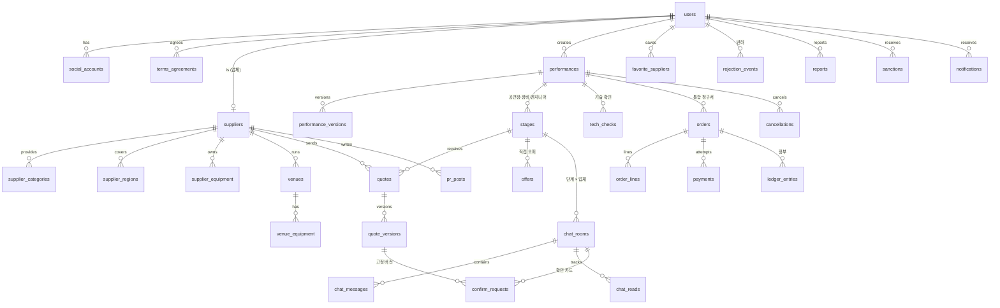

# STAGE DUCK 데이터 모델 (data-model.md)

| 항목 | 내용 |
|---|---|
| 버전 | 0.1 (초안) |
| 작성일 | 2026-11-12 |
| DB | MariaDB 11.4, InnoDB, `utf8mb4` / `utf8mb4_unicode_ci` |
| ORM | SQLAlchemy 2.0, 마이그레이션 Alembic |
| 입력 | [spec.md](spec.md), [plan.md](plan.md) |

## 공통 규칙
- 이름: 테이블·컬럼 `snake_case`, 테이블은 복수형. PK는 `id BIGINT UNSIGNED AUTO_INCREMENT`.
- 모든 테이블에 `created_at DATETIME(3) NOT NULL DEFAULT CURRENT_TIMESTAMP(3)`, 바뀌는 테이블은 `updated_at`도 둔다 (아래 표에서는 생략).
- 시간: `DATETIME(3)`은 KST로 저장한다 (서버·DB 타임존 `+09:00` 고정). 하루 안의 시각은 `TIME`, 날짜는 `DATE`.
- 금액: `INT UNSIGNED` (원, 부가세 포함). 1건 최대 약 42억 원으로 충분.
- 상태값: `ENUM` 대신 `VARCHAR(20)` + `CHECK (... IN (...))` — 값 추가 때 마이그레이션이 쉽다.
- 삭제: 회원·업체·게시글은 소프트 삭제(상태값). 버전·이력·장부 테이블은 수정·삭제하지 않는다 (추가만).
- MariaDB에는 조건부 유니크 인덱스가 없으므로, **"조건에 맞을 때만 값이 있는 생성 컬럼(PERSISTENT) + 유니크 인덱스"** 로 대신한다. 조건이 아니면 NULL이 되고, NULL은 유니크 검사에서 빠진다.

---

## 1. ERD



`status_histories`는 모든 상태 변경을 기록하는 공용 테이블이라 관계선을 생략했다.

---

## 2. 회원·업체 (F1)

### users
| 컬럼 | 타입 | 제약 | 설명 |
|---|---|---|---|
| id | BIGINT UNSIGNED | PK | |
| role | VARCHAR(20) | NOT NULL, CHECK IN ('USER','SUPPLIER','ADMIN') | 한 계정 한 역할 |
| email | VARCHAR(255) | NOT NULL, UNIQUE | 로그인 아이디 (업체는 회사 이메일) |
| password_hash | VARCHAR(255) | NULL | 소셜 전용 가입자는 NULL |
| name | VARCHAR(50) | NOT NULL | 사용자 이름 / 업체 담당자 이름 |
| phone | VARCHAR(20) | NOT NULL | 숫자만 저장 |
| birth_date | DATE | NULL | 사용자 필수(서비스 검사), 업체 NULL |
| nickname | VARCHAR(30) | NULL, UNIQUE | 사용자 필수, 마이페이지에서 변경 (FR-PROFILE-02) |
| profile_image_url | VARCHAR(255) | NULL | 개인 프로필 사진 (선택) |
| signup_purpose | VARCHAR(30) | NULL | 사용자 필수 |
| musician_type | VARCHAR(20) | NULL | 밴드 / 극단 / 교회 / 학원 / 기타 |
| signup_channel | VARCHAR(30) | NULL | 가입 경로 |
| status | VARCHAR(20) | NOT NULL DEFAULT 'ACTIVE', CHECK IN ('ACTIVE','SUSPENDED','WITHDRAWN') | |
| warning_count | TINYINT UNSIGNED | NOT NULL DEFAULT 0 | 3이면 SUSPENDED |
| failed_login_count | TINYINT UNSIGNED | NOT NULL DEFAULT 0 | |
| locked_until | DATETIME(3) | NULL | 5회 실패 시 +10분 |

> 주소 컬럼 없음 (D-15). 만 14세 검사는 서비스에서 (`birth_date` 기준).

### social_accounts
| 컬럼 | 타입 | 제약 |
|---|---|---|
| id | BIGINT UNSIGNED | PK |
| user_id | BIGINT UNSIGNED | FK → users, NOT NULL |
| provider | VARCHAR(10) | CHECK IN ('NAVER','KAKAO') |
| provider_user_id | VARCHAR(100) | NOT NULL |
| connected_at | DATETIME(3) | NOT NULL |
| | | **UNIQUE (provider, provider_user_id)** — 같은 이메일이어도 자동 병합하지 않음 |

### terms_agreements
| 컬럼 | 타입 | 제약 |
|---|---|---|
| id | BIGINT UNSIGNED | PK |
| user_id | BIGINT UNSIGNED | FK → users |
| terms_type | VARCHAR(20) | CHECK IN ('SERVICE','PRIVACY_REQUIRED','PRIVACY_OPTIONAL','MARKETING') |
| terms_version | VARCHAR(10) | NOT NULL |
| agreed | BOOLEAN | NOT NULL |
| agreed_at | DATETIME(3) | NOT NULL |

### suppliers
| 컬럼 | 타입 | 제약 | 설명 |
|---|---|---|---|
| id | BIGINT UNSIGNED | PK | |
| user_id | BIGINT UNSIGNED | FK → users, UNIQUE | 업체 계정 1:1 |
| business_type | VARCHAR(20) | CHECK IN ('INDIVIDUAL','SOLE_PROPRIETOR','CORPORATION') | 개인(프리랜서) / 개인사업자 / 법인 |
| company_name | VARCHAR(100) | NOT NULL | 개인은 활동명 |
| representative_name | VARCHAR(50) | NOT NULL | |
| business_reg_no | CHAR(10) | NULL | 개인 NULL, 그 외 필수(서비스 검사) + 체크섬 |
| business_reg_file | VARCHAR(255) | NULL | 등록증 사본 경로 |
| business_address | VARCHAR(255) | NULL | 개인은 NULL (활동 지역 사용) |
| main_phone | VARCHAR(20) | NOT NULL | |
| mail_order_no | VARCHAR(50) | NULL | 통신판매업 신고번호, NULL = 해당 없음 |
| intro | TEXT | NULL | 3단계 |
| photo_url | VARCHAR(255) | NULL | |
| setup_minutes | SMALLINT UNSIGNED | NULL | 기본 설치 소요 (설치·철수 부문) |
| teardown_minutes | SMALLINT UNSIGNED | NULL | |
| engineer_years | TINYINT UNSIGNED | NULL | |
| band_experience | BOOLEAN | NULL | |
| has_liability_insurance | BOOLEAN | NULL | 신뢰 지표, 선택 |
| sound_certification | VARCHAR(100) | NULL | 신뢰 지표, 선택 |
| review_status | VARCHAR(20) | NOT NULL DEFAULT 'PENDING', CHECK IN ('PENDING','APPROVED','REJECTED','SUSPENDED') | 심사 상태 |
| reject_reason | VARCHAR(500) | NULL | 반려·정지 사유 |
| approved_at | DATETIME(3) | NULL | |

### supplier_categories · supplier_regions · supplier_equipment
| 테이블 | 컬럼 | 제약 |
|---|---|---|
| supplier_categories | supplier_id, category VARCHAR(20) CHECK IN ('VENUE','EQUIPMENT','INSTALL','ENGINEER') | PK (supplier_id, category) |
| supplier_regions | supplier_id, sido VARCHAR(20) | PK (supplier_id, sido) |
| supplier_equipment | id PK, supplier_id FK, category CHECK IN ('SOUND','VIDEO','INSTRUMENT','LIGHTING'), name VARCHAR(100), quantity SMALLINT NULL | 자유 입력 (표준 품목 없음) |

---

## 3. 공간 (F2)

### venues
| 컬럼 | 타입 | 제약 | 설명 |
|---|---|---|---|
| id | BIGINT UNSIGNED | PK | |
| supplier_id | BIGINT UNSIGNED | FK → suppliers | |
| name | VARCHAR(100) | NOT NULL | |
| sido · sigungu | VARCHAR(20) · VARCHAR(30) | NOT NULL | 인덱스 (sido, sigungu) |
| address | VARCHAR(255) | NOT NULL | 가상 주소 |
| venue_type | VARCHAR(20) | CHECK IN ('CONCERT_HALL','CULTURE_SPACE','ROOFTOP','GARDEN','WAREHOUSE','ETC') | |
| max_capacity | SMALLINT UNSIGNED | NOT NULL, CHECK BETWEEN 1 AND 500 | AC-F2-01 |
| checkin_time · checkout_time | TIME | NOT NULL, **CHECK (checkout_time > checkin_time)** | AC-F2-02, 자정 넘김 미지원 |
| rental_fee | INT UNSIGNED | NOT NULL | 대관료 기준 |
| has_resident_engineer | BOOLEAN | NOT NULL DEFAULT FALSE | 풀스펙 판단 참고 |
| band_allowed · external_equipment_allowed · external_engineer_allowed · has_waiting_room · has_stage_platform · has_parking | BOOLEAN | **NULL = 미확인** | 공간 조건 (CHK-03) |
| hall_registered | BOOLEAN | NULL | 공연법상 공연장 등록, 선택 |
| photo_url | VARCHAR(255) | NULL | |
| status | VARCHAR(20) | DEFAULT 'ACTIVE', CHECK IN ('ACTIVE','HIDDEN') | 관리자 숨김 |

### venue_equipment
`id PK, venue_id FK, category, name, quantity` — 기본 제공 장비.

> 확정된 공연의 공간 조건은 `quote_versions.venue_snapshot`(JSON)에 복사해 둔다 → 원본 수정과 무관 (AC-F2-03).

---

## 4. 요청서·단계·견적서 (F2, F3)

### performances
| 컬럼 | 타입 | 제약 | 설명 |
|---|---|---|---|
| id | BIGINT UNSIGNED | PK | |
| user_id | BIGINT UNSIGNED | FK → users | 작성 사용자 |
| status | VARCHAR(20) | CHECK IN ('DRAFT','PUBLISHED','ASSIGNING','AWAITING_PAYMENT','CONFIRMED','COMPLETED','CANCELLED','WITHDRAWN') | |
| current_version | INT UNSIGNED | NOT NULL DEFAULT 1 | |
| title | VARCHAR(100) | NOT NULL | 현재 버전 값 (조회용) |
| form | VARCHAR(20) | CHECK IN ('BAND','THEATER','TALK_EVENT','RELIGIOUS','ETC') | |
| show_date | DATE | NOT NULL | 오늘 + 3일 이후 (서비스 검사) |
| rehearsal_start · show_start · show_end | TIME | **CHECK (rehearsal_start < show_start AND show_start < show_end)** | AC-F2-05 |
| audience | SMALLINT UNSIGNED | **CHECK BETWEEN 1 AND 500** | AC-F2-04 |
| sido · sigungu | VARCHAR | NOT NULL | 공고 지역 필터 |
| contact_phone | VARCHAR(20) | NULL | 결제 후에만 공개 |
| needs | JSON | NOT NULL | STEP2 전체 (아래 구조) |
| published_at | DATETIME(3) | NULL | |

`needs` JSON 구조:
```json
{
  "venue":    { "needed": true,  "proposalWanted": false, "types": ["CULTURE_SPACE"], "capacity": 80,
                "budget": 600000, "checkinWish": "15:00", "checkoutWish": "22:00",
                "mustHave": ["BAND_ALLOWED","EXTERNAL_EQUIPMENT","WAITING_ROOM"], "note": "" },
  "equipment":{ "needed": true,  "proposalWanted": true, "items": [{"name":"보컬 마이크","qty":4}],
                "services": ["TRANSPORT","INSTALL"], "budget": 1500000,
                "owned": [{"name":"드럼 세트","detail":"심벌 포함, 킥 페달 1"}] },
  "engineer": { "needed": true,  "tasks": ["FOH","INSTALL_ASSIST","SOUNDCHECK"], "conditions": ["BAND_EXPERIENCE"], "etc": "" },
  "ownedVenue": null
}
```

### performance_versions
| 컬럼 | 타입 | 제약 |
|---|---|---|
| id | BIGINT UNSIGNED | PK |
| performance_id | BIGINT UNSIGNED | FK |
| version | INT UNSIGNED | **UNIQUE (performance_id, version)** |
| snapshot | JSON | 그 버전의 STEP1+STEP2 전체 |
| changed_fields | JSON | 이전 버전과 달라진 항목 (업체 화면 "v1 → v2" 표시) |

### stages (배정 단계)
| 컬럼 | 타입 | 제약 | 설명 |
|---|---|---|---|
| id | BIGINT UNSIGNED | PK | |
| performance_id | BIGINT UNSIGNED | FK | |
| stage_type | VARCHAR(20) | CHECK IN ('VENUE','EQUIPMENT','ENGINEER') | **UNIQUE (performance_id, stage_type)** |
| seq | TINYINT UNSIGNED | 1·2·3 | 순서 |
| status | VARCHAR(20) | CHECK IN ('WAITING','OPEN','NEGOTIATING','CONFIRMED','SKIPPED','RECHECK') | |
| confirmed_quote_version_id | BIGINT UNSIGNED | NULL, FK → quote_versions | 컨펌된 견적서 버전 (스냅샷) |
| skip_ack_at · skip_ack_text_version | DATETIME(3) · VARCHAR(10) | NULL | 건너뛰기 책임 고지 동의 |
| opened_at · confirmed_at | DATETIME(3) | NULL | |
| **open_guard** | BIGINT UNSIGNED | **PERSISTENT = IF(status IN ('OPEN','NEGOTIATING'), performance_id, NULL)**, **UNIQUE** | 공연당 열린 단계 1개 (AC-F3-01) |

### quotes · quote_versions
| 테이블 | 컬럼 | 제약 | 설명 |
|---|---|---|---|
| quotes | id PK, stage_id FK, supplier_id FK, label VARCHAR(30) | | 기본형/고급형 등 — 업체당 여러 개 (D-6) |
| | current_version INT UNSIGNED | | |
| | status VARCHAR(20) | CHECK IN ('SENT','CLOSED','WITHDRAWN','EXPIRED','CONFIRMED') | CLOSED = 다른 견적서 컨펌으로 자동 마감 |
| | is_full_spec BOOLEAN | DEFAULT FALSE | 공연장 견적서 "풀스펙" |
| | offer_id BIGINT NULL | FK → offers | 오퍼로 온 견적서 표시 |
| quote_versions | id PK, quote_id FK, version | **UNIQUE (quote_id, version)** | 수정할 때마다 추가 |
| | based_on_perf_version INT UNSIGNED | NOT NULL | CHK-12 |
| | venue_id BIGINT NULL, venue_snapshot JSON NULL | | 공연장 견적서: 공간 조건 복사 |
| | checkin_time TIME NULL, setup_available_time TIME NULL | | CHK-02, CHK-04 |
| | setup_start TIME NULL, setup_minutes SMALLINT NULL, teardown_minutes SMALLINT NULL | | CHK-04·05·07 |
| | staff JSON | | [{role, count, start, end}] CHK-08 |
| | items JSON | | [{name, category, qty, unitPrice, amount}] |
| | includes_equipment · includes_engineer · includes_install · includes_transport | BOOLEAN | 풀스펙·CHK-09 |
| | amount_items · amount_transport · amount_install · amount_labor · amount_etc | INT UNSIGNED | |
| | total_amount | INT UNSIGNED, **CHECK (total_amount = amount_items + amount_transport + amount_install + amount_labor + amount_etc)** | AC-F2-17 |
| | extra_cost_note VARCHAR(500), valid_until DATE, tech_note TEXT | | |

---

## 5. 오퍼·관심 업체 (F3)

| 테이블 | 컬럼 | 제약 |
|---|---|---|
| offers | id PK, stage_id FK, user_id FK, supplier_id FK, status CHECK IN ('PENDING','QUOTED','DECLINED','EXPIRED'), decline_reason, expires_at | **UNIQUE (stage_id, supplier_id)**. 단계당 10개 제한은 서비스에서 `SELECT COUNT … FOR UPDATE` (AC-F3-17) |
| favorite_suppliers | user_id, supplier_id | PK (user_id, supplier_id) |

## 6. 채팅·컨펌 (F3)

### chat_rooms
| 컬럼 | 타입 | 제약 | 설명 |
|---|---|---|---|
| id | BIGINT UNSIGNED | PK | |
| stage_id | BIGINT UNSIGNED | FK | |
| supplier_id | BIGINT UNSIGNED | FK | |
| user_id | BIGINT UNSIGNED | FK | 공연 작성자 (조회 편의) |
| started_at | DATETIME(3) | NULL | 사용자가 [채팅 시작]을 누른 시각 = 컨택. NULL이면 업체 메시지 불가 (AC-F3-06) |
| | | **UNIQUE (stage_id, supplier_id)** | 업체가 견적서 여러 개여도 방은 하나 |

### chat_messages
| 컬럼 | 타입 | 제약 |
|---|---|---|
| id | BIGINT UNSIGNED | PK, 방별 정렬 기준 |
| room_id | BIGINT UNSIGNED | FK, 인덱스 (room_id, id) |
| sender_user_id | BIGINT UNSIGNED | NULL = 시스템 |
| type | VARCHAR(20) | CHECK IN ('TEXT','IMAGE','FILE','QUOTE','CONFIRM_REQUEST','CONFIRMED','NOTICE') |
| body | TEXT | NULL |
| attachment_url | VARCHAR(255) | NULL |
| ref_id | BIGINT UNSIGNED | NULL — quote_version_id 또는 confirm_request_id |
| contact_warning | BOOLEAN | DEFAULT FALSE — 연락처·계좌 패턴 감지 (AC-F3-15) |

### chat_reads
`room_id, user_id, last_read_message_id` — PK (room_id, user_id). 읽음 표시 (AC-F3-08).

### confirm_requests (견적 내역 확인 카드)
| 컬럼 | 타입 | 제약 | 설명 |
|---|---|---|---|
| id | BIGINT UNSIGNED | PK | |
| room_id | BIGINT UNSIGNED | FK | |
| quote_version_id | BIGINT UNSIGNED | FK, NOT NULL | 고정된 버전 |
| status | VARCHAR(20) | CHECK IN ('PENDING','CONFIRMED','RENEGOTIATE','EXPIRED','INVALIDATED') | |
| expires_at | DATETIME(3) | NOT NULL | 보낸 시각 + 48시간 |
| viewed_at | DATETIME(3) | NULL | 내역서 열람 — NULL이면 컨펌 불가 (AC-F3-10) |
| decided_at | DATETIME(3) | NULL | |
| **pending_guard** | BIGINT UNSIGNED | PERSISTENT = IF(status='PENDING', room_id, NULL), UNIQUE | 방당 대기 카드 1장 |

> 단계당 컨펌 1개는 `stages` 행 잠금 + `stages.status` 검사로 보장한다 (plan.md 5.3).

## 7. 기술 확인 (F3)

### tech_checks
| 컬럼 | 타입 | 제약 |
|---|---|---|
| id | BIGINT UNSIGNED | PK |
| performance_id | BIGINT UNSIGNED | FK |
| item | VARCHAR(200) | 엔지니어가 정한 항목 (재량) |
| created_by_supplier_id | BIGINT UNSIGNED | FK — 엔지니어(또는 엔지니어 포함 장비 업체) |
| owner_supplier_id | BIGINT UNSIGNED | FK — 답변 담당 (공연장 또는 장비) (AC-F3-25) |
| answer | VARCHAR(20) | CHECK IN ('UNCONFIRMED','OK','CONDITIONAL','IMPOSSIBLE','RECHECK') |
| memo | VARCHAR(500) | NULL |
| target_perf_version · target_quote_version_id | INT · BIGINT | 답변 당시 버전 |
| answered_at | DATETIME(3) | NULL |

## 8. 결제·장부·취소 (F5)

### orders (통합 청구서)
| 컬럼 | 타입 | 제약 | 설명 |
|---|---|---|---|
| id | BIGINT UNSIGNED | PK | |
| performance_id | BIGINT UNSIGNED | FK | |
| status | VARCHAR(25) | CHECK IN ('ISSUED','PAID','SETTLEMENT_SCHEDULED','CANCELLED') | |
| items_total | INT UNSIGNED | | 확정 견적서 합 |
| platform_fee | INT UNSIGNED | | 청구서에 표시 (D-18) |
| total_amount | INT UNSIGNED | **CHECK (total_amount = items_total + platform_fee)** | |
| issued_at · paid_at | DATETIME(3) | | |
| **active_guard** | BIGINT UNSIGNED | PERSISTENT = IF(status IN ('ISSUED','PAID','SETTLEMENT_SCHEDULED'), performance_id, NULL), UNIQUE | 공연당 유효 청구서 1개 |

### order_lines
`id, order_id FK, stage_id FK, supplier_id FK, quote_version_id FK, amount INT UNSIGNED` — 업체별 금액 (위약금 비율 배분 기준).

### payments
| 컬럼 | 타입 | 제약 |
|---|---|---|
| id | BIGINT UNSIGNED | PK |
| order_id | BIGINT UNSIGNED | FK |
| idempotency_key | VARCHAR(64) | **UNIQUE** (AC-F5-06) |
| provider_tx_id | VARCHAR(64) | NULL, **UNIQUE** (중복 응답 1회 반영) |
| amount | INT UNSIGNED | 서버 계산값 |
| status | VARCHAR(20) | CHECK IN ('PENDING','SUCCEEDED','FAILED','CANCELLED') |
| completed_at | DATETIME(3) | NULL |

### ledger_entries (에스크로 장부, 추가만)
| 컬럼 | 타입 | 제약 |
|---|---|---|
| id | BIGINT UNSIGNED | PK |
| order_id | BIGINT UNSIGNED | FK |
| supplier_id | BIGINT UNSIGNED | NULL (플랫폼·사용자 몫) |
| entry_type | VARCHAR(20) | CHECK IN ('HOLD','SETTLE_SCHEDULED','REFUND','PENALTY','CANCEL_FEE','PLATFORM_FEE') |
| amount | INT | 부호 있음 |
| memo | VARCHAR(200) | |

### cancellations
| 컬럼 | 타입 | 제약 |
|---|---|---|
| id | BIGINT UNSIGNED | PK |
| performance_id · order_id | BIGINT UNSIGNED | order NULL = 결제 전 |
| requested_by | VARCHAR(10) | CHECK IN ('USER','SUPPLIER') |
| fault_supplier_id | BIGINT UNSIGNED | NULL — 업체 사정 취소 |
| phase | VARCHAR(20) | CHECK IN ('BEFORE_PAYMENT','UNTIL_D3','D2','D1','D0','SUPPLIER_FAULT') |
| rate_percent | TINYINT UNSIGNED | 10·10·50·70·100·0 |
| penalty_total · refund_total | INT UNSIGNED | |

## 9. 반려·게시판·신고·제재 (F4)

| 테이블 | 주요 컬럼 | 제약·설명 |
|---|---|---|
| rejection_events | id, user_id, performance_id, kind CHECK IN ('AFTER_CHAT','NO_CHAT'), created_at | 인덱스 (user_id, created_at). 최근 180일만 계산 (AC-F4-05·06) |
| pr_posts | id, supplier_id, category CHECK IN ('VENUE','EQUIPMENT','ENGINEER'), title, body, photos JSON(최대 10), sido, price_range, status CHECK IN ('ACTIVE','HIDDEN','BLINDED','DELETED'), blind_reason NULL, bumped_at | **active_guard PERSISTENT = IF(status IN ('ACTIVE','BLINDED'), CONCAT(supplier_id,'-',category), NULL) UNIQUE** → 부문당 활성 1개 (AC-F4-02), 블라인드 글이 있으면 새 글 불가 (AC-F4-10). 정지 업체 글은 조회할 때 `suppliers.review_status <> 'SUSPENDED'`로 걸러 숨긴다 — 상태를 바꾸지 않으므로 정지가 풀리면 그대로 다시 보인다 (AC-F4-11) |
| reports | id, reporter_user_id, target_type CHECK IN ('CHAT_ROOM','PR_POST','USER'), target_id, reason, status CHECK IN ('OPEN','WARNED','DISMISSED'), handled_by, handled_at | |
| sanctions | id, user_id, type CHECK IN ('WARNING','SUSPENSION','BLIND','UNSUSPEND'), reason, report_id NULL, created_by | 경고 3회 → SUSPENSION 자동 기록 (AC-F4-08) |

## 10. 공통

| 테이블 | 주요 컬럼 | 설명 |
|---|---|---|
| status_histories | id, entity_type, entity_id, from_status, to_status, actor_user_id NULL, reason, created_at | 인덱스 (entity_type, entity_id). 추가만 (NFR-HIST-01, AC-F5-13) |
| notifications | id, user_id, type, payload JSON, read_at | 사이트 안 알림 배지 |
| idempotency_keys | key PK, user_id, endpoint, response JSON, created_at | 컨펌 등 결제 외 멱등 요청 (선택) |

---

## 11. 상태값 요약

| 대상 | 값 |
|---|---|
| performances.status | DRAFT → PUBLISHED → ASSIGNING → AWAITING_PAYMENT → CONFIRMED → COMPLETED · 중간 어디서나 CANCELLED / WITHDRAWN(공고 내림) |
| stages.status | WAITING → OPEN → NEGOTIATING → CONFIRMED (→ RECHECK → CONFIRMED) · WAITING → SKIPPED |
| quotes.status | SENT → CONFIRMED / CLOSED / WITHDRAWN / EXPIRED |
| confirm_requests.status | PENDING → CONFIRMED / RENEGOTIATE / EXPIRED / INVALIDATED |
| offers.status | PENDING → QUOTED / DECLINED / EXPIRED |
| orders.status | ISSUED → PAID → SETTLEMENT_SCHEDULED · ISSUED/PAID → CANCELLED |
| suppliers.review_status | PENDING → APPROVED / REJECTED(→ PENDING) · APPROVED ↔ SUSPENDED |
| users.status | ACTIVE ↔ SUSPENDED · WITHDRAWN |

## 12. 시드 데이터 (시연·테스트 공용)

| 구분 | 내용 |
|---|---|
| 관리자 | admin@stageduck.test |
| 사용자 | host@stageduck.test (광주 밴드) |
| 업체 A | 공연장, 풀스펙 (상주 엔지니어, 기본 장비) — 견적 400만 |
| 업체 B | 공연장, 입실·설치 가능 17:00 — 견적 40만 |
| 업체 C | 공연장, 입실·설치 가능 15:00, 기본 보컬 마이크 2 — 견적 50만 |
| 업체 D | 장비 + 설치 + 엔지니어 — 견적 125만, 설치 90분 |
| 업체 E | 장비 — 확인 필요 항목이 남은 견적 |
| 업체 F·G | 엔지니어 단독 |

모든 이메일은 `.test` 도메인, 이름·주소는 가상이다.
