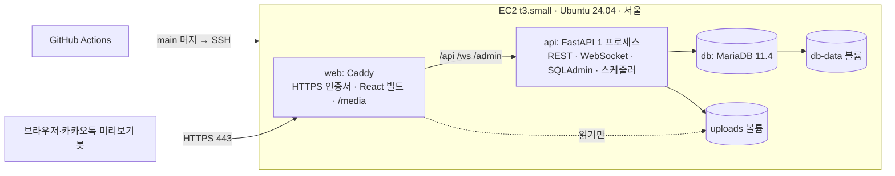

# 시연 서버 배포 (deploy.md)

> 초안 (2026-11-17, 해원). 결정 D-54. 팀 검토 전.
> 시연·발표용 서버 **AWS EC2 1대**에 Docker Compose로 올린다. 비용은 새 계정 크레딧으로 쓴다.
> 파일: `deploy/` 폴더, `.github/workflows/deploy.yml`. 개발용 DB만 있는 맨 위 `docker-compose.yml`은 그대로 둔다.

---

## 1. 구성



| 컨테이너 | 이미지 | 하는 일 | 바깥 포트 |
|---|---|---|---|
| `web` | `deploy/Dockerfile.web` (node 빌드 → caddy) | HTTPS, 빌드 파일(`/assets`·사진·글꼴)·공개 사진 `/media` 보내기, 그 밖은 모두 api로 | 80, 443 |
| `api` | `deploy/Dockerfile.api` (node 빌드 → python 3.12) | 시작할 때 `alembic upgrade head` 후 uvicorn **워커 1개** (WebSocket·스케줄러가 한 프로세스에 있어야 함). 화면 주소의 head 채우기·robots.txt·sitemap.xml | 없음 |
| `db` | `mariadb:11.4` | utf8mb4, KST | 없음 (서버 밖에서 접속 불가) |

- **주소**: 도메인이 없으면 `13-125-1-2.sslip.io`처럼 고정 IP를 넣은 무료 주소를 쓴다. Caddy가 Let's Encrypt 인증서를 자동으로 받는다. 도메인을 사면 `SITE_ADDRESS`만 바꾼다.
- **환경**: 시연 서버는 `APP_ENV=test` (시연 계정 전환·데이터 초기화가 필요). `SEO_INDEXING=false`가 기본 (seo.md).
- **화면 주소(SEO, D-50)**: Caddy 는 `/assets`·사진·글꼴처럼 파일이 있는 주소만 바로 보내고, 그 밖의 화면 주소·`robots.txt`·`sitemap.xml`은 FastAPI 로 넘긴다. FastAPI 가 `index.html`의 head(제목·설명·공유 미리보기)를 채워 보낸다. 그래서 `api` 이미지에도 화면 빌드(`/app/web`, `FRONTEND_DIST`)가 들어 있다 (Dockerfile.api 1단계).

## 2. 비용 (서울 리전, 2026-11 기준 대략 — 가입할 때 요금 페이지로 확인)

| 항목 | 월 |
|---|---|
| EC2 t3.small (2GB) | 약 $19 |
| EBS gp3 20GB | 약 $2 |
| 공인 IPv4 (탄력적 IP) | 약 $3.6 |
| 나가는 트래픽 | 100GB까지 무료 |
| **합계** | **약 $25** — 새 계정 크레딧(최대 $200, 6개월)으로 발표까지 0원 |

- 가입할 때 **무료 플랜**을 고른다. 크레딧이 끝나도 자동 결제되지 않는다.
- **AWS Budgets**: 월 $5 예산 + 80% 도달 메일을 첫날 건다.
- 발표가 끝나면 7장 "내리기"를 한다. 인스턴스를 **중지만 하면 디스크·IP 요금이 계속 나간다.**

## 3. AWS 준비 (처음 한 번, 계정 주인)

1. 계정 만들기 (무료 플랜), 루트 계정에 MFA, 작업용 IAM 사용자 따로 (팀원은 IAM 사용자로).
2. 리전 **아시아 태평양(서울) ap-northeast-2**.
3. Budgets: 월 $5, 알림 메일.
4. EC2 인스턴스 시작
   - AMI **Ubuntu Server 24.04 LTS**, 유형 **t3.small**, 스토리지 **gp3 20GB**
   - 키 페어 새로 만들기 (`stageduck-deploy.pem`, 팀 비밀 보관함에만)
   - 보안 그룹: **22 = 내 IP만**, 80·443 = 어디서나
5. **탄력적 IP** 할당 → 인스턴스에 연결. 이 IP로 `SITE_ADDRESS`(예: `13-125-1-2.sslip.io`)를 정한다.

## 4. 서버 준비 (처음 한 번)

```bash
ssh -i stageduck-deploy.pem ubuntu@<탄력적 IP> 'bash -s' < deploy/server-setup.sh
```

`server-setup.sh`가 하는 일: Docker 설치, 스왑 2GB, 시간대 KST, `~/stage-duck`에 main 받기, `deploy/.env` 만들기, DB 백업 매일 04:00 예약.

그다음 서버에서:

```bash
nano ~/stage-duck/deploy/.env      # env.prod.example 주석대로 비밀 값 채우기 (openssl rand -hex 32)
cd ~/stage-duck
docker compose -f deploy/docker-compose.prod.yml --env-file deploy/.env up -d --build
docker compose -f deploy/docker-compose.prod.yml --env-file deploy/.env exec api python -m app.demo          # 시드 데이터 (업체 A~G, 공간 A·B·C, 시연 계정)
docker compose -f deploy/docker-compose.prod.yml --env-file deploy/.env exec api python -m app.cli create-admin --email <관리자 메일>   # 비밀번호는 입력창에서
```

브라우저에서 `https://<SITE_ADDRESS>/api/v1/health` → `{"status":"ok","env":"test",...}`.

## 5. 자동 배포 (main 머지 = 배포)


- 평소에는 develop에만 머지한다. 시연 서버에 올리고 싶을 때 **develop → main PR**을 만들어 머지한다 (팀장 승인).
- `deploy.yml`은 저장소 설정이 끝나기 전에는 **건너뛴다** (`vars.DEPLOY_ENABLED`).

GitHub 저장소 설정 (Settings → Secrets and variables → Actions):

| 종류 | 이름 | 값 |
|---|---|---|
| Variable | `DEPLOY_ENABLED` | `true` |
| Variable | `DEPLOY_URL` | `https://13-125-1-2.sslip.io` |
| Secret | `DEPLOY_HOST` | 탄력적 IP |
| Secret | `DEPLOY_USER` | `ubuntu` |
| Secret | `DEPLOY_SSH_KEY` | 배포 전용 키의 개인 키 (서버 `~/.ssh/authorized_keys`에 공개 키 추가) |
| Secret | `DEPLOY_KNOWN_HOSTS` | 내 컴퓨터에서 `ssh-keyscan <탄력적 IP>` 결과 |

- 배포 전용 키는 `ssh-keygen -t ed25519 -f deploy_key -N ""`로 따로 만든다 (사람 키와 나눠 두면 회수하기 쉽다).
- Actions가 SSH로 들어오므로 보안 그룹 22번을 "내 IP만"으로 두면 배포가 막힌다. 배포할 때만 열거나, 22번을 열고 **비밀번호 로그인 끄기·키만 허용**(Ubuntu 기본)으로 둔다. 발표 기간에는 후자를 쓴다.
- 서버에서 직접 배포하려면: `cd ~/stage-duck && git pull --ff-only && docker compose -f deploy/docker-compose.prod.yml --env-file deploy/.env up -d --build`.

## 6. 운영

| 할 일 | 명령 (서버 `~/stage-duck`에서, 앞에 `docker compose -f deploy/docker-compose.prod.yml --env-file deploy/.env` 생략) |
|---|---|
| 상태 | `ps` |
| 로그 | `logs -f api` / `logs -f web` |
| 다시 시작 | `restart api` |
| DB 접속 | `exec db sh -c 'mariadb -uroot -p"$MARIADB_ROOT_PASSWORD" "$MARIADB_DATABASE"'` |
| 시연 데이터 초기화 | SQLAdmin → 시연 도구 → [초기화] (FR-DEMO-02, `APP_ENV=test`라 보임) |
| 백업 지금 | `bash deploy/backup.sh` → `~/backups/stageduck-날짜.sql.gz` (7일 보관) |
| 되살리기 | `deploy/backup.sh` 맨 위 주석 |

- 업로드 사진(`uploads` 볼륨)은 백업하지 않는다. 시연 사진은 시드로 다시 만든다. 볼륨을 지우는 `down -v`는 쓰지 않는다.
- 디스크가 차면 `docker system prune -f` (이미지·빌드 캐시만, 볼륨은 그대로).

## 7. 내리기 (발표 끝나고 요금 멈추기)

1. 필요하면 마지막 백업을 내 컴퓨터로: `scp ubuntu@<IP>:~/backups/*.sql.gz .`
2. EC2 인스턴스 **종료(Terminate)** — 루트 디스크도 같이 지워지는지 확인
3. **탄력적 IP 릴리스** (연결 안 된 IP도 요금이 나간다)
4. 남은 스냅샷·볼륨 확인
5. GitHub 변수 `DEPLOY_ENABLED`를 `false`로, 배포 키 삭제
6. Budgets 메일이 더 오지 않는지 다음 달 확인

## 8. 보안 점검

| 항목 | 기준 |
|---|---|
| 비밀 값 | `deploy/.env`에만 (chmod 600, 커밋 금지). 저장소에는 `env.prod.example`만 |
| 기본 비밀번호 | 개발용 `root/stageduck`·`dev-only-change-me` 값을 서버에 쓰지 않는다 |
| DB·api 포트 | 바깥에 열지 않는다 (compose `ports` 없음) |
| SSH | 키만, 비밀번호 로그인 꺼짐, 루트 로그인 꺼짐 (Ubuntu 기본) |
| HTTPS | Caddy 자동 인증서, HSTS, 보안 헤더 (Caddyfile) |
| 업로드 | 한 요청 12MB (Caddy) + 용도별 검사 (uploads.md) |
| SQLAdmin | `/admin`은 관리자 로그인 필요. 시연 기간이 끝나면 내린다 |
| 시연 표시 | `APP_ENV=test` — 결제는 테스트 결제 표시 (NFR-UX-05) |

## 9. 아직 하지 않은 것

- 로컬에서 Docker 이미지 빌드·실행 확인 (처음 서버에 올릴 때 확인한다)
- 이미지 레지스트리(GHCR)에 미리 빌드해 두기 — 지금은 서버에서 빌드 (t3.small에서 수 분)
- 모니터링·알림 (CloudWatch 기본 지표만), 무중단 배포, 서버 2대 이상
- 업로드 볼륨 백업
