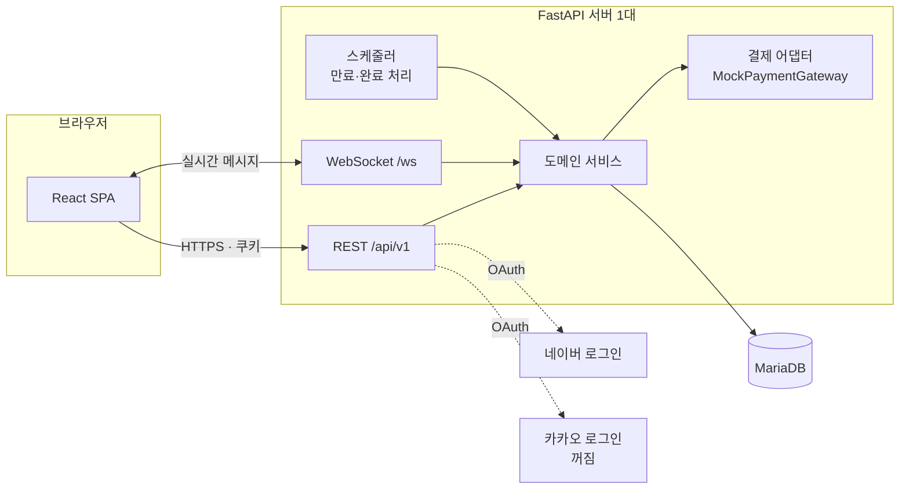
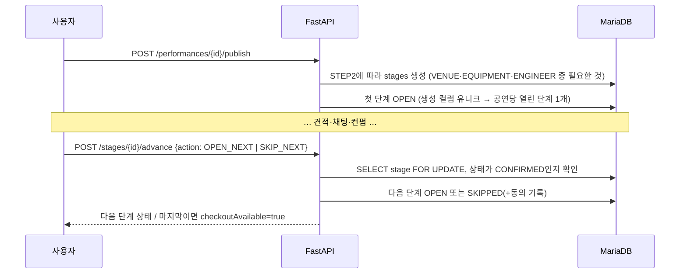
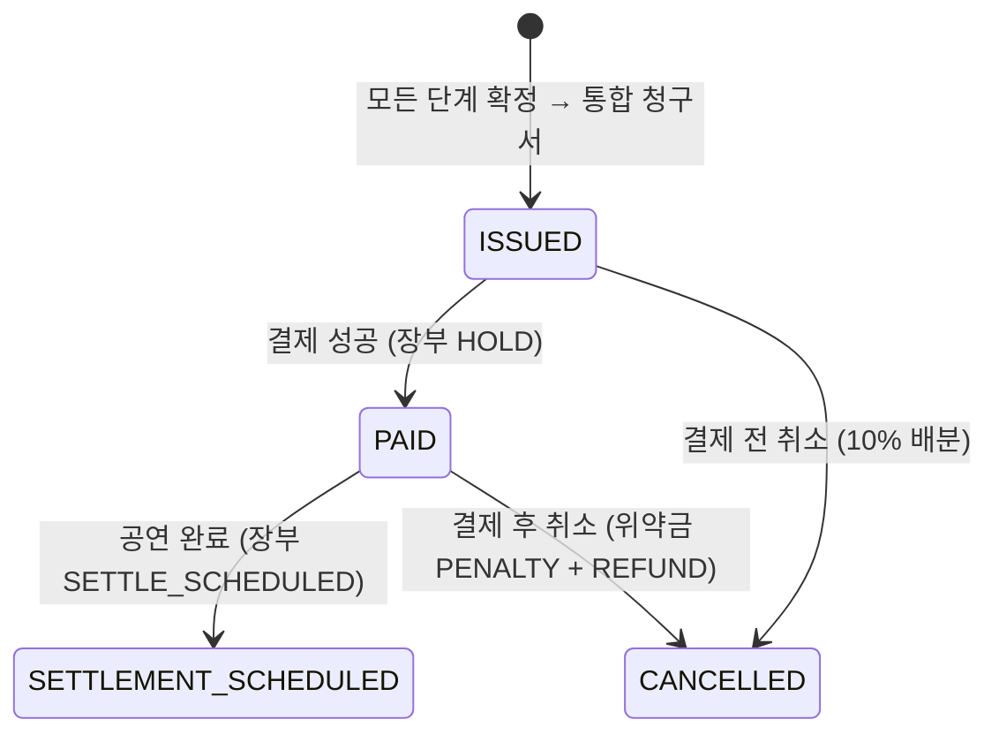

# STAGE DUCK 기술 계획 (plan.md)

| 항목 | 내용 |
|---|---|
| 버전 | 0.1 (초안) |
| 작성일 | 2026-11-12 |
| 입력 | [spec.md](spec.md) v0.1, [constitution.md](constitution.md) |
| 관련 | [data-model.md](data-model.md) · [api-contract.md](api-contract.md) · [traceability.md](traceability.md) · [ADR 0002](../docs/decisions/0002-기술스택-선정.md) |

> spec.md가 **무엇을**이라면, 이 문서는 **어떻게**다. 스펙에 없는 기능은 여기서 추가하지 않는다.

---

## 1. 기술 스택

| 영역 | 선택 |
|---|---|
| 프론트엔드 | React 18 + Vite + TypeScript, React Router, TanStack Query |
| 백엔드 | FastAPI (Python 3.12), Pydantic v2, Uvicorn |
| DB | MariaDB 11.4, InnoDB, utf8mb4 |
| ORM·마이그레이션 | SQLAlchemy 2.0 (동기) + PyMySQL, Alembic |
| 실시간 | FastAPI WebSocket |
| 관리자 화면 | **SQLAdmin** (자동 생성, UI 디자인 없음) |
| 백엔드 테스트 | pytest, httpx TestClient, pytest-cov, 테스트용 MariaDB |
| 프론트 테스트 | Vitest + React Testing Library + MSW, (권장) Playwright E2E 1개 |
| 실행 | Docker Compose (backend · frontend · mariadb) |
| CI | GitHub Actions, job 이름 `test` 유지 |

## 2. 시스템 구성



- **모놀리스 + 모듈 분리**: 4명·짧은 일정에서 서비스를 나누면 배포·통신 비용만 는다. 대신 담당 영역별로 패키지를 나누고, 영역 사이는 각 모듈의 서비스 함수로만 부른다.
- 파일(사진·사업자등록증·채팅 첨부)은 MVP에서 서버 로컬 디스크(`/uploads`, Docker 볼륨)에 저장하고 DB에는 경로만 둔다.

## 3. 저장소 구조

```
stage-duck/
├─ backend/
│  ├─ app/
│  │  ├─ main.py            # FastAPI 앱, 라우터 등록
│  │  ├─ core/              # 설정, DB 세션, 보안(쿠키·CSRF·해시), 오류 형식, 시간·금액 유틸   (공통)
│  │  ├─ auth/              # 가입, 로그인, 네이버·카카오, 약관                               (공통 · F1)
│  │  ├─ supplier/          # 입점, 심사, 서비스, 공간(venues), PR 게시판                     (2번 · F1 F2 F4)
│  │  ├─ request/           # 요청서·버전, 공고, 단계(stages), 오퍼, 관심 업체                (1번 · F2 F3)
│  │  ├─ quote/             # 견적서·버전                                                    (2번 · F2)
│  │  ├─ chat/              # 채팅방, 메시지, WebSocket, 확인 카드, 컨펌, 다음 단계            (3번 전담 · F3)
│  │  ├─ check/             # 자동 검사 엔진(CHK), 기술 확인                                 (3번 · F3)
│  │  ├─ payment/           # 청구서, 결제, 장부, 취소·위약금                                (4번 · F5)
│  │  ├─ policy/            # 반려 카운트, 신고, 경고·정지                                   (4번 · F4)
│  │  ├─ admin/             # SQLAdmin 뷰·액션, 관리자 인증, 시연 데이터                     (2번+4번 · F5)
│  │  └─ models/            # SQLAlchemy 모델 (테이블 정의는 data-model.md)
│  ├─ alembic/              # 마이그레이션
│  └─ tests/                # pytest — 파일 이름에 F 번호, 테스트 이름에 AC ID
├─ frontend/
│  ├─ src/
│  │  ├─ shared/            # api 클라이언트, StatusBadge, StageStepper, QuoteCard, MoneyText
│  │  ├─ features/          # auth, supplier, request, quote, chat, payment, board, admin
│  │  ├─ pages/             # 라우트별 화면
│  │  └─ mocks/             # MSW 핸들러 (api-contract.md 기준)
│  └─ tests/
├─ docker-compose.yml
└─ specs/  docs/
```

각 모듈 안: `router.py`(API) · `schemas.py`(Pydantic 요청·응답) · `service.py`(규칙·상태 변경) · `repository.py`(DB 조회, 선택).

### 영역 간 의존 (한 방향)
```
request ──▶ supplier (공간 스냅샷)
quote   ──▶ request (단계 상태 확인)
chat    ──▶ quote (견적서 버전), request (단계 컨펌·다음 단계), check (검사 결과)
payment ──▶ request (공연 상태), quote (확정 견적서)
policy  ──▶ request, chat (반려·신고 대상)
admin   ──▶ 모두 (조회 위주)
```

## 4. 인증·권한

| 항목 | 방식 |
|---|---|
| 세션 | 로그인 시 **JWT를 httpOnly·Secure·SameSite=Lax 쿠키**로 발급. Access 30분 + Refresh 14일 (제안) |
| CSRF | 상태를 바꾸는 요청(POST·PUT·PATCH·DELETE)은 `X-CSRF-Token` 헤더 = 쿠키 값 일치 검사 (double submit) |
| 비밀번호 | bcrypt 해시. 5회 연속 실패 시 10분 잠금 (`users.locked_until`) |
| 네이버 | OAuth 2.0 Authorization Code. `state` 값을 쿠키에 넣고 콜백에서 비교 (NFR-SEC-10). 처음이면 임시 가입 토큰 발급 → 추가 정보 화면 |
| 카카오 | 같은 흐름. `KAKAO_LOGIN_ENABLED=false`면 라우터가 404 |
| 권한 검사 | 라우터 의존성 `require_role(...)` + 서비스에서 **소유권 검사**. 남의 리소스는 `404 NOT_FOUND` (존재 여부 숨김) |
| 업체 상태 | 심사 중·반려·정지 업체가 견적서·PR 글 요청 → `403 SUPPLIER_NOT_APPROVED` / `ACCOUNT_SUSPENDED` |
| 관리자 | 시드 데이터로만 생성. 가입 API에서 `role=ADMIN`은 400 |
| 시연 계정 전환 | `APP_ENV=test`일 때만 `/dev/*` 라우터 등록 |

## 5. 핵심 흐름 구현

### 5.1 상태 변경 공통 규칙
- 모든 상태 변경은 서비스 함수 하나(`transition(entity, to, actor, reason)`)를 거친다. 허용 전이표에 없으면 `409 INVALID_STATE`.
- 같은 트랜잭션 안에서 `status_histories`에 이전·다음 상태, 처리자, 사유를 기록한다 (NFR-HIST-01).

### 5.2 순차 배정과 다음 단계



### 5.3 컨펌 (동시성·버전)
1. `POST /confirm-requests/{id}/accept` 수신
2. 트랜잭션 시작 → `stages` 행 `SELECT … FOR UPDATE` (같은 단계 동시 컨펌을 직렬화)
3. 검사: 카드 `PENDING` · 만료 전 · `viewed_at` 있음(내역서 열람) · 카드의 견적서 버전 = 견적서 현재 버전 · 자동 검사에 `CONFLICT` 없음 · 단계 상태가 `OPEN`/`NEGOTIATING`
4. 카드 `CONFIRMED`, 단계 `CONFIRMED` + `confirmed_quote_version_id` 저장(스냅샷), 같은 단계 나머지 견적서 `CLOSED`, 해당 채팅방에 안내 카드
5. 커밋. 두 번째 요청은 3번에서 `409 STAGE_ALREADY_CONFIRMED`
- 요청서·견적서가 새 버전이 되면 그 단계의 `PENDING` 카드는 `INVALIDATED`, 컨펌된 단계는 `RECHECK`.

### 5.4 자동 검사 엔진 (CHK)
- 순수 함수 `run_checks(performance_version, stage, quote_version, confirmed_snapshots) -> list[CheckResult]`. DB에 저장하지 않고 조회 때 계산한다 (입력이 같으면 결과가 같다 → 테스트 쉬움).
- 규칙: CHK-01 인원, CHK-02 설치 가능 시간(기준 60분, 설정값), CHK-03 공간 조건, CHK-04 입실→설치, CHK-05 설치→리허설, CHK-07 철수→퇴실, CHK-08 엔지니어 근무, CHK-09 엔지니어 중복, CHK-10 예산, CHK-11 정보 누락, CHK-12 이전 버전 기준. (CHK-06 없음)
- 결과 등급: `PASS` / `NEEDS_INFO` / `CONFLICT` / `WARNING`. `CONFLICT`가 하나라도 있으면 컨펌 불가.

### 5.5 실시간 채팅
- 연결: `GET /ws/chat` (쿠키 인증) → 서버의 `ConnectionManager`가 `user_id → 연결 목록`을 메모리에 관리.
- 보내기: 메시지는 **REST로 저장**(`POST /chat-rooms/{id}/messages`)하고, 저장 성공 후 같은 방 참여자 연결로 이벤트를 푸시한다. WebSocket은 받기 전용으로 써서 저장·권한 로직을 REST 한 곳에 둔다.
- 끊겼다가 다시 연결하면 `GET /chat-rooms/{id}/messages?after={lastId}`로 빠진 메시지를 채운다.
- 읽음: `POST /chat-rooms/{id}/read {lastMessageId}` → 상대에게 `read` 이벤트.
- 첨부: `POST /files` 업로드(이미지·PDF, 10MB 이하 (제안)) → 받은 URL로 메시지 전송.
- 연락처·계좌 패턴 검사: 정규식으로 감지하면 메시지에 `contactWarning=true` 표시 + 경고 카드 (막지는 않음).
- 한계: 서버 1대 메모리 기반이라 여러 대로 늘리면 Redis Pub/Sub 등이 필요 (후속).

### 5.6 결제 — 자체 에스크로형 모의 결제

- `PaymentGateway` 인터페이스 + `MockPaymentGateway` 구현. 화면에서 [성공]/[실패]를 고를 수 있게 해 시연에서 실패·중복 응답을 재현한다.
- **멱등**: 결제 요청은 `Idempotency-Key` 헤더 필수 → `payments.idempotency_key` 유니크. 같은 키로 다시 오면 처음 결과를 그대로 돌려준다. 결제 완료 콜백도 `provider_tx_id` 유니크로 한 번만 반영.
- **금액**: 청구서 금액은 확정 견적서 스냅샷 합계 + 수수료로 서버가 계산. 요청 본문의 금액이 다르면 `400 AMOUNT_MISMATCH`.
- **장부(ledger)**: 돈의 상태를 `ledger_entries`에 쌓는다 (HOLD, SETTLE_SCHEDULED, REFUND, PENALTY, CANCEL_FEE). 잔액은 장부 합으로 계산하고, 실제 돈은 움직이지 않는다.
- **위약금 계산**: `cancel_quote(order, now)` 순수 함수 — 결제 전 10% / ~D-3 10% / D-2 50% / D-1 70% / D-0 100%, 업체별 금액 비율로 나누고 원 단위 나머지는 금액이 가장 큰 업체에 더한다 (제안). 업체 사정 취소는 전액 환불 + 경고.
- 플랫폼 수수료율은 설정값 (`PLATFORM_FEE_RATE`, 요율 미정 — 시연용 기본 5% (제안)).

### 5.7 스케줄러
APScheduler(서버 내부, 1분 간격)로 처리한다.

| 작업 | 규칙 |
|---|---|
| 확인 카드 만료 | `expires_at`(보낸 뒤 48시간) 지나면 `EXPIRED` |
| 오퍼 만료 | 48시간 지나면 `EXPIRED` |
| 공연 완료 | 공연 종료 시각이 지나면 `COMPLETED` + 장부 `SETTLE_SCHEDULED` |
| 반려 카운트 | 조회 시 계산 (마지막 반려 후 180일 지나면 0) — 스케줄 불필요 |

### 5.8 반려·신고·정지
- 공고 내리기(`withdraw`) 때 그 공연의 채팅방 중 `started_at`이 있으면 `AFTER_CHAT`, 견적서만 받았으면 `NO_CHAT` 반려 이벤트 기록. 다른 업체 컨펌으로 자동 마감된 견적은 기록하지 않는다.
- 게시 제한: 최근 180일 `AFTER_CHAT` ≥ 5 또는 `NO_CHAT` ≥ 10이면 마지막 반려 + 24시간 전까지 `403 POSTING_RATE_LIMITED`.
- 관리자가 경고를 주면 `users.warning_count + 1`, 3이 되면 같은 트랜잭션에서 `SUSPENDED`.

## 6. 프론트엔드 계획

| 항목 | 방식 |
|---|---|
| 라우팅 | React Router. 역할별 레이아웃(사용자 / 업체 / 관리자) + 보호 라우트 |
| 서버 상태 | TanStack Query (캐시·재요청). 채팅은 WebSocket 이벤트로 캐시 갱신 |
| 폼 | React Hook Form + 스키마 검증(zod) — 서버 규칙과 같은 값 사용 (제안) |
| API 계약 | `shared/api/types.ts`에 api-contract.md의 요청·응답 타입 |
| 공통 컴포넌트 | StatusBadge(색+글자), StageStepper(단계 현황), QuoteCard, CheckResultList, MoneyText, SimulationBanner |
| 반응형 | CSS Modules + Grid/Flex, 모바일 우선 |

### 라우트 (화면 목록은 user-flow.md)

| 경로 | 화면 | 권한 |
|---|---|---|
| `/` · `/venues` · `/venues/:id` · `/board` | 시작, 공간 탐색·상세, PR 게시판 | 누구나 |
| `/signup` · `/signup/supplier` · `/login` · `/signup/extra` | 가입·로그인·추가 정보 | 비로그인 |
| `/me/performances` · `/performances/new` · `/performances/:id` | 내 공연, 요청서, 공연 상세(단계 현황) | 사용자 |
| `/performances/:id/stages/:stage/quotes` | 단계별 견적 비교 (대표 화면) | 사용자 |
| `/chats` · `/chats/:roomId` | 채팅 | 사용자·업체 |
| `/performances/:id/order` | 통합 청구서·결제·취소 | 사용자 |
| `/performances/:id/sheet` | 최종 담당표 | 사용자·확정 업체 |
| `/supplier/onboarding` · `/supplier/profile` · `/supplier/venues` | 입점 2·3단계, 서비스·공간 관리 | 업체 |
| `/supplier/postings` · `/supplier/postings/:id` · `/supplier/offers` | 공고 목록·상세, 받은 오퍼 | 업체(승인) |
| `/admin` | **React 라우트 아님** — 서버의 SQLAdmin (6.5) | 관리자 |

## 6.5 관리자 화면 — SQLAdmin (UI 디자인 없음)

관리자 화면은 사용자에게 보이는 화면이 아니므로 **Figma 디자인과 React 화면을 만들지 않는다.** FastAPI + SQLAlchemy용 관리자 패널 라이브러리 **SQLAdmin**으로 목록·상세·검색 화면을 자동 생성하고, 업무 처리는 **커스텀 액션 버튼**으로 만든다.

| 항목 | 방식 |
|---|---|
| 주소 | `/admin` (FastAPI 앱에 마운트, React와 별개) |
| 로그인 | SQLAdmin `AuthenticationBackend` — `users.role = 'ADMIN'` 계정만. 비밀번호 검사·잠금은 일반 로그인과 같은 서비스 함수 사용 |
| 원칙 | 액션 버튼은 **반드시 서비스 함수를 호출**한다 (상태 전이 검사, `status_histories` 기록, 경고 3회 정지). 모델 직접 수정은 막는다 (`can_edit=False`) |
| 개발 담당 | 각 영역 담당자가 자기 모델의 관리자 뷰를 함께 만든다 (2번: 업체·공간·게시글, 4번: 신고·제재·주문) |

### 관리자 뷰와 액션

| 뷰 (모델) | 목록에서 보는 것 | 액션 버튼 | 호출 서비스 | AC |
|---|---|---|---|---|
| 업체 심사 (suppliers) | 상호, 유형, 부문, 심사 상태, 신청일 · 필터: 심사 상태 | [승인] / [반려(사유 입력)] / [정지] / [정지 해제] | `supplier.service.approve / reject / suspend` | F1-19, F1-20 |
| 회원 (users) | 이메일, 역할, 상태, 경고 수 | [경고(사유)] — 3회째 자동 정지 | `policy.service.warn` | F4-08 |
| 신고 (reports) | 대상 종류, 사유, 상태, 신고일 | [대상 열기] / [경고 처리] / [기각] | `policy.service.handle_report` | F4-03 |
| PR 게시글 (pr_posts) | 업체, 부문, 제목, 상태 | [블라인드(사유)] / [블라인드 해제] | `supplier.service.blind_post` | F4-03 |
| 공간 (venues) | 이름, 지역, 상태 | [숨김] / [숨김 해제] | `supplier.service.hide_venue` | ADMIN-04 |
| 공연 (performances) | 제목, 사용자, 상태, 공연일 | 상세에 **상태 변경 이력·결제·취소 이력** 시간순 표시 (읽기 전용) | `admin.service.performance_history` | F5-13 |
| 주문·결제·장부 (orders, payments, ledger_entries) | 금액, 상태 | 읽기 전용 | — | ADMIN-02 |
| 채팅방 (chat_rooms) | **신고된 방만** 목록에 노출, 메시지 읽기 전용 | — | `admin.service.reported_rooms` | 2.5 권한표 |
| 시연 도구 | — | [시연 데이터 초기화] — `APP_ENV=test`일 때만 보임 | `admin.service.reset_demo` | F5-14 |

- 관리자는 확정·결제를 대신 처리하는 액션을 **두지 않는다** (constitution 원칙, 2.5 권한표).
- 사유가 필요한 액션은 SQLAdmin 액션 화면의 입력 폼(사유 텍스트)으로 받는다.

## 7. 테스트 전략

| 층 | 도구 | 대상 | 규칙 |
|---|---|---|---|
| 단위 | pytest | 자동 검사(CHK), 위약금 계산, 상태 전이표, 사업자번호 체크섬 | DB 없이 순수 함수 |
| API 통합 | pytest + TestClient + MariaDB | 수용 기준 대부분 (권한, 상태, 동시성, 멱등) | 테스트마다 트랜잭션 롤백 |
| 동시성 | pytest + 스레드 2개 | AC-F3-11, AC-F5-06 | 실제 MariaDB에서만 의미 있음 |
| 컴포넌트 | Vitest + RTL + MSW | 폼 검증, 버튼 활성화 조건, 배지 표시 | API는 MSW 목업 |
| 관리자 액션 | pytest | 액션이 부르는 서비스 함수 (승인·경고·블라인드·초기화) | SQLAdmin 화면 자체는 테스트하지 않음 |
| E2E (권장) | Playwright | 대표 시나리오 1개 (가입 → 공연장 → 장비 → 결제) | 시연 리허설 겸용 |

- **이름 규칙**: `test_ac_f3_11_concurrent_confirm_only_one_succeeds` / `it('AC-F2-09 장비 칸에 기본값이 없다')` — 추적표에서 바로 찾게.
- **CI**: GitHub Actions `test` job에서 MariaDB 서비스 컨테이너를 띄우고 `pytest`, `npm run test -- --run` 실행. job 이름 `test` 유지.
- 시드 데이터(업체 A~G, 공간 A·B·C)를 테스트 픽스처로도 재사용한다.

## 8. 환경·설정

| 변수 | 용도 |
|---|---|
| `APP_ENV` | `local` / `test` / `prod` — `test`에서만 시연 계정 전환·데이터 초기화 |
| `DATABASE_URL` | `mysql+pymysql://…` |
| `JWT_SECRET`, `CSRF_SECRET` | 토큰 서명 |
| `NAVER_CLIENT_ID`, `NAVER_CLIENT_SECRET` | 네이버 로그인 |
| `KAKAO_LOGIN_ENABLED`, `KAKAO_REST_KEY` | 카카오 로그인 (기본 false) |
| `PLATFORM_FEE_RATE` | 수수료율 (시연 기본 0.05 (제안)) |
| `SETUP_WARNING_MINUTES` | CHK-02 기준 (기본 60) |

비밀 값은 `.env`에만 두고 `.env.example`에 이름만 적는다.

## 9. 원칙 점검 (constitution)

| 원칙 | 계획에서 지키는 방법 |
|---|---|
| 1 스펙 먼저 | 모든 API·테이블이 traceability.md에서 AC로 연결됨. 스펙에 없는 API 없음 |
| 3 순차 배정 | 단계 OPEN은 앞 단계 CONFIRMED/SKIPPED일 때만, 생성 컬럼 유니크로 열린 단계 1개 |
| 4 기록 보존 | `*_versions` 테이블, 컨펌·청구서 스냅샷, `status_histories` |
| 5 판정하지 않음 | CHK는 입력값 비교만, 기술 확인은 사람이 답변 |
| 6 서버 기준 | 권한 의존성, 서버 금액 계산, 멱등 키, 행 잠금 |
| 7 개인정보 | 주소 컬럼 없음, 연락처는 결제 후 담당표 API에서만 반환 |
| 8 시뮬레이션 | MockPaymentGateway, 모든 화면 SimulationBanner |
| 10 테스트 | AC ID 이름 규칙, CI 필수 |

## 10. 위험과 대응

| 위험 | 대응 |
|---|---|
| 실시간 채팅 구현 부담 (전담 1명) | REST 저장 + WS 푸시로 단순화, 재연결 시 REST로 보충 |
| MariaDB 부분 인덱스 없음 | 생성 컬럼 + 유니크, 행 잠금 |
| 동시성 테스트가 불안정 | 실제 MariaDB 컨테이너에서만 실행, 반복 3회 |
| 네이버 검수 전 공개 불가 | 시연은 테스터 계정, 그 외는 이메일 시연 계정 |
| 범위가 큼 (채팅·오퍼·게시판·결제) | 개발 순서: ① 가입·입점 ② 요청서·공고·견적 ③ 채팅 확정·순차 배정 ④ 결제 ⑤ 오퍼·게시판·제재 |

## 11. 열린 질문
- 프론트 언어 TypeScript 확정 여부 (제안)
- 수수료율 기본값, 첨부 파일 크기 제한 (제안)
- 공연 완료 처리 시점: 공연 종료 시각 즉시 / 다음 날 (제안: 종료 시각)
