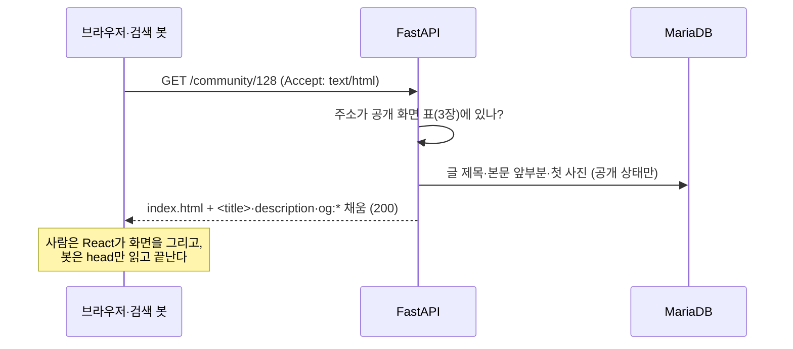

# 검색·공유 노출 설계 (seo.md)

> 초안 (2026-11-17, 해원). 결정 D-50. 팀 검토 전.
> 목적: 로그인 없이 볼 수 있는 화면이 검색 결과와 카카오톡·SNS 링크 미리보기에 제대로 보이게 하고, 로그인 뒤 화면과 개인정보는 검색에 절대 나오지 않게 한다.
> 관련: plan.md 6장(라우트), api-contract.md, 요구사항 명세서 NFR-SEO

---

## 1. 렌더링 방식 (D-50)

React SPA는 처음 받는 HTML이 비어 있어서, 카카오톡 미리보기 봇과 네이버 검색은 화면 내용을 읽지 못한다. 그래서 **화면은 그대로 React로 그리고, 서버가 처음 보내는 HTML의 `<head>`만 채운다.**



| 경우 | 응답 |
|---|---|
| 공개 화면 + 있는 글 | `index.html` + 그 글의 head, `200` |
| 공개 화면 + 없음·블라인드·삭제·정지 업체 | `index.html` + 기본 head + `noindex`, **`404`** (React는 404 화면) |
| 로그인 뒤 화면 (`/me/*`, `/performances/*`, `/chats/*`, `/supplier/*` 등) | `index.html` + 기본 head + `noindex`, `200`. DB를 읽지 않는다 |
| `/api/*`, `/ws`, `/admin` | 지금처럼 API·WebSocket·SQLAdmin |
| 정적 파일 (`/assets/*`) | 빌드 결과 그대로 |

구현 메모
- `frontend/index.html`의 `<head>` 안에 `<!--app-head-->` 자리표시를 두고, 서버가 이 자리를 바꾼다. 빌드 결과(`frontend/dist`)는 FastAPI가 `StaticFiles`로 보낸다 (Docker Compose 한 컨테이너).
- 백엔드 `app/seo/` 모듈: 주소 패턴 → 읽기 함수 → `PageMeta(title, description, image, canonical, type, robots)`. 다른 모듈의 서비스 함수만 부른다 (plan.md 영역 의존 규칙).
- 넣는 글자는 모두 HTML 이스케이프한다 (NFR-SEC-09). 본문 요약은 줄바꿈·연속 공백을 하나로 줄이고 80자에서 자른 뒤 "…".
- 화면 안에서 주소를 옮길 때(React Router)는 `usePageMeta(title)` 훅으로 `document.title`만 바꾼다. 제목 형식은 3장 표와 같다.

## 2. 주소 규칙

- 소문자, 복수 명사, 숫자 id: `/venues/12`, `/board/34`, `/community/128`. 끝에 `/` 없음.
- 필터·정렬·쪽은 쿼리로: `/venues?sido=광주&capacity=80`, `/community?category=QUESTION&page=2`. **canonical은 쿼리 없는 주소**로 둔다 (같은 내용이 여러 주소로 잡히지 않게).
- 글 주소는 제목이 바뀌어도 그대로 (제목을 주소에 넣지 않는다).
- 가입·로그인·글쓰기처럼 입력하는 화면은 공개 주소여도 `noindex`.

## 3. 공개 화면과 head

title은 30자 안팎(검색 결과에서 잘리지 않게), description은 80자 안팎. 맨 끝에 ` · STAGE DUCK`.

| 주소 | 화면 | title | description | og:image | 색인 |
|---|---|---|---|---|---|
| `/` | 메인 | STAGE DUCK · 공연장부터 엔지니어까지 차례로 | 요청서를 쓰면 공연장, 장비, 엔지니어 업체의 견적서를 차례로 받아 비교하고 컨펌해요. | 기본 이미지 | O |
| `/venues` | 공간 찾기 | 공연 공간 찾기 · STAGE DUCK | 지역·관객 수·공간 조건으로 공연할 곳을 찾아보세요. | 기본 | O |
| `/venues/:id` | 공간 상세 | {공간명} · {시군구} {수용}명 공연 공간 · STAGE DUCK | {공간 유형} · 수용 {n}명 · {조건 2~3개} · 입실 {hh:mm}부터 | 대표 사진 | O |
| `/board` | PR 게시판 | 업체 PR 게시판 · STAGE DUCK | 공연장·장비·엔지니어 업체가 직접 올린 소개 글을 둘러보세요. | 기본 | O |
| `/board/:id` | PR 게시글 | [{말머리}] {제목} · {업체명} · STAGE DUCK | 본문 앞 80자 | 대표 사진 | O |
| `/suppliers/:id` | 업체 프로필 | {업체명} · {부문} 업체 · STAGE DUCK | {활동 지역} · 소개 앞 60자 | 대표 이미지 | O |
| `/community` | 커뮤니티 | 커뮤니티 · STAGE DUCK | 공연 준비하면서 궁금한 것, 알게 된 것을 나눠요. | 기본 | O |
| `/community/:id` | 커뮤니티 글 | [{말머리}] {제목} · STAGE DUCK 커뮤니티 | 본문 앞 80자 | 첫 사진, 없으면 기본 | O |
| `/notices` · `/notices/:id` | 공지사항 | 공지사항 · STAGE DUCK / {제목} · STAGE DUCK 공지 | 본문 앞 80자 | 기본 | O |
| `/faq` | 자주 묻는 질문 | 자주 묻는 질문 · STAGE DUCK | 요청서·견적·결제·취소, 업체 입점·정산에 대해 자주 묻는 질문이에요. | 기본 | O |
| `/guide/supplier` | 업체 이용 가이드 | 업체 이용 가이드 · STAGE DUCK | 입점부터 견적서, 컨펌, 정산까지 업체가 하는 일을 순서대로 정리했어요. | 기본 | O |
| `/terms/:type` | 약관 (service · supplier · privacy) | 이용약관 / 업체 이용약관 / 개인정보 처리방침 · STAGE DUCK | 시연용 요약본 안내 한 줄 | 기본 | O |
| `/login` · `/signup*` · `/community/new` · `/board/new` | 입력 화면 | 화면 이름 · STAGE DUCK | - | 기본 | **noindex** |
| 그 밖의 모든 주소 | 로그인 뒤 화면 | STAGE DUCK | - | 기본 | **noindex** |

지키는 것
- **연락처·금액·개인정보를 head에 넣지 않는다.** 사용자 닉네임도 넣지 않는다 (커뮤니티 글 title에 글쓴이 없음). 업체명은 공개 정보라 넣는다.
- 블라인드·삭제된 글, 정지 업체의 글·프로필, 숨긴 공간은 404 + noindex (각 화면의 공개 규칙과 같게).
- 사용자 공연·공고는 공개 화면이 아니다 (업체 공고 목록도 로그인 뒤).

## 4. 공유 미리보기 (Open Graph)

카카오톡·페이스북·X는 `og:*`를 읽는다. 커뮤니티 [공유] 링크 복사(D-47)가 이걸 쓴다.

```html
<title>[질문] 관객 80명 소극장인데 모니터 스피커는 몇 개가 적당할까요? · STAGE DUCK 커뮤니티</title>
<meta name="description" content="11월 28일에 공간 C에서 첫 공연을 해요. 장비 업체 견적서를 받아 보니 모니터 스피커가 2개로…">
<link rel="canonical" href="https://{PUBLIC_BASE_URL}/community/128">
<meta property="og:type" content="article">
<meta property="og:site_name" content="STAGE DUCK">
<meta property="og:title" content="[질문] 관객 80명 소극장인데 모니터 스피커는 몇 개가 적당할까요?">
<meta property="og:description" content="(description과 같음)">
<meta property="og:image" content="https://{PUBLIC_BASE_URL}/media/free/128/1.jpg">
<meta property="og:url" content="https://{PUBLIC_BASE_URL}/community/128">
<meta name="twitter:card" content="summary_large_image">
```

- og:title은 ` · STAGE DUCK`을 뺀 제목. og:image·og:url·canonical은 **절대 주소** (`PUBLIC_BASE_URL`).
- 기본 이미지 `frontend/public/og-default.png` 1200×630 (로고 + 서비스 한 줄, 흰 바탕). 디자인 규칙(DESIGN.md 8장) 그대로.
- 사진은 업로드할 때 만든 가로 1200px 이하 사본을 쓴다.

## 5. robots.txt · sitemap.xml

FastAPI가 바로 응답한다 (`app/seo/`).

```
# SEO_INDEXING=true 일 때
User-agent: *
Disallow: /api/
Disallow: /admin
Disallow: /me
Disallow: /performances
Disallow: /chats
Disallow: /supplier
Disallow: /login
Disallow: /signup
Disallow: /dev
Sitemap: https://{PUBLIC_BASE_URL}/sitemap.xml

# SEO_INDEXING=false 일 때 (기본, 로컬·테스트)
User-agent: *
Disallow: /
```

- `sitemap.xml`: 고정 화면(메인, 공간 찾기, PR 게시판, 커뮤니티, 공지, FAQ, 가이드, 약관 3종) + 공개 상태인 공간·PR 게시글·업체 프로필·커뮤니티 글·공지. 각 `lastmod`는 수정 시각. 5만 개를 넘지 않으므로 파일 하나.
- `SEO_INDEXING=false`면 모든 화면 head에 `<meta name="robots" content="noindex">`도 넣는다. **시연 데이터가 검색에 남지 않게 기본은 false.** 발표용으로 공개할 때만 켠다.

## 6. 화면 품질 (검색과 같이 좋아지는 것)

| 항목 | 기준 |
|---|---|
| 문서 | `<html lang="ko">`, 화면마다 `<h1>` 하나, 제목 순서(h1 → h2 → h3) 지키기 |
| 이미지 | 의미 있는 사진은 `alt` (예: "공간 C 내부 사진"), 꾸밈 사진은 `alt=""` |
| 링크 | 목록의 글 제목은 `<a href="/community/128">` 진짜 링크 (onClick만 쓰지 않는다 — 봇이 따라가야 한다) |
| 속도 | LCP 2.5초 이하, CLS 0.1 이하 목표. 목록 썸네일은 작은 사본 + `loading="lazy"`, 글꼴 preload, 스크롤바 자리 고정(이미 refine.css에 반영) |
| 오류 | 없는 주소는 서버도 404를 돌려준다 (React 404 화면만으로는 봇이 200으로 안다) |

## 7. 하지 않는 것 (후속)

- 구조화 데이터(JSON-LD), 다국어, AMP
- 네이버 서치어드바이저·구글 서치 콘솔 등록 (배포 주소가 정해지면. 확인용 meta는 환경변수로 넣을 수 있게만 둔다)
- 서버 렌더링(SSR) 전환. head만 채우는 방식으로 충분하다

## 8. 환경변수

| 변수 | 용도 | 기본 |
|---|---|---|
| `PUBLIC_BASE_URL` | canonical·og:url·og:image·sitemap의 절대 주소 | `http://localhost:8000` |
| `SEO_INDEXING` | 검색 허용 여부 (robots.txt, noindex) | `false` |
| `SITE_VERIFICATION_NAVER`, `SITE_VERIFICATION_GOOGLE` | 검색 콘솔 확인 meta (선택) | 비어 있음 |

## 9. 테스트

| 테스트 | 기대 |
|---|---|
| `GET /community/128` (Accept: text/html) | 200, `<title>`에 글 제목, `og:url`이 절대 주소 |
| `GET /community/999999` | 404, `noindex` |
| 블라인드 글 · 정지 업체 프로필 | 404, `noindex` |
| `GET /me/performances` | 200, 기본 title, `noindex`, DB 조회 없음 |
| 제목에 `<script>`가 든 글 | head에 이스케이프되어 들어감 |
| `SEO_INDEXING=false` | `robots.txt`가 `Disallow: /`, 모든 화면 `noindex` |
| `SEO_INDEXING=true` | `robots.txt`에 Disallow 목록과 Sitemap 줄, `sitemap.xml`에 블라인드 글 없음 |
| head 어디에도 | 전화번호·이메일·금액·닉네임 패턴 없음 |

## 10. 담당

- `app/seo/`(서버 head·robots·sitemap)와 `usePageMeta`: **2번** (커뮤니티·공지와 함께). 각 묶음은 자기 공개 화면의 "공개 상태 조회 함수"만 내준다 (예: 1번 `get_public_venue(id)`, `get_public_pr_post(id)`).
