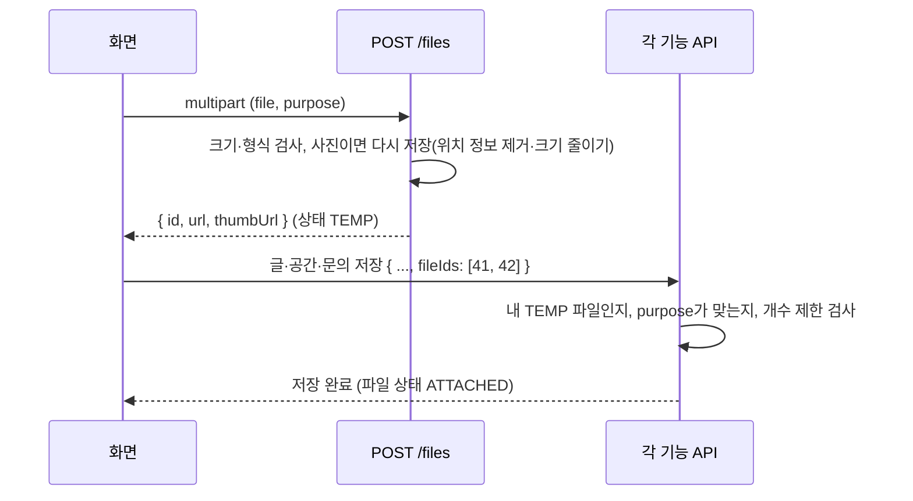

# 파일 업로드 설계 (uploads.md)

> 초안 (2026-11-17, 해원). 결정 D-51. 팀 검토 전.
> 저장 위치는 plan.md 2장대로 **서버 로컬 디스크 `/uploads` (Docker 볼륨), DB에는 메타만**. 담당은 plan.md 3장대로 **1번 `app/files/`**, 다른 묶음은 `files` 서비스 함수로만 쓴다.
> 이 문서는 용도별 제한, 공개·비공개, 사진 처리, 검사, 정리를 정한다.

---

## 1. 흐름: 먼저 올리고, 저장할 때 붙인다



- 화면은 사진을 고르는 순간 올려서 미리보기를 보여 주고, 글을 저장할 때 `fileIds`만 보낸다.
- 붙지 않은 `TEMP` 파일은 **24시간 뒤 스케줄러가 지운다** (5장).
- 글·공간에서 사진을 빼거나 글을 지우면 그 파일은 `DELETED`로 바꾸고 디스크에서 지운다. 단 **컨펌 스냅샷·최종 담당표·블라인드된 글이 가리키는 파일은 지우지 않는다** (NFR-HIST-03).

## 2. 용도별 규칙

| purpose | 쓰는 곳 | 형식 | 한 장 | 개수 | 공개 | 담당 묶음 |
|---|---|---|---|---|---|---|
| `PROFILE` | 개인 프로필 사진 (FR-PROFILE-02) | jpg·png·webp | 5MB | 1 | 공개 | 1 |
| `SUPPLIER_IMAGE` | 업체 대표 이미지 (FR-PROFILE-01) | jpg·png·webp | 10MB | 1 | 공개 | 1 |
| `VENUE` | 공간 사진 (FR-SPACE) | jpg·png·webp | 10MB | 10 | 공개 | 1 |
| `PR_POST` | PR 게시글 사진 (FR-BOARD-02) | jpg·png·webp | 10MB | 10 | 공개 | 1 |
| `COMMUNITY` | 커뮤니티 글 사진 (FR-COMM-02) | jpg·png·webp | 10MB | 5 | 공개 | 2 |
| `INQUIRY` | 1:1 문의 사진 (FR-CS-01) | jpg·png | 5MB | 3 | **본인·관리자** | 2 |
| `CHAT` | 채팅 사진·파일 (FR-CHAT) | jpg·png·webp·pdf | 10MB | 1 (메시지당) | **그 방 참여자·관리자** | 3 |
| `BUSINESS_DOC` | 사업자등록증 사본 (FR-SUP-02) | jpg·png·pdf | 10MB | 1 | **본인·관리자** | 1 |

- 형식 밖이면 `400 VALIDATION_FAILED` (field `file`, "jpg·png 사진만 올릴 수 있어요"), 크기 초과면 `413 FILE_TOO_LARGE` ("10MB 이하 파일만 올릴 수 있어요"), 개수 초과는 각 기능 API에서 `400 VALIDATION_FAILED`.
- **SVG·GIF·HEIC는 받지 않는다** (SVG는 스크립트가 들어갈 수 있다. 아이폰 사진은 화면에서 jpg로 바꿔 올리게 안내).
- 요청 전체 크기는 서버 앞단에서 12MB로 막는다.

## 3. 공개·비공개 주소

| 구분 | 디스크 | 주소 | 보내는 쪽 |
|---|---|---|---|
| 공개 | `/uploads/public/{purpose}/{yyyy}/{mm}/{uuid}.webp` | `/media/{purpose}/{yyyy}/{mm}/{uuid}.webp` | FastAPI `StaticFiles` (캐시 1년, 파일명이 바뀌므로 안전) |
| 비공개 | `/uploads/private/{purpose}/{uuid}.{ext}` | `GET /api/v1/files/{id}` | 권한 검사 후 `FileResponse`. 남의 파일은 **404** (plan.md 4장). `Cache-Control: private, no-store` |

- 파일 이름은 **서버가 만든 UUID**만 쓴다. 올린 사람이 붙인 이름은 DB `original_name`에만 두고, 내려받을 때 `Content-Disposition`에 쓴다.
- 비공개 파일은 `/media`로 절대 나가지 않는다. 공개 화면의 head·sitemap(seo.md)에도 넣지 않는다.
- 블라인드·숨김·정지로 안 보이게 된 글의 사진도 주소를 아는 사람은 열 수 있다 → **블라인드할 때 공개 사진을 private로 옮기고**, 해제하면 다시 public으로 옮긴다 (`files.move_visibility`).

## 4. 사진 처리 (Pillow)

올릴 때 한 번만 한다. 원본은 남기지 않는다 (사업자 서류 PDF와 채팅 PDF는 그대로 저장).

| 단계 | 내용 |
|---|---|
| 진짜 형식 확인 | 확장자·`Content-Type`을 믿지 않고 **파일 앞부분(매직 넘버)과 Pillow 열기**로 확인. PDF는 `%PDF-` 시작 확인 |
| 크기 폭탄 막기 | 가로·세로 합 20,000px 넘으면 거부 (`Image.MAX_IMAGE_PIXELS` 설정) |
| 방향 맞추기 | EXIF 회전 정보대로 돌려서 저장 |
| **위치 정보 지우기** | EXIF·GPS·기기 정보를 모두 빼고 다시 저장 (개인정보) |
| 크기 줄이기 | 긴 변 1600px 이하 본 사진 + 긴 변 480px 썸네일 (`_t`) |
| 저장 형식 | 공개 사진은 webp(품질 80), 비공개 사진은 jpg(품질 85) |

- 목록·카드는 썸네일, 상세는 본 사진, 공유 미리보기(og:image)는 본 사진을 쓴다.
- `alt`는 화면이 정한다 (예: "공간 C 사진 1"). 사용자가 쓰게 하지 않는다.

## 5. 데이터 모델

```
files
  id                BIGINT UNSIGNED PK
  owner_user_id     BIGINT UNSIGNED FK → users, NOT NULL
  purpose           VARCHAR(20) NOT NULL CHECK IN ('PROFILE','SUPPLIER_IMAGE','VENUE','PR_POST','COMMUNITY','INQUIRY','CHAT','BUSINESS_DOC')
  visibility        VARCHAR(10) NOT NULL CHECK IN ('PUBLIC','PRIVATE')
  status            VARCHAR(10) NOT NULL DEFAULT 'TEMP' CHECK IN ('TEMP','ATTACHED','DELETED')
  storage_key       VARCHAR(255) NOT NULL UNIQUE      -- /uploads 아래 상대 경로
  thumb_key         VARCHAR(255) NULL
  original_name     VARCHAR(255) NOT NULL
  mime_type         VARCHAR(50) NOT NULL              -- 서버가 확인한 값
  size_bytes        INT UNSIGNED NOT NULL
  width, height     SMALLINT UNSIGNED NULL
  created_at, attached_at DATETIME(3)
  INDEX (status, created_at)                          -- TEMP 정리용
```

- 지금 명세의 `photo_url`·`photos JSON`·`business_reg_file`·`attachment_url`·`profile_image_url`은 **파일 id를 가리키게** 바꾼다.
  - 하나: `venues.photo_file_id` 대신 여러 장이므로 `venue_photos(venue_id, file_id, sort)`. `users.profile_file_id`, `suppliers.image_file_id`, `suppliers.business_doc_file_id`, `chat_messages.file_id`
  - 여러 장: `pr_posts.photos`, `free_posts.photos`, `inquiries.attachments`는 JSON `[file_id, …]` (순서 = 보여 주는 순서)
- 스케줄러(plan.md 5.7)에 추가: **`TEMP` 24시간 지난 파일 삭제** (1시간마다).
- 시연 데이터 초기화(FR-DEMO-02)는 `/uploads`의 시연 파일도 지우고 시드 사진을 다시 복사한다. 시드 사진은 저장소 `backend/seed/photos/` (목업과 같은 무료 사진).

## 6. API

| 메서드 | 경로 | 권한 | 설명 |
|---|---|---|---|
| POST | `/files` | 로그인 (S\* 포함, 정지 계정은 `INQUIRY`만) | multipart `file`, `purpose` → `201 { "id", "url", "thumbUrl", "width", "height" }`. 비공개면 `url`은 `/api/v1/files/{id}` |
| GET | `/files/{id}` | 비공개 파일의 권한자 | 파일 내려받기. 남의 것 404 |
| DELETE | `/files/{id}` | 본인 (`TEMP`만) | 올렸다가 뺀 사진 바로 지우기 |

- api-contract의 `POST /files` 줄과 문의 `POST /inquiries`(`fileIds`)는 이 흐름에 맞췄다.
- 올리기 제한: 한 사람 1분에 30개 (`429 UPLOAD_RATE_LIMITED`).

## 7. 화면

- 올리는 동안 썸네일 자리에 회색 막대 + "올리는 중" (문구.md 4장). 실패하면 그 칸에 [다시 올리기].
- 형식·크기 오류는 고른 순간 화면에서 먼저 막고(같은 기준), 서버도 다시 검사한다.
- 개수 표시 "2 / 5". 끌어서 순서 바꾸기는 후속.

## 8. 테스트

| 테스트 | 기대 |
|---|---|
| 확장자만 .jpg인 실행 파일 | 400 |
| 11MB 사진 | 413 FILE_TOO_LARGE |
| GPS가 든 jpg | 저장된 파일에 EXIF 없음 |
| SVG | 400 |
| 남의 `BUSINESS_DOC` 주소 | 404 |
| 다른 방 사람의 `CHAT` 파일 | 404 |
| 남의 TEMP 파일 id로 글 저장 | 400 |
| `COMMUNITY` 파일을 PR 게시글에 붙이기 | 400 |
| 25시간 지난 TEMP | 스케줄러가 지움 |
| 블라인드 → 공개 주소 | 404, 해제 뒤 다시 200 |
| 컨펌된 공간의 사진 삭제 시도 | 스냅샷이 가리키면 디스크에서 지우지 않음 |

## 9. 하지 않는 것

외부 저장소(S3 등)·CDN, 동영상, 바이러스 검사, 사진 편집(자르기·회전), 끌어서 순서 바꾸기. 외부 저장소로 옮길 때는 `files` 서비스 안만 바꾸면 되게 `storage_key`만 쓴다.
