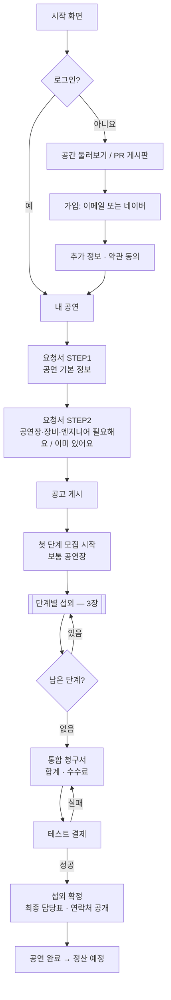
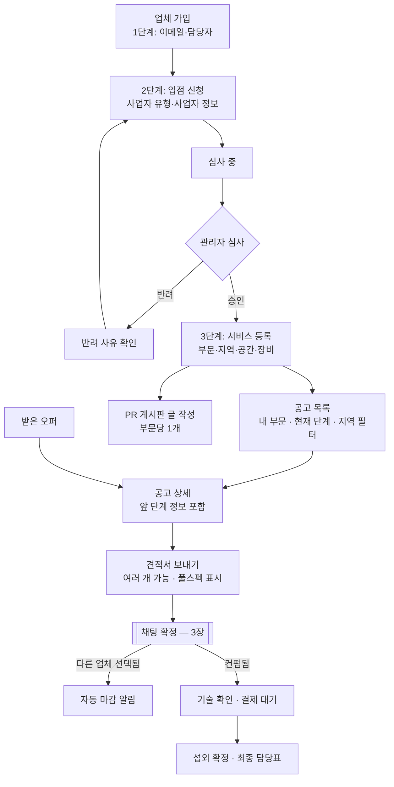
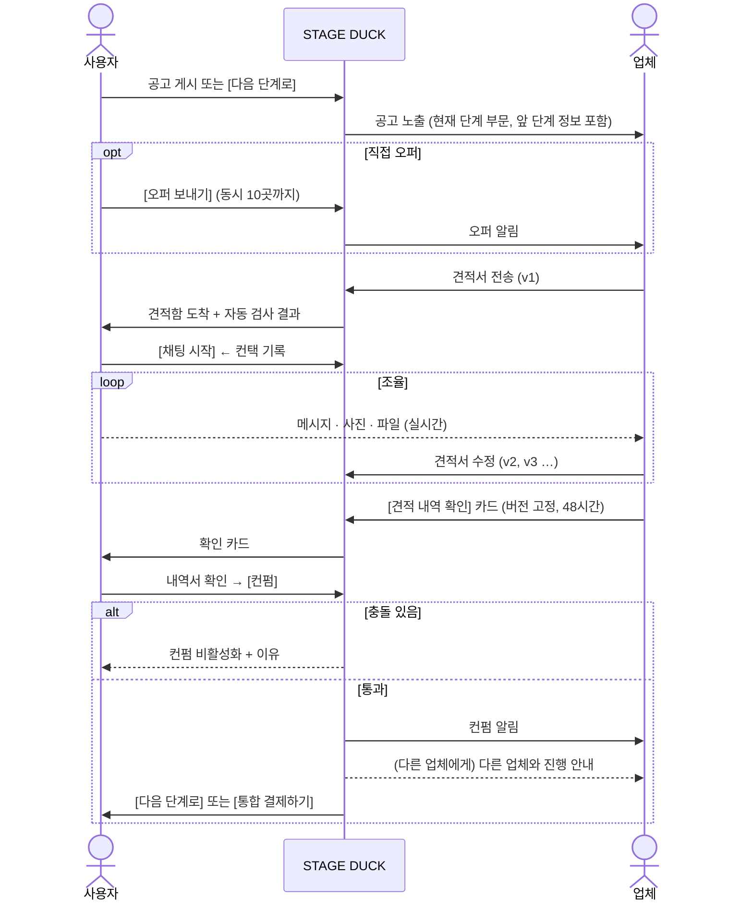
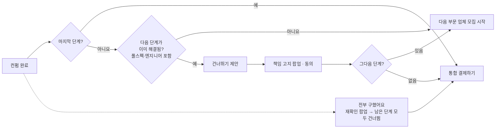
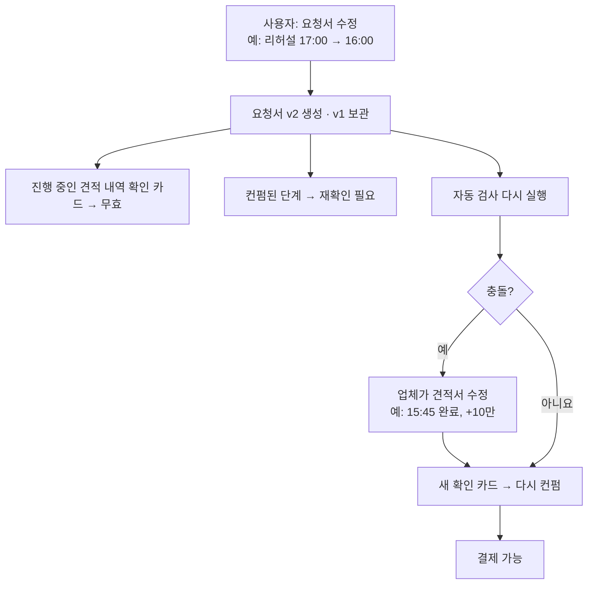
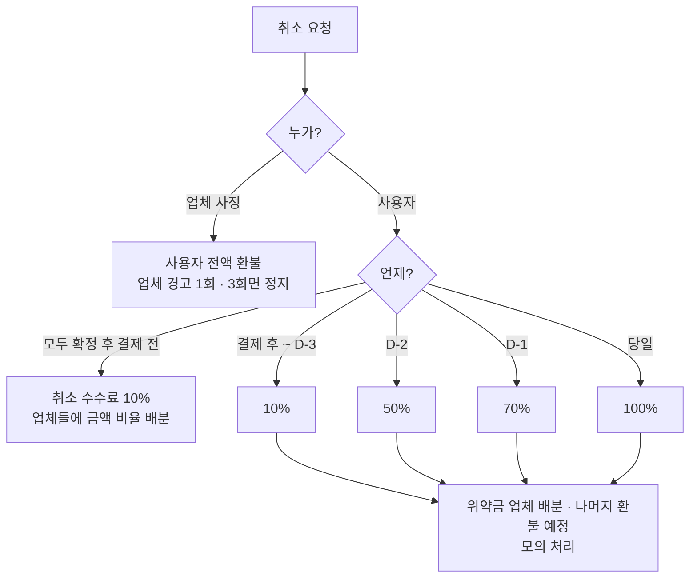
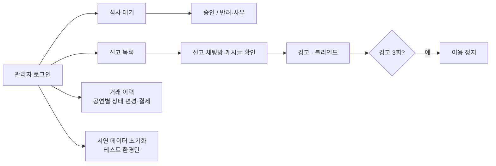

# STAGE DUCK 유저 플로우

| 항목 | 내용 |
|---|---|
| 버전 | 0.1 (초안) |
| 작성일 | 2026-11-12 |
| 기준 | [spec.md](spec.md) |
| 용도 | Figma 와이어프레임의 화면 순서와 분기 기준 |

> 다이어그램은 Mermaid로 썼다. GitHub에서 그림으로 보이고, Notion에서는 `/code` 블록 언어를 `Mermaid`로 바꾸면 보인다.

---

## 1. 사용자 — 가입부터 섭외 확정까지

## 2. 업체 — 입점부터 견적까지

## 3. 한 단계의 섭외 (공연장 / 장비 / 엔지니어 공통)

## 4. [다음 단계로] 화면의 분기

## 5. 요청서 수정이 진행 중 단계에 미치는 영향

## 6. 취소

## 7. 관리자

---

## 화면 목록 (와이어프레임 대상)

| 사용자 | 화면 | 플로우 |
|---|---|---|
| 공통 | 시작, 가입(사용자/업체 선택), 로그인, 소셜 추가 정보 | 1, 2 |
| 공통 | 공간 목록·상세, PR 게시판(말머리 목록)·게시글, 업체 프로필 | 1, 2 |
| 사용자 | 내 공연 (단계 현황) | 1 |
| 사용자 | 요청서 STEP1, STEP2 | 1 |
| 사용자 | 견적함, 단계별 견적 비교 (대표 화면) | 3 |
| 사용자 | 채팅 목록, 채팅방 (견적서·확인·컨펌 완료·안내 카드), 내역서 | 3 |
| 사용자 | [다음 단계로] / 건너뛰기 팝업 / 전부 구했어요 팝업 | 4 |
| 사용자 | 오퍼 보내기, 관심 업체, 마이페이지(내 프로필) | 3 |
| 사용자 | 통합 청구서, 테스트 결제, 취소 (예상 금액) | 1, 6 |
| 사용자·업체 | 최종 담당표 | 1, 2 |
| 업체 | 입점 1·2·3단계, 심사 상태 | 2 |
| 업체 | 공고 목록·상세, 받은 오퍼, 견적서 작성·수정 | 2, 3 |
| 업체 | 기술 확인 | 2 |
| 업체 | 내 PR 게시글 (작성·수정·삭제·끌어올리기), 사용자 프로필 보기 | 2 |
| 관리자 | 심사, 신고·제재, 거래 이력, 시연 데이터 초기화 — **SQLAdmin 자동 생성, 와이어프레임 제외** | 7 |
